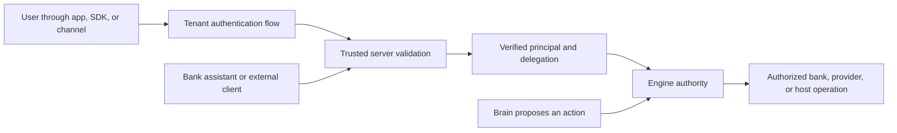

> **Imported context ? Ideeo-IA-general ? 644f0a1.** Product requirements and confirmed boundaries inform IdeeoOrchestrator. Implementation, test results, deployment instructions and scoped authorizations describe the source candidate unless explicitly adopted here. Proposed decisions remain proposed. See the [applicability and source guide](../README.md).

# ADR-001: Tenant-owned authentication and explicit delegation

| Field | Value |
| --- | --- |
| Status | Proposed |
| Date | 19 October 2026 |
| Requested by | Mateo |
| Acceptance | Full-record acceptance remains pending; scoped Sprint 1 implementation authorization is recorded below. |
| Scoped implementation authorization | The 19 October user request authorizes using these boundaries for the controlled Sprint 1 implementation; see [the implementation evidence](../reference/development/VERIFICATION.md). This does not accept every future profile or approve real bank access. |
| Related | [Project context](../product/PROJECT_CONTEXT.md), [integration evidence](../product/INTEGRATION_CONTEXT.md), [ADR-002](002-ai-provider-adapters-and-routing.md) |

## Context

On 21 October 2026 Mateo explicitly authorized implementing multi-tenant backend selection and the minimum engine-side banking contract. [The tenant contract](../contracts/TENANT_BACKENDS.md) and [delivery record](../reference/development/VERIFICATION.md) capture that scoped implementation. This does not accept every proposed identity/delegation profile or establish a particular bank's user/account/mandate mapping.

This repository builds the full shared engine, including its authority and agent-account capabilities. PayMe is a tenant; its assistant is one configured experience on the platform. The engine serves human users through apps/SDKs/WhatsApp, accepts delegated tasks from another bank's assistant, and exposes authority/banking capabilities to external agents. An external agent can use an agent account without invoking our reasoning engine.

Mateo confirmed that customer authentication and banking authorization belong to the tenant. Our engine routes authentication to the bank and consumes its verified result. He also accepted a common principal, separate client entry flows, and the initial direction of rechecking grants/status when durable work resumes. He confirmed consistent underlying account-creation information across channels. The detailed long-running credential lifecycle remains revisitable.

The inspected app/SDK code bootstraps a web session using an app key and a host-supplied field named `tokenSAML`. Its READMEs leave real token issuance/renewal unspecified. The legacy engine separately has a custom HMAC-signed HTTP account token and a shared HTTP/WhatsApp onboarding workflow. Neither observation establishes the new engine's trust contract. See the dated [source inspection](../product/INTEGRATION_CONTEXT.md).

We must distinguish channel recognition, bank-customer authentication, delegation to a client/agent account, and approval of a particular effect. A model's claim that the user approved something cannot establish any of these.

## Decision

The later [ADR-010](010-app-host-banking-and-model-context.md) clarifies interactive app/SDK banking: intent passes to the host, which owns banking screens, required authentication/approval and its core integration. Balance/history never return to chat/model context. This scopes the host route without changing this ADR's Proposed status, accepting an event wire format or removing authority/delegation and external-agent banking interfaces.

The 21 October docs-plus-runtime request additionally authorizes the development data controls in [ADR-005](005-data-ownership-and-lifecycle.md). They complement this trust contract: a data reference does not establish identity, a preference does not grant access, and successful authentication does not authorize retention or model disclosure of a complete customer profile. Tenant-owned protected data access is specified [separately](../contracts/TENANT_DATA_ACCESS.md), without creating another login system. KYC/PIN handling remains with the tenant; retain only purpose-bound references and justified authority evidence.

Adopt tenant-owned customer authentication behind a trusted server-side adapter, normalize its verified result into a common engine principal, and require the authority to authorize operations using current delegation and bank records. Keep bank credentials and authorization decisions outside the brain.

This ADR selects the trust and responsibility boundaries. It does not require every tenant to replace its login system, mandate a platform-owned customer identity provider, or freeze one public token encoding for all integrations.

### 1. Responsibilities and trust boundary

| Component | Responsibility |
| --- | --- |
| Tenant/bank | Customer identity, enrollment and credential verification, customer-to-bank membership, recovery/channel binding, and bank authorization/execution. |
| Trusted tenant-auth adapter at the authority boundary | Initiate the configured tenant flow; validate its result against explicitly configured trust; map verified identity/delegation facts into engine context. |
| Engine authority | Enforce platform restrictions and delegated access; validate actor/account/grant binding; consult current mandate, status, approvals, and bank state before applicable operations. |
| Brain and models | Interpret requests and propose typed actions. Receive no PINs, bank/session credentials, signing keys, or ability to mint their own principal. |
| Channel/app/SDK | Present the flow and transport input/events. App keys, client JSON, redirects, and local success callbacks do not independently establish bank identity. |

Tenant authentication is necessary but does not override platform restrictions or the particular grant. Effective access is constrained by the bank's authorization, platform rules, the caller's grant, and the current agent-account mandate. The bank core remains the authority for money and performs its own checks at execution.

The external-client path requires the corresponding registered-client and grant proof; it does not turn client identity alone into customer authority.

### 2. Canonical principal

Use one versioned internal identity contract after validation. The following are semantic requirements, not final claim names or a complete wire schema:

| Information | Meaning |
| --- | --- |
| Principal kind | Distinguish onboarding-only, authenticated customer/delegation, and service-only contexts. |
| Tenant | Derived from configured trust and validated claims, with an explicit consistency check. |
| Subject/membership | Stable bank customer/membership identifier, namespaced by tenant and issuer. A phone number is an associated channel attribute, not the permanent bank identity. |
| Current actor/client | The authenticated software/workload making the request, distinct from the owner it represents. |
| Active agent account | The authorized account used by the assistant/agent, verified against current ownership and client binding. Missing required context cannot be fabricated by the model. |
| Grant and permissions | A verifiable delegation/grant reference and the permitted resources/actions. Claims are bounded evidence, not a replacement for current policy checks. |
| Authentication evidence | Verified method/assurance, authentication time, audience, validity, and proof binding needed by the configured profile. |
| Correlation | Server-associated session/task/request references for audit and replay/idempotency controls; these references confer no permissions by themselves. |

Keep the internal principal outside model-authored input. Across service boundaries, carry it only through an authenticated, integrity-protected contract that verifies the calling service's delegation rights. A workload identity alone is not permission to name any customer. Never accept a serialized principal from arbitrary client JSON.

### 3. Tenant integration and credential profiles

Prefer standards-based tenant authentication/delegation where supported. OpenID Connect supplies an identity layer; OAuth protects delegated API access. OAuth authorization-code integrations use PKCE and the relevant current security controls. An ID token is not a general-purpose engine API access token. [OpenID Connect Core](https://openid.net/specs/openid-connect-core-1_0.html), [OAuth security BCP](https://www.rfc-editor.org/rfc/rfc9700.html)

A tenant with an existing session or assertion format can supply a documented adapter that verifies it server-side. The adapter either validates proof intended for the engine or exchanges the original proof through the tenant's supported service. The canonical result is the same regardless of transport. Do not forward an access token to an unintended downstream audience.

For each enabled profile, define and verify:

- Trusted issuers, endpoints, keys, accepted credential kinds, and tenant mapping; untrusted request/token fields cannot choose arbitrary verification endpoints or signing keys.
- Audience, allowed signature algorithms, validity/freshness, key rotation, and compromise/revocation behavior. JWT integrations follow [JWT best current practices](https://www.rfc-editor.org/rfc/rfc8725.html).
- Calling-client authentication and any sender binding, using DPoP or mutual TLS where the agreed profile requires them. Unsupported client features do not silently downgrade the profile. [DPoP](https://www.rfc-editor.org/rfc/rfc9449.html), [OAuth mutual TLS](https://www.rfc-editor.org/rfc/rfc8705.html)
- Secure callback correlation and replay handling, including one-time consumption where required by the flow. Ordinary session tokens need not be single-use; action approvals and effect idempotency have separate controls.
- Bounded validation/refresh calls and distinct authenticated, challenge-required, denied, and unavailable results. Failure to obtain required proof never becomes an authenticated result.

No profile means no authenticated banking access. The legacy HMAC token can inform compatibility work, but is not automatically an enabled profile or a template for sharing one signing secret across tenants.

### 4. Distinct entry flows

| Caller | Required relationship |
| --- | --- |
| Human through app/SDK/channel | A tenant-verified customer session or proof, bound to the membership and permitted assistant account. Public help and onboarding-only context remain distinguishable from authenticated banking access. |
| Bank's existing assistant delegating a task | Authenticated bank client plus verifiable user/task delegation. Record both owner and current actor; independently validate any claimed operation approval. |
| External agent using an agent account | Registered client plus a user-approved tenant grant bound to that client and account. Use the authority/banking path without requiring our brain. External agents receive mandate allowance, not the parent bank balance. |
| Internal worker/service | Authenticated workload plus authorized task/delegation context. A service-only credential grants only its service permissions, never arbitrary customer impersonation. |

Use standard delegation semantics where applicable; OAuth token exchange distinguishes subject and actor, while rich authorization requests can express structured grant details. Exact tenant profiles are specified separately. MCP/A2A transport or a model/provider name is not proof of authority. [Token exchange](https://www.rfc-editor.org/rfc/rfc8693.html), [Rich authorization requests](https://www.rfc-editor.org/rfc/rfc9396.html)

### 5. Onboarding, phone recognition, and PIN handling

**Later scoped supersession:** [ADR-011](011-tenant-api-and-channel-ownership.md) places enrollment forms, session exchange, PIN handling, account creation and WhatsApp webhook/Flow execution entirely in the tenant backend. The engine retains intent-only handoffs. The earlier setup-handler discussion below is proposal/history, not a current engine execution contract; this ADR remains Proposed.

Use a shared tenant-level account-creation contract across channels, with channel-specific rendering and applicable consent. The bank validates enrollment/KYC and creates the banking identity. PayMe-specific fields are not universal requirements for every tenant.

An entered phone number is an identifier; a verified WhatsApp sender establishes a channel identity. Neither automatically establishes a new bank-account binding, authenticated bank session, or approval of an effect. The platform does not select phone-only banking access as its universal policy. A tenant profile must document what assurance it accepts, which operations that assurance permits, and when a stronger challenge is required. No such profile is approved for PayMe by this ADR.

PIN enrollment and later PIN verification are different operations. Where the tenant uses a bank PIN, collect/verify it through an approved protected form or bank flow, outside the model and ordinary chat. The approved setup handler may forward a setup PIN to the bank, but must not put it in prompts, logs, traces, persisted workflow history, or API event payloads. Keep verification and credential storage with the tenant.

Account linking to a new channel/device, changing a number, and account recovery require the tenant's binding/recovery flow; matching a phone string is insufficient. A valid bank session may be reused within its approved limits, rather than challenging every message. Protected operations still require the appropriate fresh assurance or exact operation approval.

### 6. Authorization and durable work

Before applicable tool calls, the authority validates tenant/membership ownership, actor/grant/account binding, current account/grant status, and required policy/approval. Identity from text or tool arguments cannot redirect the call to another membership. Preferences select among authorized resources without enlarging access.

For protected effects, apply current limits/mandates and the bank's authorization route. Bind approvals to the exact authorized operation and enforce expiry and replay/idempotency rules. Recheck at the applicable execution boundary; preserve the bank's own final enforcement. If required authorization or current-state checks are unavailable, reject or defer the protected work without performing the effect.

For long-running work, the initial direction is to persist authorized task/grant references and obtain current authority on resumption, rather than treating an old user token as indefinite permission. Paused/revoked grants do not authorize resumed effects. Cancellation cannot undo an already accepted external operation; reconcile uncertain outcomes and report actual state instead of replaying blindly.

Token renewal, task-scoped credentials, authoritative status APIs, and revocation propagation mechanics remain to be designed with the durable loop. Changes may refine this mechanism while preserving the trust and authorization invariants. Material changes to the accepted decision require a superseding ADR under the methodology.

## Alternatives considered

| Alternative | Assessment |
| --- | --- |
| Build a separate platform customer login/password/PIN store | Duplicates bank identity and recovery; contradicts tenant-owned authentication. Not selected. |
| Trust a phone, app key, SDK metadata, or user/model-supplied identity | Confuses recognition or client bootstrap with bank authentication/delegation. Not selected. |
| Expose each tenant's raw identity contract throughout the engine | Makes the brain and tools depend on bank-specific session details and increases inconsistent checks. Use trusted boundary adapters and a common principal instead. |
| Require a central platform issuer and universal JWT format immediately | Could simplify internal credentials but imposes a broker and integration migration not justified yet. The boundary supports validated tenant proof or documented exchange; exact transport remains profile-specific. |
| Use one broad service credential or long-lived user token for all effects | Loses actor/grant restrictions and current pause/revocation checks. Not selected. |

## Consequences

Tenant login and recovery remain reusable, and bank-specific wire details stay outside the brain. The same authority protects the PayMe assistant, delegated bank tasks, and external-agent capabilities. Account creation can share validation/workflow behavior across channels.

Integration now requires a real trust/profile contract per tenant and client class. Bank auth/status outages can interrupt access or defer work. We must maintain key/profile configuration, protected challenge handling, delegation audit, and current-state checks. These costs are explicit tradeoffs of the proposed design.

## Required supporting contracts and open details

Before the affected real integration starts, specify:

1. PayMe's actual session/token validation or exchange service, trusted owner/issuer, and stable membership identifiers. Existing `tokenSAML` bootstrap documentation is insufficient.
2. Principal wire schemas, credential profiles, actor/account/grant binding, signing/sender-proof algorithms, key rotation, and security review.
3. Tenant assurance/action policy, callback/channel-binding/recovery flows, PIN handling, session freshness, and applicable abuse protections. No arbitrary numeric limits are chosen here.
4. Current grant/mandate/status sources and the atomic execution/revocation checks at the authority/core boundary.
5. Durable task renewal/resumption and failure behavior, with explicit expiry, propagation, and recovery semantics.

Supporting contracts can supply exact fields, endpoints, and configuration without changing these boundaries. Local test identities must use isolated trust configuration that cannot authenticate real bank users. Implementation setup was initially deferred; the subsequent scoped Sprint 1 implementation and executable profile are tracked in [the implementation evidence](../reference/development/VERIFICATION.md). Real tenant integration and its approval gates remain separate.

## Verification obligations for implementation

These are required scenarios to refine into the approved implementation/verification plan, not executed results:

| Scenario | Required observation |
| --- | --- |
| Valid customer proof through supported channels | Same authorized tenant/membership context; consistent onboarding requirements where applicable. |
| Forged, expired, wrong-audience, wrong-issuer, or wrong-kind credential | Access denied; no protected reads, downstream effects, or privilege-bearing principal. |
| Phone/app-key/metadata matches an account without bank proof | Does not acquire unsupported banking access or link a new channel. |
| Client names a different user/account/tenant | Ownership/delegation check rejects it, including list/read and background paths. |
| Valid client without customer grant, or grant bound to another client | Cannot act for the customer or account. |
| External agent requests parent balance or exceeds mandate | Disclosure/action denied; no prohibited effects. |
| Pause/revoke/expiry while a task sleeps or before an effect | Resumed work does not use obsolete authority; required unavailable checks defer/deny. |
| Replayed callback/approval or retried uncertain effect | No duplicate authorization consumption or repeated external effect; reconciliation records actual outcome. |
| PIN/credential supplied in setup or challenge | Absent from model inputs, ordinary chat, logs, traces, and persisted engine events. |
| Deliberately broken critical identity/permission check | Independent assertions detect the forbidden read/effect under the production-readiness policy. |

Required independent reviews, critical-control human review, current-revision evidence, and the parent/Verification ownership gates remain in the existing policies. Acceptance of this ADR is not a passing security test or production approval.
