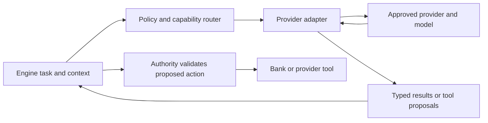

> **Imported context ? Ideeo-IA-general ? 644f0a1.** Product requirements and confirmed boundaries inform IdeeoOrchestrator. Implementation, test results, deployment instructions and scoped authorizations describe the source candidate unless explicitly adopted here. Proposed decisions remain proposed. See the [applicability and source guide](../README.md).

# ADR-002: AI provider adapters and capability-aware routing

| Field | Value |
| --- | --- |
| Status | Proposed |
| Date | 19 October 2026 |
| Requested by | Mateo |
| Acceptance | Full-record acceptance remains pending; scoped Sprint 1 implementation authorization is recorded below. |
| Scoped implementation authorization | The 19 October user request authorizes the Sprint 1 Gemini adapter and live synthetic-data checks; see [the implementation evidence](../reference/development/VERIFICATION.md). Mateo subsequently explicitly instructed implementation of the ADR adapters; [the verification index](../reference/development/VERIFICATION.md) records the Sprint 1 OpenRouter planner and bounded synthetic qualification. The 5 November request explicitly authorizes the native OpenAI structured-output adapter, per-purpose tenant model profiles and bounded real OpenAI checks on synthetic data; the same verification index records that implementation. Other routes/features still need their task-specific implementation and qualification. Full-record acceptance remains pending. |
| Related | [Project context](../product/PROJECT_CONTEXT.md), [ADR-001](001-tenant-authentication-and-delegation.md), [ADR-004](004-voice-channel-and-speech-providers.md) for speech modalities, architecture Rev4 sections 4.4, 4.12, 6, and 9 |

## Context

The shared engine must be flexible across inference providers such as OpenAI/GPT, Anthropic/Claude, Gemini, and suitable self-hosted models. Provider choice must not spread into bank logic or change the authority boundary. An inference provider used internally is distinct from an external agent client authorized to use an agent account.

Providers share concepts such as instructions, content, tools, and results, but their APIs, feature support, schema restrictions, streaming, and continuation state differ. OpenAI's function-calling flow has provider-specific output items; Claude uses tool-use/result blocks; Gemini APIs can require preserved thought signatures. These differences make a text-only response abstraction insufficient. [OpenAI function calling](https://developers.openai.com/api/docs/guides/function-calling), [Claude tool use](https://platform.claude.com/docs/en/agents-and-tools/tool-use/overview), [Gemini continuation state](https://ai.google.dev/gemini-api/docs/generate-content/thought-signatures)

The architecture already proposes a Python brain, LangGraph primitives, model routing, and evals. This record selects the provider boundary and routing semantics. It does not select a specific model/version, vendor contract, deployment topology, or integration library.

## Decision

[ADR-010](010-app-host-banking-and-model-context.md) later separates the customer's visible original messages from subsequent model input. Permitted initial interpretation does not authorize replay of sensitive captured fields through routers, planners, summaries, caches or continuations. App/SDK balance/history results stay in the host and are not inference input. Current account aliases/model-route gates do not yet implement complete pending-context sanitization; provider retention and real-data qualification remain separate.

The scoped 21 October data-boundary implementation follows [ADR-005](005-data-ownership-and-lifecycle.md) and the [model disclosure contract](../product/DATA_OWNERSHIP_AND_LIFECYCLE.md#model-disclosure). Router, planner, speech, embeddings, reviewers and fallbacks need the same tenant/provider/data-policy gate. The current runtime checks exact enabled model routes, projects account aliases and keeps raw native usage extensions in encrypted task state; ordinary inference evidence is runtime-validated. This does not qualify a processing region or vendor retention/training terms for customer data.

Use task-facing internal AI contracts with provider adapters and explicit model capability profiles. The engine owns task/conversation state, domain tools, behavioral rules, routing policy, and evaluation gates. Adapters translate the supported provider interaction without owning banking authorization or executing banking tools.

Provider independence means adding and qualifying integrations without changing domain logic. It does not promise identical behavior or automatic support for every provider/model/feature.

### 1. Separate contracts by purpose

| Contract | Intended result |
| --- | --- |
| Generation and tool use | Ordered typed content and proposed tool calls, or a validated structured answer with an explicit completion/failure outcome. |
| Classification | A result from an approved label set, with abstention/ambiguity handling. A classification implemented by an LLM can use a generation adapter internally. |
| Embeddings | Vectors with model/version, dimension, and index-compatibility metadata. Changing embedding spaces requires an explicit index/migration strategy. |
| Other modalities when introduced | Dedicated contracts for their observable behavior; audio/image services need not pretend to be chat completion calls. [ADR-004](004-voice-channel-and-speech-providers.md) proposes the voice-session, speech-to-text, and text-to-speech ports. |

A classifier does not grant permissions or choose an unauthorized account. Confidence scores from different models are not assumed comparable; any decision threshold requires calibration/eval evidence for its profile. Keep deterministic validators in code rather than invoking a model to replace known invariants.

### 2. Internal requests and results

The generation contract represents stable semantics rather than copying one vendor's SDK types. Its exact schema belongs in a separate versioned contract. Required concepts are:

- A task class, approved model/profile selection, request correlation, deadlines/cancellation, and approved resource limits.
- Ordered content with role, provenance, trust, and supported modality distinctions; trusted platform/tenant instructions remain distinguishable from user input and untrusted tool observations.
- Versioned tool definitions and optional structured-output requirements derived from the approved domain contracts/tenant tool manifest. Do not maintain competing bank schemas manually in each adapter.
- Typed output content, tool proposals with correlation IDs, validated structured data, completion status, usage, and provider/model provenance.
- Distinct refusal, truncation, cancellation, unsupported-feature, context-limit, invalid-output, transport, rate-limit, and provider-failure outcomes where applicable. They are not successful answers.
- Adapter-owned opaque continuation artifacts when the provider requires them.

Provider-native details stay inside an adapter/profile extension when they cannot be represented faithfully in the common contract. Unsupported requirements fail explicitly; adapters must not silently drop constraints or flatten tool content into trusted instructions.

Normalize usage for reporting while retaining provider-specific units/fields. Missing usage is unknown, not zero cost. Credential resolution occurs behind the approved secret boundary; model inputs never include provider API keys, bank tokens, PINs, or the full privileged authentication context.

### 3. Capability profiles and routing

A versioned profile identifies provider/API, model/version or resolvable revision, adapter revision, prompt/schema revisions, capabilities, policy restrictions, and applicable eval qualification. A model name or provider brand alone is not a capability profile.

Profiles and provider endpoints are controlled server configuration. User messages, model outputs, and tool arguments cannot register a new endpoint, acquire provider credentials, or relax routing/data policy.

| Capability/policy | Routing requirement |
| --- | --- |
| Tool calling and schema constraints | Satisfy the task's allowed tool/argument requirements without weakening them. |
| Structured output | Support the required schema features or an explicitly evaluated alternative; always validate local values and domain rules. |
| Modalities and context capacity | Accept the actual permitted input and preserve required facts; no silent loss of critical context. |
| Streaming/continuation | Preserve event ordering and native continuation requirements for the chosen interaction. |
| Tenant/provider data policy | Use only approved providers, regions, retention modes, and data classes. Capability/cost cannot override this policy. |
| Quality and resource constraints | Qualify for the task's eval gates and approved latency/cost/budget constraints. Values are defined separately, not invented by the adapter. |

First filter by required capabilities, tenant/data policy, and eval qualification; then choose among eligible profiles using the approved quality/cost/latency policy. If none qualify, return a clear unsupported/unavailable outcome. An optional capability can be omitted only when the task contract permits it and the omission is observable.

For example, a balance-query task may need an evaluated Spanish tool-selection profile and a typed balance lookup. The selected model can propose a tool call, but the trusted account context and balance source remain with the authority and bank adapter.

Structured-output providers support different schema subsets, and valid JSON can still contain incorrect values. This design therefore keeps schema translation and domain validation separate. [Gemini structured-output documentation](https://ai.google.dev/gemini-api/docs/structured-output)

### 4. Shared intent and provider-specific prompting

Maintain versioned shared behavioral rules, tenant policies, task instructions, and tool descriptions. A renderer maps that intent into the provider's supported instruction/message structure, with profile-specific tuning where useful. Record both the shared prompt revision and renderer/profile revision in evals and permitted observability.

Do not require byte-identical prompts across providers or allow tuning to weaken product invariants. Content from pages, files, tools, and other agents retains its untrusted provenance; it cannot become a platform instruction during serialization or context compaction.

Tool schemas use a portable supported subset where practical. Provider-specific compilation must preserve required validation semantics, or reject the profile for that task. Typed/strict output is a parsing aid, not authorization or proof that an action happened.

### 5. Canonical records and native continuation state

The engine retains its own canonical record of user requests, authorized tool proposals, executed effects, tool results/evidence, and task state. Provider-hosted sessions or native response IDs cannot be the sole task record.

Preserve native artifacts that an API requires to continue its interaction, including opaque signatures or reasoning/continuation items, without reinterpreting them as portable domain data. Use the provider's supported continuation method; do not fabricate or edit native signatures. Store only required artifacts encrypted under the approved retention/access controls and bind them to tenant, owner, task/session, and profile. Keep them out of ordinary user output and broad telemetry. Provider sessions or personalized cached results must never be reused across those identity boundaries; reusable prompt-prefix caching requires its own approved data policy.

Pin an in-flight native interaction to its qualified provider/model profile unless a defined handoff is supported. Switching providers reconstructs permitted context from canonical domain records at a checkpoint where effect state is known. Do not send one provider's opaque continuation state to another or assume compatibility across model/API versions. Untrusted content remains untrusted after reconstruction.

### 6. Tool execution remains with the authority

Adapters return proposals; they do not call bank APIs, debit accounts, issue cards, approve requests, or select identity from model arguments. Every proposed domain action uses the [ADR-001](001-tenant-authentication-and-delegation.md) identity/authority boundary and the same policy checks regardless of provider.

Any framework's automatic tool loop must preserve this boundary. Disabling a tool or rejecting an action in one provider must not make it available through another adapter. Provider-hosted tools that bypass our dispatch are separate capabilities requiring an explicitly approved egress/execution profile; they cannot be used as an alternate banking execution path.

Accumulate a complete tool proposal before validating and dispatching it; partial streaming argument fragments cannot trigger execution. Preserve multiple proposals as distinct correlated calls. The harness/authority decides permitted ordering and concurrency; an adapter cannot merge calls, reorder dependent effects, or execute a batch without per-action authorization.

Responses claiming a current balance or completed effect require the approved bank/domain evidence. Parsing a model's structured assertion is not that evidence.

### 7. Failures, retries, and fallback

The 5 November follow-up requests automatic recovery from provider failures for
customer UX. Scoped development implementation of stateless tenant-profile
failover follows the [provider contract](../contracts/PROVIDER_PROFILE.md#automatic-failover-for-stateless-tenant-profiles):
ordered qualified alternatives, transient errors only, bounded attempts/deadline,
fresh authority/data checks and accounting for each call. This supersedes the
single-attempt rule for those registered-profile paths only; it does not accept
the full ADR or authorize new providers, real-data processing or effect retries.

Retries are bounded by the task's approved budgets/deadline and retain logical request/effect correlation. Provider errors do not trigger unlimited work or silently reset spend accounting.

Fallback is allowed only to another profile qualified for the same task, data policy, and required capabilities, at an approved handoff boundary. It may change cost/latency/behavior, so record the actual route and reason. A safety refusal, invalid schema, or missing capability is not permission to keep trying providers until one bypasses the intended rule.

If a model/API fails after a tool has executed, continue from the recorded result rather than repeating the effect. If external execution is uncertain, reconcile that effect before resuming. Preserve the logical idempotency key across inference retries/provider changes; never infer from an inference timeout that a bank/provider operation did not occur.

Cancellation stops further inference/tool dispatch where possible. It does not erase a completed effect or establish that a submitted external action was canceled.

### 8. Reuse integrations without outsourcing the contract

Use existing provider SDKs/integrations behind the internal contracts when they preserve the required semantics. LangChain exposes shared model interfaces; LiteLLM supplies provider integrations/routing facilities. These are candidate mechanisms consistent with the architecture, not accepted selections or substitutes for our authority/data/eval policy. [LangChain model documentation](https://docs.langchain.com/oss/python/langchain/models), [LiteLLM documentation](https://docs.litellm.ai/docs/)

An implementation plan should choose one primary integration path for each qualified profile and verify it preserves native state, output validation, streaming, and metrics. Avoid stacking multiple translators without an identified need and conformance evidence. Keep the domain-facing contract owned by this engine so the library/provider can change independently.

## Alternatives considered

| Alternative | Assessment |
| --- | --- |
| Direct native SDK calls throughout domain code | Maximum immediate API access, but spreads provider schemas and behavior across the engine. Not selected. |
| Reduce everything to one text-in/text-out or generic chat API | Simple initially, but loses tool semantics, provenance, strict outputs, and continuation state. Not selected. |
| Restrict permanently to one provider | Less initial integration work, but conflicts with the requested flexibility and independent-model review strategy. Not selected. |
| Treat a proxy/unified SDK as complete portability | Useful mechanics, but cannot establish domain permissions, equivalent quality, data eligibility, or effect safety. Use behind our contract instead. |
| Force classifiers, embeddings, and every modality into a chat interface | Misrepresents output semantics and compatibility requirements. Use purpose-specific contracts. |

## Consequences

Banking logic, authority checks, task records, and tool contracts remain stable when an inference provider changes. Specialized models can be selected by task, and provider features can evolve through explicit profiles instead of leaking into every domain module.

We take on adapter/profile maintenance, schema compatibility checks, state-handling complexity, and eval qualification for each supported route. Provider switching may require a checkpoint and context rebuild; it is not a universal mid-call failover. New models are supported only after capability and behavior evidence, rather than by changing a model-name string.

## Required supporting contracts and open details

Before the affected implementation, define:

1. Versioned request/result/content/tool/error/stream schemas and profile extensions for the first task classes.
2. Initial adapter/integration libraries, provider/model profiles, and handling of native continuation artifacts and retention.
3. Tenant/provider data policies, permitted routing/fallback combinations, operational budgets, and outage/cancellation behavior.
4. Domain/tool-manifest/schema revision ownership and contract-compatibility checks.
5. Model/prompt/tool eval datasets, scenario-level thresholds, grader independence, and evidence required to qualify each route. No numeric target is selected in this ADR.
6. Any embedding-space migration or new-modality contract when that capability is introduced.

Implementation setup was initially deferred; the subsequent scoped Sprint 1 profile is tracked in [the implementation evidence](../reference/development/VERIFICATION.md). Deployment remains a separate controlled operation. This ADR does not require implementing all providers at once; the first qualified integration must respect the contract and leave the other integrations as explicit unimplemented capabilities.

## Verification obligations for implementation

These obligations describe expected evidence, not tests or evals already run:

| Scenario | Required observation |
| --- | --- |
| Same approved task through each supported profile | Correct domain behavior and required invariants; natural-language wording need not match. |
| Required capability or tenant/data permission absent | Route rejected before disallowed provider submission or tool execution. |
| Tool calls, results, streaming, and continuation artifacts | Correlation/order preserved and valid follow-up interactions; no stripped native state. |
| Invalid/truncated/refused/schema-valid-but-wrong output | Distinct outcome; no unauthorized domain action or invented bank result. |
| Provider-specific prompts and untrusted tool content | Shared rules retained; external content cannot become privileged instructions. |
| Retry/fallback after completed or uncertain effect | No repeated effect; known result reused or uncertainty reconciled. |
| Timeout, 429/5xx, cancellation, exhausted budget | Bounded calls, recorded route/usage, defined failure; no hidden downgrade or continued effects. |
| Classifier/embedding profile changes | Label/threshold evidence or index compatibility/migration established; no assumed interchangeability. |
| Secret and tenant-boundary probes | No credentials in model input/telemetry; no cross-tenant context or provider-state reuse. |

Use deterministic adapter/contract checks plus actual provider integration evidence and behavioral evals for each approved task/profile. Mocks establish controlled behavior, not real API compatibility. Record model/provider/adapter/prompt/schema/dataset/grader revisions and case-level outcomes under [AI_DEVELOPMENT.md](../policies/AI_DEVELOPMENT.md) and [PRODUCTION_READINESS.md](../policies/PRODUCTION_READINESS.md). Model agreement cannot waive permission, tenant, or payment invariants.
