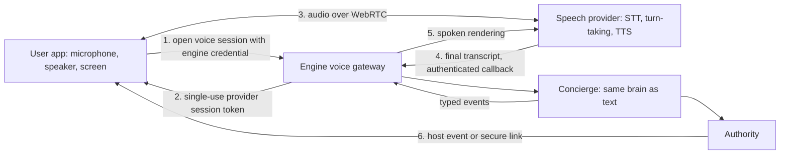

> **Imported context ? Ideeo-IA-general ? 644f0a1.** Product requirements and confirmed boundaries inform IdeeoOrchestrator. Implementation, test results, deployment instructions and scoped authorizations describe the source candidate unless explicitly adopted here. Proposed decisions remain proposed. See the [applicability and source guide](../README.md).

# ADR-004: Voice conversation channel and speech providers

| Field | Value |
| --- | --- |
| Status | Streaming speech direction accepted; remaining design details proposed |
| Date | 20 October 2026 |
| Requested by | Mateo |
| Acceptance | On 15 November 2026 Mateo confirmed keeping streaming speech recognition → existing concierge → streaming speech synthesis for now, despite latency concerns, and authorized documentation updates. This accepts that architectural direction only; runtime/provider selection, implementation, vendor contracts and customer-audio processing remain pending. |
| Related | [Project context](../product/PROJECT_CONTEXT.md), [integration context](../product/INTEGRATION_CONTEXT.md), [ADR-001](001-tenant-authentication-and-delegation.md), [ADR-002](002-ai-provider-adapters-and-routing.md), [ADR-003](003-engine-implementation-stack.md), architecture Rev4 sections 2.3, 2.6, 4.2, 4.4, 4.6, 4.15, 6, 8, 9, 10 and 13 |

## Context

The later [ADR-010](010-app-host-banking-and-model-context.md) applies to banking intents raised through the app assistant, including voice: open the host's protected screen rather than narrating balance/history through the assistant or sending those values to a speech/model provider. The host's own accessibility presentation is a tenant responsibility. Original visible input and sanitized subsequent model context remain separate; this clarification does not approve speech processing or native adoption.

On 20 October 2026 Mateo asked what happens when a user wants to speak to the assistant instead of typing, whether ElevenLabs should provide the voice, and whether it should apply only to the agent that replies to the user. Mateo then asked for the design and architecture to include it.

The architecture already covers some voice:

- **Voice notes (month 1, US-003).** Spanish speech-to-text on our GPUs. The transcript is shown before any money action (B-11). The audio is deleted after extraction.
- **Spoken replies.** Listed in the Rev4 section 6.1 routing table with self-hosted TTS candidates. No story covers them.
- **The phone agent (month 2, US-038).** A hand that calls providers for the user, in four gated steps.
- **The voice stack.** "Pipecat or LiveKit Agents; STT and TTS in Spanish on our GPUs; SIP telephony", decided after a week of Spanish test calls. Rev4 section 13 records voice as open until month 2.
- **Deployment.** Voice runs as a separate deployment with admission control (Rev4 section 10).

What is missing is a **live spoken conversation between the user and the assistant**. The design must keep its existing invariants:

- Only the concierge speaks with the user (B-22, Rev4 section 4.4).
- The brain proposes and the authority authorizes.
- Approvals go through the signed host event with Face ID or PIN, a secure link, or a signed mandate. A PIN never passes through the model or a chat channel.
- External content is data, not instructions (B-14).
- Answers use Mexican Spanish with exact amounts taken from records (B-19).
- Identity comes from verified credentials (ADR-001).
- Provider-specific tools are not a banking execution path (ADR-002 section 6).
- Other modalities get dedicated contracts instead of pretending to be chat completions (ADR-002 section 1).
- Personal data in routine steps stays inside the bank's VPC (Rev4 section 6).
- Processing outside Mexico needs the CNBV procedure the architecture already identifies, pending legal confirmation (Rev4 section 7.5).

Speech adds problems that text does not have:

- A latency budget from the end of the user's speech to the first audio.
- Turn detection and interruptions (barge-in).
- Channels without a screen.
- Numbers and account references read aloud.
- Eavesdropping on spoken values.
- Audio as personal data.
- Cloned voices that defeat speaker verification.

### What ElevenLabs offers

The table is an inventory from vendor documentation read on 20 October 2026, with the integration-mode corrections below checked on 15 November. Prices, models, terms and regional availability are dated inputs to qualification, not current guarantees or accepted selections. Most pages carry no date. They describe vendor interfaces, not our qualification results.

| Fact | Consequence for this design |
| --- | --- |
| **Speech Engine** (launched 25 May 2026) runs ElevenLabs speech-to-text, turn-taking, interruption handling and text-to-speech. It connects over WebSocket to a developer-hosted "brain" that receives each turn's transcript. Brain connections carry an ElevenLabs JWT header and can carry a custom secret header. The published price is 0.08 USD per minute, with LLM cost paid separately. Pipecat and LiveKit integration guides exist. | Matches "ElevenLabs for the voice only". The reasoning, tools and records stay with the engine. |
| **ElevenAgents with a custom LLM** supports Chat Completions or Responses SSE endpoints. Configured system tools can be included alongside the platform's channels, knowledge base, workflows and analysis. | Requires explicit tool/configuration and data-boundary qualification; it is not selected as our agent platform. |
| **ElevenLabs Realtime models** do not support a custom LLM in Realtime mode and include managed reasoning. | Not a speech-only adapter for the existing concierge. |
| **Models:** Scribe v2 Realtime STT (about 150 ms, 90+ languages, keyterm prompting); Flash v2.5 TTS (about 75 ms); v4 Turbo TTS (about 100 ms). Latencies are inference only. Mexican accents appear in marketing material, but no es-MX error rate is published. | Mexican Spanish quality and end-to-end latency must be measured on our own audio. |
| The vendor's best-practice page warns that Flash v2.5 normalises numbers worse than Multilingual v2. | Spoken amounts must not depend on TTS normalisation. |
| **Client auth:** the backend creates a signed URL (valid 15 minutes to start a session) or a WebRTC conversation token. The vendor says never to ship the API key in a mobile app, and signed URLs do not identify users. | The engine mints session tokens and binds the session to the verified principal on the server. |
| **Data residency:** the US is the default. Isolated EU, India and Singapore environments exist on Enterprise. There is no Latin American region, and the page warns that processing may still occur outside the selected location. | Audio leaves the bank's AWS and Mexico, which triggers the same compliance treatment as frontier model APIs. |
| **Retention:** transcripts and audio are kept 2 years by default. Retention is configurable, and a Zero Retention Mode (ZRM) exists that limits analysis, MCP and WhatsApp. Enterprise data is not used for training by default; other plans have an opt-out. | Retention 0 or ZRM, no training, and a data processing agreement are preconditions for real users. |
| **Private deployment** in customer AWS or GCP (Enterprise, under NDA): the agents runtime, older-generation TTS (v2 and v2.5) and Scribe v2 can run inside the customer environment. | A path if compliance requires audio to stay in the VPC. Whether it runs in mx-central-1 is unconfirmed. |
| **Certifications** renewed 16 October 2026: SOC 2 Type II, ISO 27001, 27701, 42001, 27017 and 27018, PCI DSS Level 1 Service Provider. | Supports vendor due diligence. It does not approve processing. |
| **WhatsApp channel:** the number cannot already be registered with another provider, and inbound WhatsApp messages are ignored under ZRM. | Keep our existing WhatsApp adapter. |
| **No speaker-verification product.** The audio detector only recognises ElevenLabs-generated audio. Published research reports cloned voices bypassing commercial speaker verification. | Voice is never an identity or approval factor. |
| **Capacity:** the Business plan publishes 40 concurrent calls. Burst capacity goes up to 3x at double price with lower priority. The status history shows incidents of about 45 minutes to 2.4 hours between July and September 2026. | Admission control, Enterprise sizing and a fallback to text are required. |

## Decision

Keep **streaming speech-to-text → the existing concierge → streaming text-to-speech** as the current voice architecture. Only the concierge speaks with the user. The engine retains canonical conversation state, reasoning, tools, durable tasks and authority; its voice gateway invokes speech providers through dedicated ports. A voice-native conversational model or hybrid frontend is deferred for now.

ElevenLabs remains the first candidate speech provider, not the agent platform. **Speech Engine is a conditional integration candidate, not a required first step.** Compare it with an engine-operated runtime (Pipecat or LiveKit Agents) using interchangeable speech APIs, including self-hosted candidates. The streaming direction is accepted; the concrete runtime, transport, models and voice still require qualification. The diagram illustrates the managed speech-transport candidate, not a selected physical transport for every runtime.

### 1. Who speaks

| Speaker | Scope under this ADR |
| --- | --- |
| Concierge to the user | In scope. The only agent that speaks with the user. Task agents never speak. The concierge narrates their typed events at turn boundaries, and items that need the user also reach the screen or push. |
| Phone agent to a third party (US-038) | Out of scope for the provider selection. It may reuse the voice runtime and speech ports later under its own qualification, with AI disclosure (B-18), recording consent and notice, and the other party's speech treated as untrusted (B-14). Its telephony provider is decided separately. |
| Voice notes (US-003) | Remain asynchronous input on the existing WhatsApp and app adapters. Their transcription uses the same speech-to-text port and data policy. This ADR does not move them to ElevenLabs. |

### 2. Components and ownership

| Component | Owner | Responsibility |
| --- | --- | --- |
| App or tenant SDK client | App and SDK repositories | Microphone and speaker, echo cancellation, connecting to the provider with a short-lived token, showing transcripts, cards and host events |
| Speech provider | Vendor (ElevenLabs first) | Speech-to-text, end-of-turn detection, interruption detection, text-to-speech, audio transport |
| Voice gateway | Engine | Session creation and limits, binding to the verified principal, minting provider tokens, authenticating provider callbacks, admission control, metrics, fallback to text |
| Voice turn adapter | Engine | Turning final transcripts into concierge turns, streaming concierge output to text-to-speech, cancelling in-flight generation on interruption |
| Spoken renderer | Engine | Deterministic es-MX spoken text for domain results |
| Concierge, tasks and authority | Engine | Unchanged. The same contracts as text. |

Domain code never sees provider SDK types. Define `VoiceSession`, `SpeechToText` and `TextToSpeech` ports as dedicated modality contracts under ADR-002 section 1. A Speech Engine adapter would implement a combined turn-taking speech transport behind those ports. An engine-operated runtime would implement the separate ports with ElevenLabs raw APIs or self-hosted models; turn detection and audio transport then belong to that runtime.

### 3. Integration mode

**Candidate: Speech Engine behind the engine contract.** It keeps reasoning, tool proposals, authority and records with the engine and reduces speech integration work. Speech Engine sends the full conversation history each turn. The engine ignores that copy and uses its own conversation log as the canonical record (ADR-002 section 5).

The documented Python/JavaScript SDK response methods operate inside the transcript handler; out-of-turn responses are dropped, and a new transcript cancels the previous handler. Before selecting this transport, demonstrate delivery of a durable task's late result while the user is silent, safe scheduling around new speech, and survival of durable work across handler cancellation/disconnect. A LiveKit audio bridge alone does not establish these semantics. If the required delivery cannot be supported, use an engine-operated runtime from the start.

**Alternative starting point and long-term target: an engine-operated runtime.** Pipecat or LiveKit Agents in our deployment, calling interchangeable speech providers: ElevenLabs STT and TTS APIs, or qualified self-hosted models. Select it when lifecycle/late-result requirements above require it, or when any of these hold:

- Compliance requires processing inside the VPC.
- The phone agent needs SIP.
- Volume makes raw speech pricing (estimated at roughly 0.02–0.03 USD per minute, an inference from published rates) materially cheaper.
- A qualified secondary provider is needed for availability.

**Not selected: ElevenAgents as the platform.** Its hosted orchestration overlaps engine responsibilities. A custom-LLM integration could preserve engine reasoning, but configured system tools, state and data handling would need their own qualification. It is not needed for the current speech-only direction; keep the tenant's existing WhatsApp adapter.

**Deferred: voice-native or hybrid conversation.** Native audio models can serve as a conversational frontend while delegating work to this engine; they do not inherently require replacing its authority or durable tasks. They would, however, change who interprets and phrases the conversation and require explicit context, output-fidelity and interruption contracts. The current choice keeps the existing concierge and does not add another model to rewrite its approved replies. Reconsider only through a separate qualified model/channel design under ADR-002 and the canonical [UX rules](../product/UX.md).

### 4. Identity and session binding

1. The app opens a voice session with its engine access credential (ADR-001).
2. The gateway stores, on the server, the session bound to tenant, membership, caller, active agent account and conversation, with an expiry and limits.
3. The engine mints the provider session token server-side. The token is single-use and short-lived. The provider API key never reaches a device.
4. Provider callbacks to the engine are authenticated: the provider-signed token or shared secret, plus an egress-IP allowlist where the vendor offers one.
5. The engine resolves the principal from its own session record. Client-supplied provider metadata (`user_id`, dynamic variables, extra request body) never confers identity.
6. Current grant and session validity are checked when a turn is processed. Voice sessions have bounded duration.
7. Voice is never an authentication factor or approval. The engine uses no speaker verification or voice biometrics.

### 5. Turns, interruptions and progress

- **Final transcripts** become user turns with `voice_transcript` provenance in the conversation log. **Partial transcripts** are not turns.
- **Input streams while the user speaks.** Turn completion still waits for endpoint detection and transcript finalization. Partial transcripts do not trigger tool execution, approvals or durable tasks.
- **Output streams in speakable chunks.** Send only user-facing concierge text allowed by the UX/data policy, with deterministic domain rendering where needed. Do not expose raw tool events, private model content or unchecked partial results. Existing task-event streaming does not establish incremental speech-safe text support; qualify that path explicitly.
- **An interruption** stops speech playback and cancels the in-flight concierge generation for that turn. It does not cancel tasks, approvals or commitments. "Cancela" is an intent that goes through the authority like any other cancellation (Rev4 section 4.3).
- **Background task events** are narrated at turn boundaries without talking over the user. Items that need the user are also delivered on screen or by push.
- **While a step is slow**, the assistant may use fixed filler and progress templates. They never state a result that has no record.
- **Idle sessions** close gracefully, and the conversation continues in text.
- **Playback state** distinguishes generated text from what was actually played when interrupted. A vendor's replayed history cannot establish that the user heard a result.

Streaming overlaps transcription with the user's speech and synthesis with response generation; it does not eliminate turn-finalization, reasoning, network or playback delay. Measure end of user speech to first **useful audible response**, p50/p95, with stage timings. Report acknowledgments separately from useful answers and completed task results. TTS request-to-first-byte timing alone is not conversation latency. No end-to-end voice qualification or numeric acceptance threshold is established by this design decision.

### 6. Speaking domain data

- **Spoken form.** Results already carry structured data next to display text. Add a deterministic spoken rendering per locale (es-MX first):
  - Amounts in words with currency and centavos.
  - Exact dates and times.
  - Masked account and card references.
  - RFC, CURP and full CLABE are not read aloud by default.

  Do not rely on the model or TTS normalisation for money values or references (B-19).
- **Model prose.** It may surround the rendered values. Amounts, account references, order numbers and statuses come from records.
- **What is said aloud** follows channel, tenant and compliance policy. Under ADR-010, app/SDK balance and history results stay in the protected host screen, never in assistant speech or model/speech-provider context, even on explicit request. Host accessibility remains tenant-owned. The rendering rules above apply only to data otherwise permitted in conversation; they do not authorize bank-data disclosure. Telephone banking disclosure remains unapproved.

### 7. Approvals and protected operations

- A spoken "sí" never approves a commitment. Approval remains one of:
  - The signed host event with Face ID or PIN.
  - The secure link with PIN.
  - The bank backend.
  - A signed mandate (Rev4 sections 2.2 and 4.5).
- Before money moves, the interpreted recipient, amount and other critical details appear on screen for correction (B-11). A channel without a screen uses push or a secure link.
- Never request or accept a PIN, one-time code, full card number or full account number by voice or DTMF tones.
- The voice gateway and turn adapter have no commit tools. Every proposal goes from the concierge to the authority. Background speech, a television or replayed audio can produce at most a proposal that the user confirms on screen (B-14).

### 8. Data protection and residency

Applicable obligations remain [legal-register](../compliance/LEGAL_REGISTER.md) entries LR-01, LR-02, LR-03, LR-04 and LR-16; legal interpretations and vendor clearance remain pending. Relevant target controls are ISO/IEC 27001:2022 5.19 (suppliers), 5.34 (PII), and ISO/IEC 42001:2023 A.6.2.2–A.6.2.4 (requirements, design documentation and verification). Confirming the streaming direction does not satisfy these controls or authorize real-tenant processing.

- **Treatment.** Processing of customer audio and transcripts by an external speech provider gets the same treatment as frontier model APIs:
  - Inclusion in the CNBV filing for processing outside Mexico (Rev4 section 7.5; pending legal confirmation).
  - An Enterprise contract with a data processing agreement and no training.
  - Retention 0 or ZRM where compatible.
- **Until that approval**, use only synthetic data and internal test users.
- **What the engine stores.** The engine keeps the canonical transcript text under tenant and owner isolation with the approved retention. Raw audio is not stored by default. Any recording needs consent, notice and an approved retention policy.
- **Telemetry** carries no raw audio. Transcripts are redacted before export (Rev4 section 9).
- **Tenant data policy** (ADR-002 section 3) decides whether voice is enabled and which providers, regions and retention modes are allowed. A fallback cannot widen that boundary.
- **If audio must stay in the VPC**, use ElevenLabs private deployment in the bank's AWS account or self-hosted models in the engine-operated runtime.

### 9. Provider profiles, capacity and fallback

- **Profiles.** Speech profiles record provider, API, model identifiers, voice, language, region, retention mode, adapter revision and qualification evidence, like the inference profiles in ADR-002.
- **Capacity.** Admission control and per-tenant concurrency limits apply to the voice deployment (Rev4 section 10).
- **Availability.** Provider outage, rejected admission or exhausted capacity ends voice explicitly and continues in text. Switching to a secondary speech provider requires that provider's qualification and data-policy approval.
- **Cost.** Voice minutes and cost per session and tenant are measured and budgeted.

### 10. Channels

| Channel | Treatment |
| --- | --- |
| PayMe app and tenant SDK | First target. The current SDK opens an embedded web experience. Whether voice runs through the JavaScript client inside that web view or through a native client must be verified with the app and SDK repositories (see the [integration context](../product/INTEGRATION_CONTEXT.md#voice-channel-integration-questions)). |
| WhatsApp | Keep the existing adapter and voice notes. Do not use ElevenLabs' WhatsApp channel. WhatsApp calling (Meta Calling API) needs its own bridge to the engine voice runtime and a later decision. |
| Telephony | Later, through the engine-operated runtime over SIP. The provider of Mexican numbers is not selected here. |

### 11. Voice identity

Use a designed or licensed voice with contractual rights. Each tenant may configure its own. Do not clone a real person's voice without a contract and consent. Tell the user they are speaking with an AI assistant when a session starts.

## Alternatives considered

| Alternative | Assessment |
| --- | --- |
| ElevenAgents as the complete agent platform (hosted LLM, tools, knowledge base, workflows) | Duplicates the brain and puts tools outside the authority boundary. Not selected. |
| ElevenAgents with our custom LLM endpoint | More built-in channels and analysis, with additional platform state and configured tools to qualify. Not selected. Any later adoption must preserve ADR-002 section 6. |
| Voice-native or hybrid conversational frontend | Potentially richer audio understanding and natural timing, but changes the conversational model and output contract. Can delegate to this engine. Deferred while the streaming pipeline is qualified. |
| Engine-operated runtime with raw speech APIs from the start | More control over interruptions and late task speech, with more audio integration work. Valid initial candidate if Speech Engine cannot satisfy the engine's lifecycle requirements; concrete runtime not selected. |
| Fully self-hosted speech from the start (Rev4 baseline) | Best data control. Mexican Spanish quality of the candidates is unproven: Parakeet's training data is European, Kokoro's card warns about non-English pronunciation, Chatterbox has an es-MX fine-tune but no published latency. Retained as the residency path. |
| Other speech vendors (Deepgram, Cartesia, Azure Speech) | Credible candidates to compare during qualification. No selection here. |
| Voice notes only | Does not meet the requested experience. |

## Consequences

The concierge gains a spoken channel without changing the brain, authority, tasks or approval paths. Provider-specific behaviour stays in the voice gateway and adapters. ElevenLabs can be replaced by the engine-operated runtime or another qualified provider through the same ports.

We take on:

- A new realtime session contract with the app.
- Provider token and callback security.
- A spoken renderer.
- Speech-specific evals.
- A vendor dependency with US processing, published concurrency caps and recent incidents.
- A compliance procedure before real customer audio.

Voice turns may cost more and feel slower than text when the concierge needs a frontier model. Latency budgets must be measured, not assumed.

## Required supporting contracts and open details

Before the affected implementation, define:

1. **Voice session API and event contract** with the app and SDK integrators: transport, session creation, limits, reconnects, the client path (web view or native), and on-screen events during voice.
2. **Speech ports and profile schema**: speech-to-text, text-to-speech, turn events and interruption semantics.
3. **Compliance decisions**:
   - Provider processing outside Mexico and the CNBV filing.
   - Retention and ZRM.
   - Recording consent and notice.
   - Which values may be spoken aloud on each channel.
4. **Vendor confirmations**:
   - Enterprise terms (data processing agreement, no training, retention).
   - How ElevenLabs authenticates to our brain endpoint.
   - WebRTC token lifetime.
   - Speech Engine support for native or web-view clients.
   - Latency from Mexico.
   - Private deployment in mx-central-1 and any telemetry it sends.
5. **es-MX spoken-rendering specification** for amounts, dates, references and masking.
6. **Eval datasets and thresholds** for Mexican Spanish speech, accents, noise and 8 kHz telephone audio, critical-entity accuracy, interruptions and latency. This ADR selects no numeric threshold.
7. **A functional story for live voice conversation** through [SPECS_TO_BACKLOG.md](../workflows/SPECS_TO_BACKLOG.md). US-003 covers text and voice notes only.
8. **The phone agent's telephony and speech decision**, recorded separately.

Implementation setup and deployments remain deferred. This ADR does not change Sprint commitments or the month plan in Rev4 section 11.

## Verification obligations for implementation

These describe expected evidence, not tests or evals already run.

| Scenario | Required observation |
| --- | --- |
| Forged, expired or reused provider token; provider callback without valid authentication; client-supplied `user_id` or variables naming another user; cross-tenant session | Denied before any turn is processed. No disclosure of another principal's data. |
| Spoken approval ("sí, mándalo") for a commitment | No effect without the host event with Face ID or PIN, secure link, or mandate. The interpreted details appear on screen. |
| Requests for PIN, one-time code or full numbers | The assistant never asks for them by voice, and spoken digits are not used as credentials. |
| Spoken rendering of amounts, currencies, centavos, large values, dates and masked references | Deterministic tests match the records. Human review of synthesised samples. |
| Mexican Spanish speech recognition on representative audio | Word error rate and critical-entity accuracy are recorded. Misrecognised critical values lead to clarification, not action. |
| Interruption during speech and during background work | Speech stops; tasks continue. "Cancela" maps to an authorized cancellation. |
| Background or replayed audio containing instructions | Produces at most a proposal that needs on-screen confirmation (B-14). |
| End of user speech to first useful audible response | p50/p95 and stage timings measured against an approved budget; acknowledgments, useful answers and final task results reported separately. |
| Task completes after the transcript handler returns, during silence, interruption or disconnect | Durable work survives; the engine schedules speech without talking over the user and preserves screen/push delivery. No silently dropped or duplicate result. |
| Incremental output and interrupted playback | Only permitted speakable text reaches TTS; generated and played output remain distinguishable. App/SDK balance/history results never reach the speech provider. |
| Provider outage, capacity exhaustion or rejected admission | Explicit fallback to text. No silent switch to a provider outside the tenant data policy. |
| Telemetry and retention | No raw audio in traces. Vendor retention and no-training settings are evidenced. Engine transcripts follow the approved retention. |

Record the provider, model, voice, adapter, prompt, renderer and dataset revisions with case-level outcomes under [AI_DEVELOPMENT.md](../policies/AI_DEVELOPMENT.md) and [PRODUCTION_READINESS.md](../policies/PRODUCTION_READINESS.md).

## Sources

Integration review on 15 November 2026: [Speech Engine Python SDK](https://elevenlabs.io/docs/eleven-api/resources/libraries/speech-engine/python-sdk-reference), [JavaScript SDK](https://elevenlabs.io/docs/eleven-api/resources/libraries/speech-engine/javascript-sdk-reference), [Python session implementation](https://github.com/elevenlabs/elevenlabs-python/blob/main/src/elevenlabs/speech_engine/session.py), [custom LLM interfaces](https://elevenlabs.io/docs/eleven-agents/customization/llm/custom-llm), [Realtime mode](https://elevenlabs.io/docs/eleven-agents/customization/realtime-models), [LiveKit audio output](https://docs.livekit.io/agents/multimodality/audio/), and [OpenAI voice-agent architecture](https://developers.openai.com/api/docs/guides/voice-agents.md). These establish candidate interfaces, not engine implementation or acceptance evidence.

Original inventory consulted on 20 October 2026:

The later [ADR-005](005-data-ownership-and-lifecycle.md) and [data lifecycle contract](../product/DATA_OWNERSHIP_AND_LIFECYCLE.md) apply to audio, interim transcripts, provider sessions, summaries and exports. Speech providers need their own tenant disclosure/region/retention approval; enabling a text model route does not enable speech processing. Audio remains temporary by default, with explicit purpose and deletion propagation for any retained evidence.

Vendor pages describe capabilities and terms as published. They are not acceptance evidence for this engine.

- ElevenLabs Speech Engine: [capability overview](https://elevenlabs.io/docs/overview/capabilities/speech-engine.md), [launch changelog, 25 May 2026](https://elevenlabs.io/docs/changelog/2026/5/25/llms.txt), [JavaScript SDK reference](https://elevenlabs.io/docs/eleven-api/resources/libraries/speech-engine/javascript-sdk-reference.md), [Pipecat guide](https://elevenlabs.io/docs/eleven-api/guides/how-to/speech-engine/pipecat-integration.md), [LiveKit guide](https://elevenlabs.io/docs/eleven-api/guides/how-to/speech-engine/livekit-integration.md)
- ElevenAgents: [platform overview](https://elevenlabs.io/docs/agents-platform/overview), [custom LLM](https://elevenlabs.io/docs/eleven-agents/customization/llm/custom-llm), [realtime models](https://elevenlabs.io/docs/eleven-agents/customization/realtime-models.md), [tools](https://elevenlabs.io/docs/eleven-agents/customization/tools.md), [conversation flow](https://elevenlabs.io/docs/eleven-agents/customization/conversation-flow.md), [authentication](https://elevenlabs.io/docs/eleven-agents/customization/authentication)
- Models and speech: [models](https://elevenlabs.io/docs/models), [speech-to-text](https://elevenlabs.io/docs/overview/capabilities/speech-to-text.md), [TTS best practices](https://elevenlabs.io/docs/overview/capabilities/text-to-speech/best-practices.md), [realtime TTS WebSocket](https://elevenlabs.io/docs/eleven-api/guides/how-to/websockets/realtime-tts.md)
- Privacy and deployment: [data residency](https://elevenlabs.io/docs/overview/administration/data-residency), [retention](https://elevenlabs.io/docs/eleven-agents/customization/privacy/retention.md), [Zero Retention Mode](https://elevenlabs.io/docs/eleven-agents/customization/privacy/zrm.md), [training use](https://elevenlabs.io/docs/help-center/legal/is-my-data-used-to-improve-eleven-labs-ai-models), [private deployment](https://elevenlabs.io/docs/overview/capabilities/private-deployment.md), [certification renewals, 16 October 2026](https://elevenlabs.io/blog/certification-renewals)
- Channels and capacity: [WhatsApp](https://elevenlabs.io/docs/eleven-agents/whatsapp), [SIP trunking](https://elevenlabs.io/docs/eleven-agents/phone-numbers/sip-trunking), [agents pricing](https://elevenlabs.io/pricing/agents), [burst pricing](https://elevenlabs.io/docs/eleven-agents/guides/burst-pricing), [status incident write-up](https://status.elevenlabs.io/incidents/01KFEPA1FPC2HB34XJ04PS9SE0/write-up), [audio detector](https://elevenlabs.io/docs/eleven-creative/audio-tools/audio-detector.md)
- Speaker-verification attacks with cloned voices: [arXiv 2601.02914](https://arxiv.org/pdf/2601.02914) (third-party research)
- Self-hosted candidates: [Parakeet-tdt-0.6b-v3](https://huggingface.co/nvidia/parakeet-tdt-0.6b-v3), [Voxtral Mini 4B Realtime](https://huggingface.co/mistralai/voxtral-mini-4b-realtime-2602), [Chatterbox](https://huggingface.co/ResembleAI/chatterbox), [Kokoro voices](https://huggingface.co/hexgrad/Kokoro-82M/blob/main/VOICES.md)
