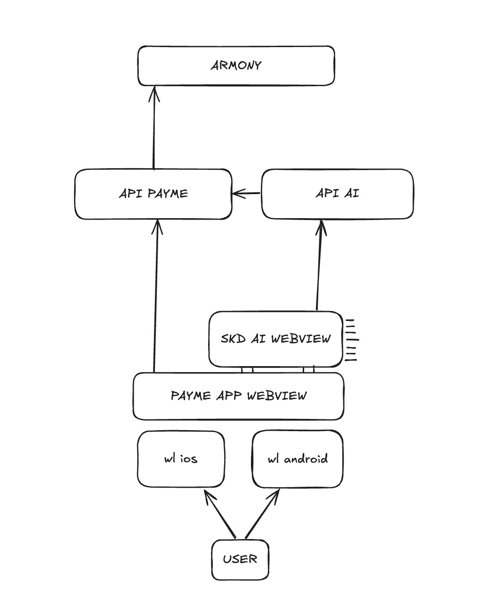

> **Imported context ? Ideeo-IA-general ? 644f0a1.** Product requirements and confirmed boundaries inform IdeeoOrchestrator. Implementation, test results, deployment instructions and scoped authorizations describe the source candidate unless explicitly adopted here. Proposed decisions remain proposed. See the [applicability and source guide](../README.md).

# ADR-011: Tenant APIs own enrollment and channel ingress

| Field | Value |
| --- | --- |
| Status | Confirmed product boundary; scoped development implementation authorized |
| Date | 2 November 2026 |
| Basis | Mateo confirmed the supplied PayMe diagram, clarified that PayMe is one tenant of the shared engine, and explicitly requested documentation, runtime removal, a tenant WhatsApp simulator and real-model tests. |
| Related | [ADR-001](001-tenant-authentication-and-delegation.md), [ADR-010](010-app-host-banking-and-model-context.md), [tenant backends](../contracts/TENANT_BACKENDS.md), [onboarding handoff](../contracts/ONBOARDING.md) |
| Supersession | Replaces the engine-owned enrollment execution, forms, session exchange and Meta webhook/Flow scope introduced on 1 November. It preserves ADR-001's Proposed status and ADR-010's app-host banking and model-context boundary. |

## Evidence and example

The newer [2 November Impromptu Google Meet](https://fathom.video/share/Sy1oXDnenWLxG_ZF3Eyd7otxv7CMYx7N) settles account ownership in the tenant backend/core around [10:20–11:40](https://fathom.video/share/Sy1oXDnenWLxG_ZF3Eyd7otxv7CMYx7N?timestamp=620), the tenant API receiving WhatsApp and routing messages to the AI at [15:36](https://fathom.video/share/Sy1oXDnenWLxG_ZF3Eyd7otxv7CMYx7N?timestamp=936), and the engine calling PayMe while PayMe encapsulates Armony around [29:12–30:02](https://fathom.video/share/Sy1oXDnenWLxG_ZF3Eyd7otxv7CMYx7N?timestamp=1752). Mateo subsequently confirmed this boundary in conversation and supplied the diagram below.

**This is the PayMe tenant example, not a universal bank topology.** Another tenant supplies its own API, identity integration, capabilities and underlying banking systems. The drawing's iOS/Android wrappers and WebViews describe PayMe's consumer arrangement; other tenants need not adopt that UI structure. WhatsApp is not drawn: its ingress is `Meta → tenant API → engine API` for requests requiring AI.

## Decision

- Tenant apps/SDKs call the engine's documented authenticated conversation APIs. They do not all have to proxy AI requests through the tenant backend. The SDK supplies transport and the host bridge, not banking authority.
- The tenant API receives and authenticates its WhatsApp webhook, correlates/deduplicates channel messages, establishes the tenant-approved customer binding and calls the engine when reasoning is needed. It delivers the response through its channel integration. The engine receives authenticated API turns, not Meta webhook payloads.
- The tenant owns account enrollment, KYC, protected forms, applicant/session exchange, PIN handling, account-creation execution and reconciliation. Banking accounts, customer records and ledgers remain tenant/bank-owned. None of those execution endpoints or Meta Flow handlers belong in this codebase.
- The engine recognizes `account.onboard` and returns a typed `onboarding_required` handoff to the tenant. It neither collects enrollment values nor announces account creation. A customerless applicant starts in the tenant's flow; the existing customer-authenticated engine APIs do not become anonymous banking endpoints.
- The engine selects each tenant API, service credential and capabilities from trusted configuration bound to verified tenant/caller identity. User text, body fields, model output and channel labels cannot choose a backend or change an authorization grant. Missing, changed or failed configuration fails closed, with no fixture or cross-tenant fallback.
- Interactive app/SDK banking retains ADR-010: the engine prepares a typed host request, the host authenticates and uses its tenant API, and balance/history appear once in the protected host view outside chat/model context. WhatsApp uses tenant-controlled protected consultation/authorization links and does not ask for a bank PIN in chat. Client-specific route selection uses trusted verified caller IDs.
- Shared reasoning, durable tasks, authority and full agent-account interfaces remain engine scope. Another bank's AI delegating reasoning and an external agent using banking APIs under a mandate remain separate. Existing explicitly qualified adapter paths are distinct from normal tenant API integration and are never fallback routes.

## Implementation and adoption

[ONBOARDING](../contracts/ONBOARDING.md) defines the intent-only handoff. [TENANT_BACKENDS](../contracts/TENANT_BACKENDS.md) defines trusted routing and protected-link preparation; [HOST_BANKING](../contracts/HOST_BANKING.md) defines the separate app-host protocol. The administration console can simulate tenant channel behavior using authenticated engine calls and synthetic tenant services. It does not activate Meta, send real messages, create bank accounts or qualify native consumer adoption.

Remove enrollment runtime registrations/assets/configuration and regenerate OpenAPI/client artifacts. Preserve applied migrations and historical evidence. Retained enrollment content and duplicate-prevention anchors require their existing lifecycle and tenant-approved reconciliation/retirement; removing execution does not authorize deleting records or assuming an uncertain creation never happened. Tenant-side migration/provisioning and production promotion require their own evidence. See [verification](../reference/development/VERIFICATION.md) for actual tested revisions, not this architecture record.

Compliance impact: [legal register](../compliance/LEGAL_REGISTER.md) LR-01/02/03/04/06/09/12/18; target ISO/IEC 27001 controls 5.12, 5.14–5.23, 5.31, 5.34, 8.3, 8.5, 8.10–8.12, 8.24, 8.26, 8.28 and 8.29; ISO/IEC 42001 A.5.2–5.4, A.6.2.2–6.2.4, A.6.2.7–6.2.8 and A.7–A.9. This records engineering obligations, not legal approval, risk acceptance or certification. Real-tenant model disclosure stays denied until the existing prerequisites hold.
