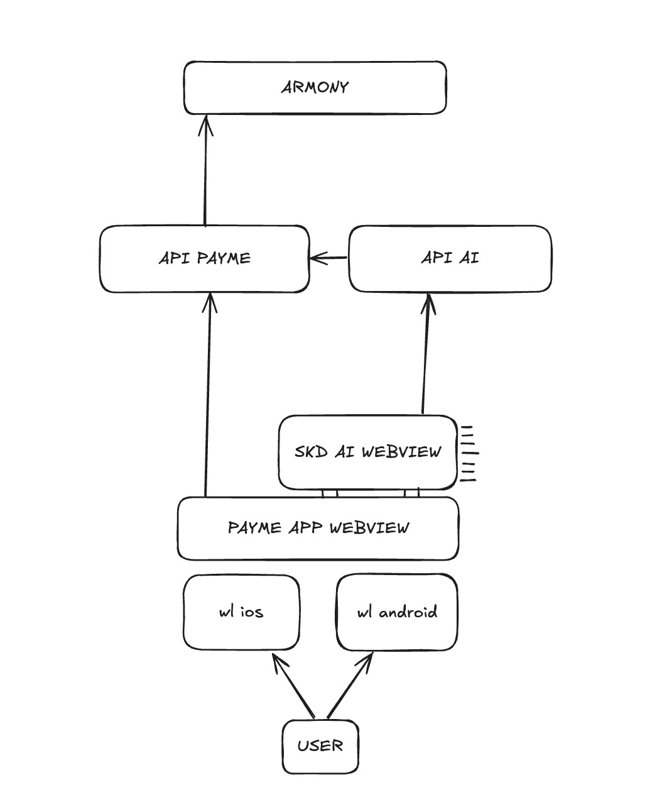

> **Imported context ? Ideeo-IA-general ? 644f0a1.** Product requirements and confirmed boundaries inform IdeeoOrchestrator. Implementation, test results, deployment instructions and scoped authorizations describe the source candidate unless explicitly adopted here. Proposed decisions remain proposed. See the [applicability and source guide](../README.md).

# Shared AI engine: project context and scope

> **IdeeoOrchestrator operating profile.** The confirmed full-engine scope and ownership below apply to this candidate. Its first balance slice, Python service paths, source deployment and scoped past implementation authorizations describe Ideeo-IA-general. The local revision 5 architecture and IMPLEMENTATION_STATUS.md define this candidate's composition and actual status.

Start here when beginning a session. This is the canonical repository record of the product boundaries and scope clarifications confirmed by Mateo through 2 November 2026. Read the [updated architecture revision 4](architecture/arquitectura-motor-agentes-rev4.html) for the detailed design, [ADR-010](../decisions/010-app-host-banking-and-model-context.md) for the app/SDK banking and context boundary, [ADR-011](../decisions/011-tenant-api-and-channel-ownership.md) for tenant API/enrollment/channel ownership, and the [integration context](INTEGRATION_CONTEXT.md) for observations from adjacent repositories.

## What this repository builds

This repository is the implementation home for the **entire shared, multi-tenant AI engine**, including full agent-account capabilities. Its first executable increment is the controlled Sprint 1 balance flow in `src/ai_engine`; [the shared interface](../contracts/SHARED_INTERFACE.md) and [setup guide](../reference/SOURCE_REFERENCES.md#source-8f929a906ccd) document the actual surface and commands. That increment does not establish the remaining full-engine capabilities or real bank access.

The full product includes:

- The brain: tenant assistants, concierge, reasoning, skills, task agents, subagents, and model routing.
- The authority: authenticated/delegated identities, gateway decisions, mandates, approvals, action limits, vault/credential boundaries, protected-operation contracts, and audit evidence. This is a separate responsibility and service boundary from the brain.
- Engine-side hands and integrations: bank-tool adapters, provider APIs, computer/browser and phone interfaces, and the contracts that deliver protected operations to a host or secure page.
- Durable tasks and records: task lifecycle, interruption, cancellation, notifications, idempotency, evidence, memory, and tenant isolation.
- Agent-account capabilities: lifecycle and connection/grant interfaces, mandates, A0-A3 behavior, permitted resources/actions, usage and remaining allowance, pause/revocation, external-agent access, and enforcement against current bank records.
- Engine-side authenticated APIs for tenant SDKs and tenant channel backends, bank-assistant delegation, and agent-account APIs at the authority boundary. Tenant APIs own inbound WhatsApp webhooks, delivery, enrollment and their core integrations; the engine owns intent/handoff and approved service adapters.
- Testing, behavioral evals, observability, and recovery evidence for these capabilities.

This is full product scope, not an instruction to build every component in one Sprint or approve every technical choice in the architecture. Each increment needs approved criteria, applicable contracts and proportionate planning in the existing issue or conversation; separate committed plans are not routine deliverables.

### Multi-tenant backend connectivity

Mateo reaffirmed on 21 October 2026 that connecting the shared engine to several tenants' different backends is required engine work. PostgreSQL isolation and inference-provider adapters are insufficient. Select each bank/authority adapter from trusted tenant configuration, isolate endpoints/credentials/capabilities, and map each backend to [the minimum engine-side contract](../contracts/TENANT_BACKENDS.md). PayMe/WhatsBank is an example integration, not the universal bank API. The engine defines its requirements; adapters translate to what each bank actually has. Configured backend failures must never substitute fixtures or another tenant.

The implemented tenant registry and reference connector are distinct from bank-specific identity/field mapping acceptance and production authority. Development fixtures remain explicitly synthetic. A fixture-backed demo does not establish bank connectivity; each real tenant integration needs its own evidence.

### Tenant administration

On 23 October 2026, Mateo requested implementation of a shared administration
console in this repository: super admins across tenants, scoped tenant admins,
agent personalization and configuration chat, tenant conversations, banking and
WhatsApp settings, and a capability changelog. He selected Next.js, the October
patched Node release and an idempotently seeded PayMe assistant. See
[the administration contract](../contracts/ADMINISTRATION.md) and
[ADR-009](../decisions/009-tenant-administration-console.md). This authorizes the
development implementation; real bank trust, channel provisioning and production
promotion retain their own acceptance boundaries.

### Timeline and fallback clarification

The engine in this repository is not reduced to a launch-only assistant or to the current balance-query slice. If the full engine does not meet a launch timeline, the launch/legacy fallback is handled in another repository. Historical month-one shortcuts do not remove agent accounts, authority, durable work, or other full-engine capabilities from this repository's intended scope.

Linear remains authoritative for live Sprint selection, ownership, estimates, and issue state. A small selected story is an increment toward the full engine. Its limited acceptance does not redefine the repository's product scope. The Sprint 1 robust-engine slice is tracked as [IDE-167](https://linear.app/ideeo-ai/issue/IDE-167); inspect its live criteria and linked verification before pickup.

## Entities and ownership

| Entity | Meaning and relationship |
| --- | --- |
| Shared AI engine (also called the super AI engine) | The reusable platform built here. One engine serves PayMe and other tenants. |
| Tenant | A bank/customer configuration and isolation boundary: tools, bank adapters, policies, assistant configuration, channels, data permissions, and permitted models. PayMe is the first tenant. |
| PayMe AI / PayMe assistant | The PayMe tenant's assistant experience, powered by the shared engine. It is not a second engine. Other tenants can have their own assistant experience on the same platform. |
| Human user and bank membership | A person interacting through an app, SDK, WhatsApp, or another channel. Access belongs to the verified membership in a tenant; the same person at two banks has separate memberships and data. |
| PayMe mobile app | The bank's user-facing app and native host. Its UI and binaries live in separate app repositories. The host presents and executes protected native bank flows under the agreed bank contract. |
| Tenant SDK | A client/embedded-chat and host-bridge component used by PayMe or another tenant's app. Mobile SDK binaries live separately. The SDK is not itself a tenant, user, or proof of banking authorization. Engine-facing APIs and event contracts belong to this engine's integration surface. |
| Another bank's existing AI | An independently operated assistant that delegates a task to this engine through the bank-agent gateway. It provides verified delegation and receives task states/results. |
| External agent | A registered client such as a third-party assistant using an agent account under a user-approved grant. It can use the authority/banking API without invoking our reasoning engine. It is not automatically a new tenant. |
| Agent account | A mandate and activity record tied to its owner's parent account, not an independent ledger or balance. It identifies the authorized agent/client, allowed actions, funding preferences, limits, approval rules, validity, and status. |
| Bank core | The external system of record for money, accounts, balances, debit/issuance execution, and banking records. Full agent-account support here does not move the bank's ledger or regulated core ownership into this repository. |
| LLM provider | An inference dependency used by our brain. Using a provider's model internally is distinct from authorizing an external agent hosted by that provider. |

The assistant powered by this engine, including PayMe's, operates with its own agent account and passes through the same authority boundaries as other agents. The full-engine scope clarification adopts this Rev4 model rather than the older work plan's proposed launch shortcut without an assistant mandate. A model never grants itself permissions.

## Interaction paths

| Path | Who reasons, who authorizes, and what happens |
| --- | --- |
| User -> app/tenant SDK/channel -> tenant assistant -> shared engine | Our brain handles the conversation and proposes actions. Verified tenant/user/delegation context accompanies the request outside model-controlled text. The authority decides tool/action access. |
| Interactive app/SDK core-banking request -> SDK event -> host app -> bank | The engine identifies intent and missing information. The host opens its banking screen, obtains tenant-required authentication/approval and uses its bank integration. Balance/history appear once in that protected screen, never as chat/model results; the SDK does not execute money movement. |
| User -> WhatsApp -> tenant API -> engine API | The tenant API validates/deduplicates its webhook and resolves banking identity before forwarding an authenticated turn. The shared assistant reasons; tenant-controlled protected links present consultations/approval. The tenant delivers responses through Meta. |
| Bank's existing assistant -> delegation API -> shared engine | The other bank's assistant delegates reasoning/execution work to us. We run the authorized task and return progress, requests for input/approval, and evidence-backed results. |
| External agent -> agent-account connector/API -> authority -> bank core | The external agent supplies its own reasoning. Our authority enforces its grant and agent-account mandate. This path does not require a pass through our brain. |
| Brain -> authority -> bank/provider adapter or host | A proposed tool call is validated and authorized using trusted server context and current records. Secrets are added outside the model. The relevant bank/provider/host performs the authorized operation. |
| Authority -> protected host request -> app -> bank core | The host owns interactive banking. Any minimized return status/evidence needs its own verified contract; raw balance/history do not return to chat or the model. Engine-side navigation/input schemas are defined in the [host contract](../contracts/HOST_BANKING.md); native adoption remains pending. WhatsApp retains its channel-specific secure page. |

The SDK route, bank-assistant delegation route, and external-agent banking route are distinct integrations. A common authority and identity model does not imply identical APIs, permissions, or disclosure of account data.

## Confirmed product decisions

### Tenant API, enrollment and channel ownership, 2 November

[ADR-011](../decisions/011-tenant-api-and-channel-ownership.md) records Mateo's explicit confirmation and implementation request after the newer team meeting. Tenant apps embed the shared SDK and call the engine API directly under verified identity. Each tenant API owns its WhatsApp webhook and enrollment/KYC/forms/session exchange, creates accounts through its bank and exposes approved services to the engine. The engine recognizes onboarding intent and hands off; it does not execute account creation or receive Meta Flow/webhook traffic.

**PayMe is only this diagram's example tenant.** Its API encapsulates Armony; another tenant can use a different API/core and consumer architecture. Verified tenant/client context selects trusted endpoints, credentials and capabilities; model/client text cannot select them. App-host banking, WhatsApp protected links, delegated-bank AI and external-agent mandates remain distinct routes. The administration simulator exercises channel-specific behavior with synthetic tenant services; it does not activate WhatsApp or establish bank/native adoption.

### App/SDK banking and model context, 2 November

[ADR-010](../decisions/010-app-host-banking-and-model-context.md) records the requirements Mateo supplied from the Hugo discussion and Fer's later messages/audio. For interactive banking in PayMe or another bank's app, the AI infers the request and the SDK sends it to the host; the host presents on-demand banking screens, handles the bank's authentication/approval flow and connects to its core. Do not query a third-party core from the engine merely to return this path's bank values to chat. Balance and movements are shown once by the host and are absent from chat history/replay and model context. The [development host contract](../contracts/HOST_BANKING.md) defines exact intent IDs, session-bound one-time consume and view invalidation rules; native implementation/device acceptance remains separate.

The original user message may remain visible to its authorized customer. That history is not the model prompt: after approved initial interpretation, sensitive captured fields must be replaced by scoped references in later inference, including pending tasks and derived context. Reusable recipients belong in protected structured contacts, resolved outside inference, without returning raw destinations to the model. Contact ownership, saving UX, retention and native wire details are not settled. Credentials remain prohibited in chat/inference and real-data/provider gates remain unchanged.

WhatsApp protected links, superagent task execution, another bank AI's delegation and external-agent banking APIs retain their separate contracts and authority checks; this boundary does not remove full agent-account scope or raise autonomy. Mateo subsequently requested runtime implementation and real-model tests on 2 November. The opt-in [host contract](../contracts/HOST_BANKING.md) implements engine-side delivery/consume and optional bank-owned contacts; pending model projection contains field names without prior values. Direct reads, links and opaque authority `host_intent` remain separate. Native binaries, independent acceptance and production approval are not supplied by this implementation request.

### Tenant assistant self knowledge

On 22 October 2026, Mateo requested implementation of tenant-customizable
assistant identity and knowledge of its current tools, capabilities and limits,
with a PayMe example usable in the local test UI. Identity belongs in trusted
tenant configuration, not shared tenant-specific code or a UI prompt. Tool
claims must derive from the running engine and current access; configuration and
conversation cannot grant banking permissions. Task agents need their own role
and restricted tool context. See [the assistant contract](../contracts/ASSISTANT_PROFILES.md)
and [ADR-006](../decisions/006-tenant-assistant-self-knowledge.md) for the scoped
development implementation and remaining adoption gates. This does not reduce
the full concierge or shared-engine product scope.

These decisions were supplied or confirmed by Mateo in the 19 October 2026 discussion. They are product context, not a claim that implementation or verification exists.

### Accounts, balances, and spending preferences

- Users can select a preferred account and configure account/funding priorities or spending preferences where the bank permits them.
- An unqualified balance request concerns the **available-to-spend balance of the preferred account**, identifying the account and currency. The user can request other accounts explicitly. In the target app/SDK flow, the host resolves and displays it once in its protected view; the implemented direct-read development contract remains separately documented.
- An explicitly selected account must belong to the authenticated membership and be authorized for the operation. Otherwise reject access; a preference never enlarges permissions.
- With several accounts and no usable preference or clear explicit choice, ask the user to select rather than invent a default. If a saved choice becomes inaccessible, clarify instead of silently switching.
- Display account selection and spending/funding configuration are related but separate. A balance query does not change how a card or agent account is funded.
- The engine respects the bank/core's funding order and conversion rules. It may propose protected configuration changes; it cannot apply them merely because a model requested them.
- Read current bank records for balances and remaining budgets. Never supply a remembered balance as a current value or mix currencies/points without an approved conversion contract.
- External agents see their mandate's remaining allowance, not the parent account's bank balance. Selecting a preferred account does not change this disclosure boundary.

The exact bank field defining available-to-spend balance, the account-selection/funding schemas, and preference persistence contract still need to be specified with the bank. The user-facing meaning above is settled.

### Agent accounts and authority

- Full agent-account support belongs to this repository's engine scope, including the PayMe assistant's own account, delegated grants, mandates, usage, and revocation controls.
- An agent account spends against permitted parent funding and has no separate balance/ledger.
- Identity, tenant, membership, agent account, and granted capabilities come from validated credentials and server records. Request text, model tool arguments, SDK metadata, and client-supplied account references do not confer identity or access.
- The brain proposes; the authority authorizes; bank/provider/host systems execute under the relevant contract. Bank money and policy checks do not depend on a model behaving correctly.
- Current pause/revocation state, mandate validity, resource/action scope, approvals, and spending limits must be checked where applicable. Historical approval or a valid login is not a standing permission for arbitrary effects.

Detailed A2 threshold equality, exception/failure policies, token schemas, and other unresolved product or protocol questions still need written decisions. Full-engine scope does not resolve these incidentally.

### Tenant-owned authentication and consistent onboarding

Further confirmed by Mateo during the authentication ADR discussion on 19 October 2026:

- The tenant/bank is responsible for authenticating and authorizing its customers. The engine routes the user to the tenant's authentication flow and consumes a validated result under the agreed trust contract; it does not create a competing bank-customer identity or infer successful authentication from a redirect or client assertion alone.
- The engine still needs a common verified principal distinguishing owner/membership, calling client, active agent account, and delegated rights. Separate entry flows for user channels, bank-assistant delegation, external agents, and internal services were accepted in principle; the exact credential/proof contracts remain open.
- Account creation asks for the same underlying information regardless of channel. Define a shared onboarding contract for the relevant tenant, with channel-specific presentation and bank-owned validation. This does not require every tenant worldwide to use PayMe-specific KYC fields or every channel to collect channel-only consent.
- Checking current grants, account status, and mandates when long-running work resumes is the accepted starting direction. Detailed credential renewal and task-resumption mechanics may change as the durable execution design develops; no final long-running protocol is approved by this discussion.

Mateo asked whether a phone number, or phone plus a bank PIN, can establish user identity. This is still a design question, not approval of phone-only banking access. Distinguish an entered number, evidence of control of a channel/number, bank account binding, an authenticated bank session, and approval of a particular operation. PIN creation during onboarding does not establish a later login or account-linking protocol. See the [legacy WhatsApp/onboarding observations](INTEGRATION_CONTEXT.md#whatsapp-onboarding-and-returning-senders).

### Autonomous browser work and proactive responsibilities

Confirmed by Mateo on 20 October 2026, with an explicit request to update the architecture:

- Browser execution is a central engine capability for tasks without a suitable API or proprietary integration. Task agents need their own observation/action/verification loop, bounded context, recovery, and durable progress; reusable skills do not require a predefined script for every site.
- One conversational assistant speaks directly to the user and coordinates background task agents. The user can continue the conversation while work progresses. Executors return progress, questions, and evidence through the coordinator.
- Durable, proactive responsibilities are part of the target: the engine can pursue goals, wait, wake, and adapt within an authorized assignment. Preferences or a classifier's prediction do not create permission for new effects.
- The shared authority, agent-account mandates, tenant isolation, budgets, current grants, and evidence requirements continue to constrain execution. Browser access alone does not prove safe checkout or exactly-once effects.

The updated [architecture section 4.14](architecture/arquitectura-motor-agentes-rev4.html#autonomia-ejecucion) develops this direction and includes a dated bibliography of primary sources. Detailed delegation, wake-up, checkout and runtime contracts remain proposed; this confirmation does not accept every ADR, select Jev, or establish implementation/verification of these capabilities.

The scoped [pre-VM browser increment](../decisions/012-browser-execution-lifecycle.md),
authorized on 7 November, implements generations, bounded recovery/takeover,
confirmed teardown ownership, an environment port, artifact evidence and synthetic
authority-owned connections. The local backend rejects real routes before reading
credentials. Reasoning and authority remain outside compute; disposable VM,
real-account and independent acceptance prerequisites remain open. See the
[verification index](../reference/development/VERIFICATION.md) for revision-scoped evidence.

### Reuse of repeated work

On 8 November Mateo requested [Browser Use preparation](../decisions/013-browser-use-preparation.md)
and real OpenAI engine testing, together with updated architecture/design
decisions. He subsequently directed full upstream library adoption instead of
the initial DOM-only helper. The opt-in worker uses Browser Use Agent, browser
session and tools for navigation, with engine-owned task/authority/model budgets.
Controls remain visible while secret values/input and effect dispatch stay
protected. Its separate dependency environment does not qualify real sites or a VM.
[ADR-014](../decisions/014-persistent-assistant-context.md) records separate
assistant-state lifecycles, inspectable structured memory, proactive assignments,
activity/takeover and grounded self-knowledge. Detailed new stores, native views
and unattended authorization remain proposed; existing retention limits apply.

On 23 October 2026, Mateo requested a design for reusing repeatedly successful, verified model interpretations so a matching request can take a deterministic route without another inference call. The reused artifact is a scoped typed intention or plan; current authority, source facts, approvals and effect evidence are still obtained on each execution. He also requested caches for appropriate model, API and browser work. [Architecture section 4.10](architecture/arquitectura-motor-agentes-rev4.html#memoria) and [ADR-007](../decisions/007-inference-reuse-and-cache-boundaries.md) develop the proposal. The specific cache store, promotion thresholds and production qualification remain open; documenting the proposal does not claim implementation or ADR acceptance.

The skill direction clarified on 3 November is portable instructions and references that teach the AI how to use approved tools, including Playwright or browser-use. Skills guide live observation, action selection, verification and recovery; selectors are hints rather than fixed click recordings. Tools/adapters own executable operations and the authority owns permissions. Executable skill packages, bundled scripts, automatic module imports and interpreter execution are deferred for the reasons in [the research](RSI_RESEARCH.md#why-interpreter-execution-is-deferred). This removes the earlier proposed two-form skill requirement without removing deterministic tools or general browser capability.

### Concierge services and customer experience

The canonical [UX rules](UX.md) define intended customer interaction for rides, food, groceries/shopping, restaurant reservations, appointments and local businesses. Prepare complete proposals with minimal questions using permitted context/preferences; present Approve / Change / Cancel when policy requires approval. Changes invalidate affected approvals, paused work revalidates current terms, and confirmation requires source evidence. Current mandates may permit autonomous work within their limits. Account connection and secret entry use protected flows; one concierge presents typed executor observations.

The separate [service integration contract](../contracts/SERVICE_INTEGRATIONS.md) covers Uber, Uber Eats, Rappi, OpenTable, Doctoralia, Google Maps/businesses, DiDi rides and DiDi Food, with other providers using the same contract. Resolve routes from trusted tenant configuration, qualify preparation and commitment separately, and keep unsupported routes disabled. Intended coverage, a skill or a synthetic test does not establish a working integration. The existing public-document research executor does not establish authenticated ordering or booking.

Customer-service administration may expose scoped operational history and attributed preferences. AI profiling and marketing need their separate permissions; simulated tasks and drafts never count as confirmed spend. These are product rules, with detailed contracts and implementation still required. They do not select Lovable, an external executor or a browser framework, change app/SDK ownership, or authorize production/provider activation.

### Spoken conversation with the assistant

Requested by Mateo on 20 October 2026. Mateo asked for the design and architecture to include it, and asked whether ElevenLabs should provide the voice, only for the agent that replies to the user.

On 15 November 2026 Mateo confirmed keeping **streaming speech-to-text → the existing concierge → streaming text-to-speech** for now despite latency concerns. Voice-native and hybrid conversational frontends are deferred. This confirms the architecture direction, not a runtime or provider qualification.

- Users can speak with the assistant and hear its replies, in addition to text and voice notes. Only the conversational assistant (the concierge) speaks with the user; task agents keep reporting through it.
- Voice changes how the user talks to the assistant, not who decides. Identity, authority, approvals and channel rules stay the same. A spoken "yes" is not an approval, and PINs, codes and full account or card numbers are never requested by voice.
- ElevenLabs is the proposed first speech provider, limited to speech recognition, turn-taking and speech synthesis for the concierge. The engine keeps the reasoning, tools and records.
- Speech Engine is a conditional candidate: its transcript-handler response lifecycle must support late background-task delivery. An engine-operated Pipecat or LiveKit runtime with separate speech APIs is also a valid starting point; neither runtime is selected.
- Measure end of speech to first useful audible response, including turn finalization, concierge generation and playback. Streaming reduces serial waiting but does not remove latency. Task-event streaming and isolated TTS timings do not establish an end-to-end voice experience.
- App/SDK balance and history stay in the host's protected screen under ADR-010, outside assistant speech and speech-provider context.

[ADR-004](../decisions/004-voice-channel-and-speech-providers.md) and [architecture section 4.15](architecture/arquitectura-motor-agentes-rev4.html#voz) record the accepted streaming direction and the remaining proposed details. Still pending:

- The vendor contract.
- Processing of customer audio outside Mexico.
- Recording and spoken-disclosure policy.
- The voice-session contract with the app.
- Mexican Spanish qualification.

Live voice needs its own functional story; US-003 covers text and voice notes. The phone agent that calls providers (US-038) remains a separate capability.

## Design discussion versus approved implementation

On 21 October Mateo requested documentation plus runtime enforcement of the data ownership/minimization proposal, based on the legacy source, the Hugo/Mateo call and current engine design, with local integration into the latest `dev`. [The data contract](DATA_OWNERSHIP_AND_LIFECYCLE.md) defines retained categories and implementation/adoption boundaries; [ADR-005](../decisions/005-data-ownership-and-lifecycle.md) records the scoped authorization. It complements tenant-owned auth in ADR-001 and preserves full durable-task and agent-account scope. It does not approve a universal bank profile API, local bank ledger, reserved-funds subledger, production retention values or vendor/KMS qualification.

The session proposals are now written as [ADR-001: tenant authentication and delegation](../decisions/001-tenant-authentication-and-delegation.md) and [ADR-002: AI provider adapters and routing](../decisions/002-ai-provider-adapters-and-routing.md). Both are Proposed, pending human review of their complete contents. The [ADR index](../decisions/README.md) records their status, including [ADR-003](../decisions/003-engine-implementation-stack.md) for the implementation stack and [ADR-004](../decisions/004-voice-channel-and-speech-providers.md) for the voice channel.

| Topic | Current status |
| --- | --- |
| Full engine, full agent accounts, PayMe as a tenant, and fallback in another repository | Confirmed repository scope. |
| Preferred-account available-to-spend balance and user-configured priorities | Confirmed product behavior; wire/storage and bank-data contracts remain to be defined. |
| Authentication | Confirmed boundary: tenant-owned customer authentication/authorization, routed through the tenant, and a verified engine principal with distinct owner/caller/delegation context. [ADR-001](../decisions/001-tenant-authentication-and-delegation.md) proposes the trust/delegation design and lists required tenant credential/assurance contracts. Phone-only banking access was discussed, not approved. The complete ADR is not yet Accepted. |
| Account onboarding | Confirmed: the same underlying account-creation information across channels for the relevant tenant, with channel-specific presentation. Shared schemas, tenant validation, consent applicability, channel/account binding, and recovery contracts still need specification. |
| External-agent access | Architecture baseline: registered clients and user-approved grants bound to agent accounts. A connector's actual supported security profile and deployment contract must be confirmed. |
| LLM-provider flexibility | Requested design goal. [ADR-002](../decisions/002-ai-provider-adapters-and-routing.md) proposes task-facing contracts, capability-aware routing, provider adapters, model-specific prompt rendering, native-state preservation, and safe handoff/fallback boundaries. The complete ADR is not yet Accepted; supporting schemas, libraries, model profiles, and route qualifications remain to be specified. |
| Stack and services | Rev4 proposes Python/FastAPI/Pydantic/LangGraph for the brain, a separate authority, durable runtime, adapters, and observability. [ADR-003](../decisions/003-engine-implementation-stack.md) proposes the concrete implementation baseline and staged adoption, including native provider SDKs initially and qualification of the Temporal-LangGraph integration. It remains Proposed; scope approval does not make versions, services, security profiles, benchmarks, or deployment choices accepted or verified. |
| Voice conversation | Streaming STT → existing concierge → streaming TTS confirmed on 15 November; voice-native/hybrid frontends deferred. [ADR-004](../decisions/004-voice-channel-and-speech-providers.md) retains engine-owned speech ports and ElevenLabs as a candidate. Speech Engine versus an engine-operated runtime remains conditional on lifecycle and latency qualification; provider contract, data processing, disclosure policy, app session contract and es-MX qualification remain pending. |
| Network partitions and state consistency | [ADR-008](../decisions/008-partition-consistency-and-availability.md) selects consistency-first protected operations and conditional, dated snapshots for nonauthoritative reads. It is Accepted; atomic bank/authority enforcement, freshness, outage responses, and reconciliation contracts still require review before implementation. |
| Implementation setup | Initially deferred, then explicitly requested for Sprint 1 using the ADR boundaries and real Gemini calls with controlled data. [The verification index](../reference/development/VERIFICATION.md) records scoped implementation authorization and [the setup guide](../reference/SOURCE_REFERENCES.md#source-8f929a906ccd) supplies the actual profile. Real integration, independent review, remote gates and production controls remain separate obligations. |

No new session should treat an assistant's recommendation in this record as a human-approved architecture decision. Proposals need refinement and the applicable approval; confirmed product decisions do not need to be reopened simply because a historical source contains an older alternative.

## Sources and how to read them

1. **This context record:** the 19 October 2026 user clarifications govern repository scope, entity boundaries, and the explicitly confirmed decisions above.
   The [ADR index](../decisions/README.md) tracks proposed and accepted design records; an unaccepted proposal does not supersede a confirmed requirement.
2. **Current Linear:** authoritative for live work scope, criteria, ownership, estimates, dependencies, and Sprint state. If existing criteria conflict with a confirmed clarification, surface the specific conflict for reconciliation rather than silently changing either artifact. This repository update does not change Linear issues or Sprint commitments.
3. **Architecture Rev4, 17 October 2026:** [local source](architecture/arquitectura-motor-agentes-rev4.html) and [native Linear document](https://linear.app/ideeo-ai/document/arquitectura-del-motor-de-agentes-revision-4-216b0f608b00). A detailed proposal/reference; read accepted decisions and later clarifications alongside it.
4. **PayMe work plan, 16 October 2026:** [historical Linear document](https://linear.app/ideeo-ai/document/plan-de-trabajo-payme-27-diapositivas-fd09cc8a45f4). Slides 2-4 define product relationships; 8 and 18 describe host execution; 9 and 19 distinguish agent accounts and external-agent access. Historical launch reductions, dates, stack alternatives, and process suggestions do not override this scope clarification, current delivery policies, or approved later decisions.
5. **Adjacent code:** [integration context](INTEGRATION_CONTEXT.md) records a dated source inspection. Existing code is evidence of an integration surface, not automatically intended behavior or a completed security review.

The original work plan remains available in its Linear publication and Git history. Current product rules above supersede its historical launch reductions and process suggestions.

For engineering gates, use [Scrum](../policies/SCRUM.md), [methodology](../policies/METHODOLOGY.md), [AI development](../policies/AI_DEVELOPMENT.md), [production readiness](../policies/PRODUCTION_READINESS.md), and [testing ownership](../policies/TESTING_OWNERSHIP.md). No historical product-plan milestone or model score overrides these controls.
