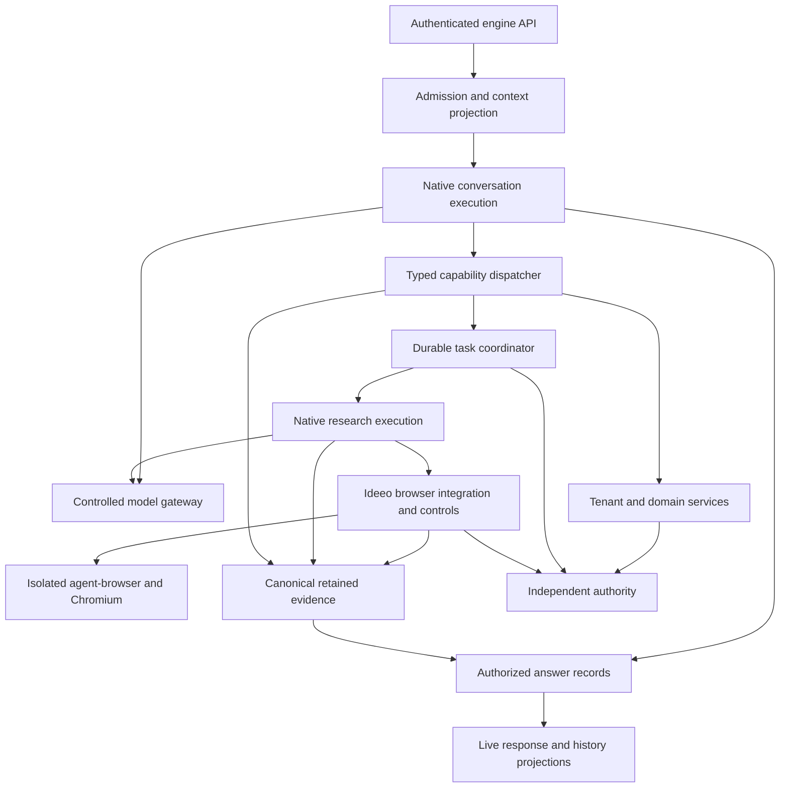

> **Imported context ? Ideeo-IA-general ? working-tree reference, 2026-11-18.** Product requirements and confirmed boundaries inform IdeeoOrchestrator. Implementation, test results, deployment instructions and scoped authorizations describe the source candidate unless explicitly adopted here. Proposed decisions remain proposed. See the [applicability and source guide](../../README.md).

# Ideeo-native conversation and browser execution: recommendation and implementation handoff

Date: 18 November 2026.

Status: user-requested detailed recommendation. The user has confirmed the architectural direction described below; the particular module layout, interfaces and delivery sequence are implementation proposals. Preparing this document does not implement the design, supersede ADR files automatically, qualify a release, or authorize new paid experiments, publication or deployment.

## 1. Read this first

**Build Ideeo-owned conversation and research execution in this repository, using [Vercel's `agent-browser`](https://github.com/vercel-labs/agent-browser) directly for browser automation. Borrow OpenMausBot's architecture, design choices and useful behavior, but do not adopt its application runtime, vendor its source, translate its source into a disguised fork, or retain an OpenMaus-specific integration as the intended architecture.**

The user explicitly confirmed this browser-component choice on 18 November 2026. It supersedes this document's earlier proposal to implement browser tools directly with Python/Playwright. “Native” means Ideeo owns the reasoning loop, integration and execution controls; it does not mean writing a browser engine or Chrome driver from scratch. `agent-browser` executes browser operations; Ideeo decides which permitted operation to request next and owns task completion.

The user is pursuing two distinct delivery candidates under a two-week minimum-product deadline:

1. **This repository:** improve the existing Ideeo product through a substantial native redesign of the conversation/research execution path, preserving required behavior and useful existing domain components.
2. **The separate OpenMausBot repository:** build an alternative product directly on that foundation. Work there is a separate track, outside this implementation handoff.

The intended outcome here is a coherent engine, not another application attached through increasingly elaborate adapters. Reusing `agent-browser`, provider clients, PostgreSQL and Temporal is appropriate. Calling the browser component directly does not require running the OpenMaus application, its bot/task API or its model loop.

The mandate is:

> Deliver the existing Ideeo product through a simpler, Ideeo-owned conversation-and-research execution path with direct `agent-browser` automation. Preserve required authority, tenancy, data and lifecycle behavior. Replace unnecessary orchestration. Retire the direct OpenMaus runtime dependency when the native path and its migration are verified.

This is not a recommendation to rename the existing OpenMaus bridge, place a new loop in front of the legacy planner, or split large files without changing responsibility ownership. The implementation must remove duplicate decisions and cross-layer dependencies from the migrated path.

## 2. Context, decisions and changes of direction

### 2.1 Why this work exists

The user questioned whether Ideeo had accumulated too many patches, especially around browser use, and whether starting from OpenMausBot would be cleaner. The initial investigation compared repository architecture, local Git history and retained session/runtime evidence. Subsequent research compared other open-source agent repositories and tested alternative conversational runtimes through the authenticated engine.

The user then introduced a hard business constraint: a minimally ready product within two weeks. They proposed developing the existing repository and an alternative base in parallel. They challenged the assumption that reconstructing substantial functionality necessarily takes too long: much of Ideeo's functionality was built with AI assistance in roughly three weeks, followed by considerable browser integration churn.

The historical evidence supports rapid implementation capacity. It does not prove that every current behavior is independently accepted or that either candidate will automatically meet the deadline. The appropriate response is to optimize architecture, integration and verification for that demonstrated pace, rather than dismissing a substantial redesign because it involves writing many files.

### 2.2 Decision register for this handoff

| Decision | Standing |
| --- | --- |
| Pursue an Ideeo candidate and an OpenMaus-based candidate in parallel | User's delivery strategy; this file covers only Ideeo |
| Use OpenMaus as an architectural reference here, without directly adopting its runtime/source | Explicit user direction; controls this recommendation |
| Stop framing this track as “finish the OpenMaus integration” | Explicit correction of the earlier recommendation |
| Preserve required behavior/security boundaries, not every existing class or internal schema | Recommendation consistent with the user's architectural objective |
| Keep useful domain components where they fit; redesign coupling where necessary | Recommended implementation approach, not a prohibition on domain refactoring |
| Use Vercel's `agent-browser` directly for this repository's browser tasks | Explicit user direction confirmed on 18 November; replaces the direct-Playwright proposal, not proof of completed integration |
| Build an Ideeo-owned execution loop and controlled browser-tool integration, borrowing OpenMaus design choices | Confirmed direction; no OpenMaus application runtime or source adoption |
| Keep Python for engine integration and use the selected `agent-browser` process/protocol | Proposed implementation arrangement; exact package version, transport details and platform qualification remain implementation work |
| Do not make PydanticAI, Pi or another agent framework adoption a prerequisite | Recommendation based on inconclusive replacement experiments |
| Preserve the full multi-tenant engine purpose while selecting a two-week release slice | Existing product scope plus delivery recommendation |
| Do not impose an automatic Day 4 cancellation of the alternative candidate | Earlier rigid cutoff withdrawn; judge actual integrated progress and remaining release work |

The earlier “preserve all services and put a thin alternative runtime around them” constraint was too rigid. Preserve responsibilities and required outcomes. An implementation that carries unnecessary coupling can be changed, even when it belongs to an otherwise valuable domain area.

### 2.3 Relationship to ADR-016 and previous proposals

[ADR-016](../../decisions/016-engine-owned-openmaus-browser-runtime.md) currently describes internalizing the OpenMaus source and packaging. That was the prior direction. The user's latest instruction changes the intended destination to native Ideeo code informed by OpenMaus design, integrating Vercel's `agent-browser` directly. Record how the selected browser scope also supersedes ADR-013's Browser Use direction as its consumers migrate; do not silently retire unrelated service routes.

When implementation is commissioned, record this change in the ADR system and index: preserve ADR-015/016 as historical decisions and identify the superseding direction. Do not silently rewrite their historical evidence or claim that the vendored runtime has already been removed. Use the next available ADR number after checking the index; do not assume a number is still unused.

The older comparison handoff remains useful for its inventory of authority, lifecycle and migration requirements. Its proposed OpenMaus-derived runtime, source import and bridge instructions are **not** the implementation recipe for this track anymore.

## 3. Evidence and reports

### 3.1 Reading map

Paths in this document are relative to the Ideeo repository unless explicitly prefixed with another repository name. Links into `../../experiments/` assume the existing sibling checkout arrangement; if moved, locate the report by its exact filename. No sibling directory is a product build or runtime dependency.

| Source | What to use it for | Limits and current standing |
| --- | --- | --- |
| [Original Ideeo/OpenMaus review and comparison implementation handoff](ideeo-openmaus-runtime-comparison-implementation.md) | Architecture/history findings, detailed lifecycle requirements, source seams, migration risks | Historical proposal; direct OpenMaus adoption instructions are superseded by this direction |
| [Independent repository comparison, 17 November](ideeo-agent-architecture-repository-comparison-2026-11-17.md) | Coupling diagnosis, comparison of candidate libraries/apps, preservation by responsibility | Its preference for PydanticAI was a candidate selection judgment, not a proven runtime win |
| [Fresh experiment preparation, 17 November](../SOURCE_REFERENCES.md#source-38c6db42523d) | Initial experiment identities, R0 history reproduction and preparation findings | Early database-blocked status was superseded by later qualification; do not report it as the final state |
| [Database qualification, 18 November](../SOURCE_REFERENCES.md#source-defdf81777ae) | Actual API/PostgreSQL checks, history and cancellation-settlement repairs, P/J integration details | Controlled inference and retained evidence; no complete browser acquisition journey |
| [Original live runtime results, 18 November](../SOURCE_REFERENCES.md#source-1f1c47d97b65) | Actual R1/P/J semantic outcomes and failures | Narrow synthetic retained-evidence slice, version changes and failed attempts retained |
| [Live repair record](../SOURCE_REFERENCES.md#source-90cad3553cb5) and [continuation record](../SOURCE_REFERENCES.md#source-503db264c47a) | Supporting execution/repair provenance referenced by the campaign | Use final campaign results for conclusions; these are not additional independent wins |
| [Contract-alignment preparation](../SOURCE_REFERENCES.md#source-c66be0ff6b0d) | Revised typed control contract, shared grounded answer contract, offline checks | Its pending-live wording is historical; use the live follow-up for actual execution |
| [Contract-alignment live results](../SOURCE_REFERENCES.md#source-ed9e7fbfd3ce) | Final P2/R1 observations, incomplete generation and unexecuted coverage | Inconclusive; correction and repair behavior were not exercised in relevant live cases |
| [Verification index](../development/VERIFICATION.md) | Product evidence, deployed fingerprints, conversation defects, integration and acceptance gaps | Each entry has its own revision and environment; evidence does not automatically qualify this redesign |

Preserve these reports. This document synthesizes their implications; it does not replace their raw traces, revise failed outcomes or relabel old experiments as native-runtime validation.

### 3.2 What the evidence supports

**The coupling concern is concrete.** The repository comparison identified the following interactions, also visible during this document's source inspection:

- `AssistantService._run` combines conversational decisions, task controls, banking handling, dispatch and presentation.
- `CapabilityPlanner.capture` constructs a broad structured contract and performs output interpretation/repair.
- `BackgroundService.__init__` borrows assistant dependencies, assigns `assistant.mission_runtime` and mutates assistant handlers.
- `PublicResearchTasks.checkpoint` mixes retained progress and presentation responsibilities.
- `PublicResearchTasks.advance` combines acquisition, assessment, completion, presentation, budgets and cleanup.
- `browser/openmaus.py` reaches through `tasks.background.assistant`.

The older report measured approximately 3,939 lines in `assistant.py`, 2,018 in `planning.py`, 1,742 in `presentation.py`, 2,406 in `public_tasks.py` and 2,508 in `public_site.py`. These are historical snapshot measurements, not targets or current line-count assertions. The problem is responsibility interaction, not file size by itself.

**Two shared repairs have concrete evidence.** R0 means committed Ideeo `68749d1750dc53443e6d3f8c65b6be283c265d44`. R1 means that source plus separately attributed history and lifecycle patches in the experiment. R1 is not the unchanged product repository.

1. Failed-turn history hid useful authorized outcomes. The experiment reproduced the defect and preserved the failure notice together with allowed partial content after repair. Financial-history exclusions and current authorization remained enforced.
2. Cancellation could let a caller finish before terminal persistence completed. The lifecycle repair joined owned persistence/lease-release work through repeated cancellation. Review the actual patch and tests before adapting it; adding `asyncio.shield` alone is not the demonstrated solution.

**The initial live comparison did not establish a replacement winner.** It accounted for 54 journeys across R1, PydanticAI and Pi, with 132 physical model dispatches. Both replacement integrations failed all three correction repeats in the original campaign. The exact correction-span contract and evidence-output integration contributed to the diagnosis. The results do not establish that either framework is intrinsically incapable.

**The aligned follow-up was incomplete.** Six of 36 journeys had their operations observed; five had finish markers. Twelve public turns were observed, eleven completed and one failed. P2's exact-versus-starting-price turn hit the 2,048-output-token limit before an admissible typed result reached output validation. Thirty journeys were NOT_RUN. Relevant live corrections, injected failure/history reloads and SDK repair events were not demonstrated in that follow-up.

Both arms benefited from a shared grounded renderer. Its source/price comparison quality therefore cannot be credited solely to PydanticAI. The deterministic fact grammar was narrow, and lower input-token usage did not establish a complete cost, reliability or maintainability win. The unfinished generation body was not retained; its actual contents and the reason they consumed the output allowance are unknown.

**None of those semantic experiments ran the complete browser worker/Temporal/public-site journey.** Their source observations were preloaded synthetic evidence. A task fixture marked running does not establish actual worker progress. Those experiments neither prove nor disprove the proposed native Ideeo browser design or the separate full OpenMaus candidate.

### 3.3 History and the two-week constraint

The previous Git review found rapid domain implementation: authenticated balance around 19 October, tenant routing/authority/durable-task work during 21–23 October, tenant ownership/app-host boundaries and additional channels in early November, and dense browser/evidence/conversation repair activity during 8–17 November.

This supports investing in a substantial architectural improvement at the user's demonstrated AI-assisted pace. It also suggests that interaction design and feedback quality deserve more attention than raw code-generation throughput. It does not establish causal proof that every browser repair came from one architectural mistake.

## 4. Baseline and governing requirements

### 4.1 Repository state inspected for this document

| Item | Observed state |
| --- | --- |
| Active branch | `feat/engine-owned-openmaus-browser` |
| HEAD and local `dev` | `68749d1` |
| Missing commits from local `dev` | 0 |
| Working tree | Dirty; substantial pending OpenMaus integration/source/packaging/documentation changes |
| ADR-016 | Present as an untracked working-tree file at inspection |
| Remote freshness | Not established by this document's local inspection |
| New runtime execution performed for this document | None |

Pending changes include `tools/openmaus/`, `deployment/openmaus/`, `browser/openmaus.py`, settings, tests, documentation and vendor tooling. They are not all in committed `dev`. Preserve them; do not discard, stash, commit or delete them as incidental cleanup. Implementation needs an explicit inventory and controlled migration of the affected files.

At implementation start, repeat the separate branch/worktree/HEAD/dev checks required by AGENTS.md. Inspect current changes and exclusive file/resource claims. Reuse the checkout for sequential work; use isolated worktrees only when authorized parallel edits need them. Do not reuse historical experiment ports/databases just because a report lists them.

### 4.2 Required product boundaries

Read [README](../SOURCE_REFERENCES.md#source-b33563055168), [project context](../../product/PROJECT_CONTEXT.md), [integration context](../../product/INTEGRATION_CONTEXT.md), [UX](../../product/UX.md), [ADR index](../../decisions/README.md), [shared interface](../../contracts/SHARED_INTERFACE.md), [tenant backends](../../contracts/TENANT_BACKENDS.md), [authority](../../contracts/AUTHORITY.md), [background tasks](../../contracts/BACKGROUND_TASKS.md), [service integrations](../../contracts/SERVICE_INTEGRATIONS.md) and [provider profile](../../contracts/PROVIDER_PROFILE.md).

The design must retain:

- The full shared engine purpose, including authority, delegation and agent accounts. PayMe is one tenant, not the engine's universal bank backend.
- Trusted tenant/backend/capability/credential resolution. Model text, request bodies and channel labels cannot select a tenant or grant authority. No fallback to another tenant or synthetic fixtures.
- Independent current authorization before protected execution and disclosure, including replay/history access.
- Existing financial operation identity and uncertain-outcome reconciliation. A conversational loop does not own ledger truth or permission to retry a money movement.
- ADR-010 app-host banking: host-owned protected screens/authentication/core calls, one-time handoff semantics, balance/history outside chat/model context. Customer-visible original messages and sanitized model context remain distinct.
- ADR-011 tenant ownership of enrollment, session exchange and WhatsApp ingress. The engine returns typed handoffs and receives verified turns; it does not acquire those external responsibilities.
- Separate routes for interactive app/SDK use, tenant channel use, another bank's AI delegating reasoning, and an external agent using banking APIs under its mandate.
- Encrypted scoped storage, retention/erasure, idempotency, durable tasks, outbox/replay and bounded recovery.
- Existing tenant personalization, approved instruction skills and media/voice interfaces where consumers already depend on them. Missing parity must be visible; do not silently remove them when changing the conversation entry point.

Proposed ADRs remain proposals. The document is not permission to treat every documented future capability as currently operational.

## 5. Architecture to build

### 5.1 Ownership and dependency direction

Use a small number of explicit components, composed at startup:



The diagram describes responsibilities, not a requirement to create a service deployment for every box. Start with Python modules and existing service boundaries. Browser isolation is justified by process ownership and containment; introducing RPC between ordinary in-process components is not required.

The conversation component does not own browser cleanup. The browser does not own durable task completion. Presentation does not mutate task state. A background service does not reach through the assistant to obtain repositories or authority. Application composition supplies shared dependencies directly.

### 5.2 Native execution primitive

Build an Ideeo-owned execution primitive for bounded model/tool iteration. Use it for conversational execution and browser research with separate typed policies, context projections and available tools. Do not force them into one enormous universal schema or a single durable state machine.

One iteration is:

1. Load the current execution scope, revision and control state.
2. Build a permitted context projection with selected tools and retained observations.
3. Reserve and dispatch a model request through the existing controlled provider boundary.
4. Classify its result: final answer, tool requests, user question, refusal, incomplete output or failure.
5. Validate tool arguments and enforce current domain authorization, revision, budget and deadline.
6. Execute the permitted tool; persist its receipt and observation before relying on it in continuation.
7. Continue with the actual tool result, or finish/yield with an honest typed outcome.

Termination is explicit: useful final answer, required customer input, accepted delegation to a durable task, cancellation, budget/deadline exhaustion, unrecoverable error, or a domain completion decision. A model saying “done” does not set a financial effect or browser task to successful.

The loop owns iteration, not another independent durable task database. A short conversation turn uses existing admission/leases/receipts. A long-running research assignment uses the existing durable task/workflow ownership with bounded activity steps. Persist only the allowed continuation state and references needed for recovery, not raw provider internals in Temporal history.

### 5.3 Proposed internal contracts

These are semantic contracts to implement with existing typed models where suitable. They are not current exported API types, and names can change if a compatible existing abstraction is clearer.

| Contract | Minimum meaning | Ownership rule |
| --- | --- | --- |
| `ExecutionEnvelope` | Verified scope references, turn/task IDs, runtime version, goal revision, deadline, trace ID | Constructed by admission/domain code; no model-supplied principal, tenant or grant |
| `ContextProjection` | Permitted conversation messages, selected evidence refs, current capability descriptions and limits | Excludes protected banking values and secrets; bounded explicitly |
| `ToolSpec` | Stable name/version, typed arguments/result, read/control/protected-operation classification | Closed registry from trusted composition; no arbitrary plugin discovery |
| `ToolInvocation` | Engine invocation ID, validated arguments, target task/revision and originating accepted turn | Model tool-call IDs are correlation data, not sufficient idempotency keys |
| `ToolReceipt` | Scope, invocation identity, dispatch/outcome state, safe result or evidence references | Retained through the existing repository/domain journal with replay behavior |
| `RunOutcome` | Answer/question/delegation/interruption/failure plus safe output references | Internal sum type mapped to existing public schemas; not new public statuses by default |
| `Observation` | Source/acquisition identity, timestamp, entity/claim association, task/goal revision and exact content refs | Owned by evidence storage, not reconstructed from model prose |
| `AnswerRecord` | Authorized customer answer/partial, source refs, language and independent operation status | Shared source for live and history projections |

A principal's transport credential should not be serialized into these general-purpose envelopes. Resolve proof through the existing trusted request/executor mechanism. Authenticate any process boundary and scope its commands to the intended owner; a local process assumption is not tenant authentication.

### 5.4 Tool dispatch and effects

Keep ordinary conversational replies free of a mandatory all-capabilities plan. Make actionable requests explicit typed tool calls. For consequential operations the typed schema is only the first gate: domain code still checks resource identity, authority, current terms, approval and reconciliation state.

Tool execution must:

1. Validate the selected tool against trusted availability for this caller.
2. Validate argument types and domain meaning.
3. Resolve the intended target without cross-tenant or ambiguous fallback.
4. Recheck revision/control state and current permission at dispatch, including after authorization awaits where state may change.
5. Reserve capacity/budget and establish the existing operation identity before an effect.
6. Persist a result/uncertainty receipt and settle owned resources.

Do not add a second general journal for financial operations that already have one. Adapt those services into the dispatcher. When a dispatch result is uncertain, reconcile the same operation; do not rerun it because the conversational loop started again.

### 5.5 Model gateway and recovery

Adapt `profile_runtime.py` and the existing provider implementation through a small native interface. Preserve tenant model policy, per-physical-attempt accounting, request size limits, configured routing, timeout/cancellation and sanitized diagnostics.

Do not copy OpenMaus's provider fallback ladder, permissive tool parsing, ambient environment resolution or retry behavior wholesale. Those behaviors must fit Ideeo's explicit policies.

Separate these cases in diagnostics and recovery decisions:

- A complete provider response rejected by a tool/output validator.
- A provider response explicitly incomplete at an output limit.
- A network interruption where dispatch/completion is unknown.
- A tool/domain validation or authorization rejection.
- An uncertain external effect.
- A completed generation whose useful result could not be delivered to the caller.

Use bounded, classified recovery where the existing policy permits it. A known incomplete stateless generation is not the same event as an uncertain money movement. Billing uncertainty is also not automatically execution uncertainty. Conversely, no classification permits refunding an unknown reservation or concealing a failed attempt.

Diagnostics should include the stage, error category, schema field path where safe, usage/limit information, attempt ID and runtime/prompt/tool versions. Do not retain chain-of-thought, secrets or unrestricted raw responses as a debugging shortcut. Any additional diagnostic content needs existing data-policy and retention controls.

## 6. Native browser execution

### 6.1 Learn from OpenMaus without importing it

Direct source inspection of the separate OpenMausBot repository at `263d9b79b` found a default `agent-browser` backend exposed through MCP, with OpenMaus's own model/tool loop and session management around it. It also has an optional early-test Chrome/CDP driver; that driver is not the selected dependency here. The inspected integration launches `agent-browser mcp --tools core --no-webmcp`. Its Linux/default pin is 0.37.0 and its Windows artifact is a separate patched build; these are reference facts, not an automatic version or artifact selection for Ideeo. This inspection is source evidence, not new runtime qualification.

Use these OpenMausBot paths as design-reading references, relative to that repository:

| Reference | Design question |
| --- | --- |
| `server/drivers/openai-chat.ts` | How does a turn continue through tool calls and terminal model output? Which responsibilities should remain outside a reusable loop? |
| `server/drivers/chat-mcp-tools.ts` | How are typed tool results, bounded transport and cancellation handled? |
| `server/browser-steps.ts` | How are actions associated with observations, generations, page health and stale references? |
| `server/browser-evidence.ts` | How are browser observations attributed to actual steps? |
| `server/browser-runtime.ts`, `server/browser-processes.ts`, `server/browser-lifecycle-cleanup.ts` | Who owns launch, process descendants, disposal and interrupted sessions? |
| `server/browser-engine.ts`, `server/browser-engine-release.ts`, `server/host/browser.ts` | How is `agent-browser` pinned, launched and exposed as scoped tools with explicit session ownership? |
| `server/browser/config.ts`, `server/browser/engines.ts` | How are the default `agent-browser` backend and optional OpenMaus CDP driver distinguished? Do not import the latter. |

Read the relevant tests as behavioral examples. Do not import those modules, copy application bootstrapping, translate their code line by line, reuse their application state directory, or depend on the sibling checkout. This is an architecture reference, not a clean-room certification; respect provenance if any existing derivative material is retained during transition.

Borrow these design choices and implement them under Ideeo's contracts:

- A direct observe → choose tool → execute → return observation loop; no second agent application deciding the same task.
- Accessibility snapshots with actionable element references, focused text reads, and fresh observations when page state changes.
- Navigation results that include a useful page observation, and action results that describe relevant changes, so the loop avoids redundant captures. These are integration behaviors to implement and verify, not promises that every bare `agent-browser` call already supplies them.
- Serialized browser actions, explicit human takeover where supported, bounded transport and tool results, and process/session ownership.
- Honest uncertainty after a timeout: check whether the action settled before allowing another action; never blindly replay a possible effect.
- Attributed step evidence and verified cleanup. Keep Ideeo's authority, retention, model policy and durable-task ownership rather than importing OpenMaus's approval, profile or persistence rules.

### 6.2 Initial native implementation

Integrate [Vercel's `agent-browser`](https://github.com/vercel-labs/agent-browser) directly behind an Ideeo-owned executor. Ideeo's research loop selects typed browser operations, the executor validates and dispatches them to `agent-browser`, and actual results return to that same loop. `agent-browser` supplies browser automation, not Ideeo's reasoning, authority or durable task scheduler. Do not launch an OpenMaus server, create OpenMaus bots, call its task API, or intercept its model requests.

Use its MCP tool interface as the initial integration approach, following the architectural pattern observed in OpenMaus. Pin and verify the selected upstream release, executable and Chromium dependency for each target platform, and qualify its actual tool schemas, observation semantics, cancellation and daemon shutdown behavior. Do not inherit OpenMaus's patched Windows binary or download it from OpenMaus releases by default; record and resolve any upstream platform gap explicitly. The default runtime/build must not depend on the OpenMaus repository to obtain browser artifacts.

Expose a closed, policy-filtered subset of tools. Upstream tool discovery does not authorize every advertised operation. Keep launch flags, executable paths, session/profile selection and destinations under trusted configuration; page/model text cannot override them. Disable page-provided WebMCP tools and ambient configuration that could redirect the session. A direct Playwright implementation, the Python Browser Use agent, and OpenMaus's custom CDP driver are not the replacement architecture. Existing Playwright dependencies may remain for tests or unmigrated consumers.

Provide a deliberately small tool surface, for example:

- Navigate to an authorized public destination.
- Observe the current page with bounded readable text and actionable element references.
- Follow an observed link or perform an allowed public-page interaction.
- Scroll or select a tab when needed.
- Extract an attributed document/page observation.
- Close the owned session.

These are proposed capabilities, not a preapproved route list. A “read-only” name does not make arbitrary clicks safe. The executor must distinguish navigation/public discovery from submission, login, upload, purchase, booking and account mutation. Do not expose arbitrary JavaScript, selectors or shell execution to the model as a shortcut. Fixed implementation-owned extraction scripts can be used behind validated tools.

Use element references bound to a particular page observation and browser generation. Stale references must require a fresh observation; they must not silently resolve against a new page. Typed failures should distinguish a disappeared element, navigation failure, blocked source and dead browser.

### 6.3 Isolation, egress and session ownership

The Ideeo executor owns the `agent-browser` process, its daemon and Chromium descendants within a separately owned process or equivalent qualified isolation boundary. Closing an MCP connection alone does not prove that its browser daemon and Chromium stopped. “Native” describes Ideeo code ownership, not running Chromium unsafely inside the API process; using `agent-browser` does not itself establish sandbox qualification.

Preserve or reimplement the relevant behavior from existing browser lifecycle contracts:

- Scope every session to a task/tenant and fresh generation; do not share cookies or profiles across tenants.
- Fence commands against task revision, generation and current cancellation state.
- Use bounded command transport, explicit response IDs, owner authentication and timeouts.
- Restrict network egress, including redirects and subresources, with existing destination policy and private-address protections. A string URL check alone is insufficient.
- Reject external content that attempts to change instructions, tools, authority or destinations. Treat page text as untrusted evidence.
- Own process descendants and confirm cleanup before granting a replacement writer.
- Preserve cleanup-pending/uncertain states rather than declaring disposal successful on timeout.
- Keep credentials, protected account sessions, screenshots/uploads and financial effects disabled on the initial public-text route unless separately qualified.

A public-source native browser milestone does not establish hostile-tenant sandbox qualification or real-account automation support. Existing effect-capable service routes must remain separate until their own migration is verified.

### 6.4 Observation and completion

Capture one canonical observation where possible and let authorized consumers derive their projections from it. Additional captures need an explicit reason: freshness, changed page state, missing content or verification. Track this overhead separately from native model/tool actions.

At minimum retain source URL/document identity, actual acquisition time, content digest/reference, task/goal revision, entity association, selected exact supporting content and extraction gaps. Do not use a model-written summary as the sole source record.

The research coordinator determines completion against the accepted goal. Deterministic validation checks source binding and required fields; semantic assessment, when needed, is an explicit bounded step with accounted model calls. Do not require a second assessment/presentation loop for every result by default. Do not remove substantive verification to make the new runtime appear faster.

## 7. Conversation, evidence and durable controls

### 7.1 Conversation behavior

The native path must support ordinary conversation and useful work in the same thread:

- Draft, revise and recall permitted prior assistant wording.
- Match language, tone and detail to the tenant profile and current request.
- Answer a side question without erasing an ongoing research goal.
- Read retained authorized evidence for follow-ups without automatically starting another search.
- Ask for clarification only when the missing information changes the next useful action.
- Avoid fixed capability inventories, unrelated booking disclaimers and internal filter/worker wording.
- Avoid claiming saved changes, started work or completed cancellation until the relevant state transition actually happened.

Keep customer-visible history separate from model context. Context selection can be smaller and more relevant without erasing the retained transcript. Prior assistant wording can support a revision request but cannot become proof of current price, a bank result or execution authority.

### 7.2 Correction and cancellation

Use one control interpretation and one domain application per accepted user action. A correction command needs the target task, expected goal revision, accepted turn identity and permitted correction text/fields.

Preserve the current exact-source correction requirement where it applies. If a future contract changes it, change the specification, validation and tests together. Do not repeat the experiment's mismatch in which the model was asked for a generic paraphrased goal but the domain required an exact substring.

Example: “Make it under 100 pesos; also explain what delivery is included.”

1. Resolve the intended task; clarify if multiple tasks make the target ambiguous.
2. Apply the correction once under revision and permission checks.
3. Reject stale in-flight results as proof of the revised goal.
4. Answer the side question from permitted evidence, marking older observations as predating the correction where relevant.
5. If the task completed before the command could apply, explain that observed state; do not create a new task implicitly.

Cancellation blocks new actions as soon as the control is committed. Acknowledge the stop separately from physical cleanup. The task owner confirms disposal; the conversation component does not infer it. Recovery preserves spent budget, deadline and evidence, and obtains fresh permission before continuing.

### 7.3 Answer records and history

Keep three independent facts: operation status, available evidence and customer-visible answer. A failed operation can have a useful authorized partial answer. A fluent answer does not establish operational success.

Live rendering and history must consume the same retained answer/evidence references. Reauthorize on reload; do not persist an unrestricted rendered blob and use it to bypass revocation or protected-data rules. Failure notices and partial answers can coexist. Financial data and old approval controls retain their exclusions.

The shared experiment renderer is a useful specification example, not a universal implementation to copy. General research needs typed provenance and claim association beyond parsing fixed phrases such as “Exact price” or “Starting price.” Validate exact quotations and mechanical facts deterministically. Evaluate paraphrase/claim support separately; valid citations alone do not prove arbitrary generated prose.

### 7.4 Durable execution and delivery

Keep the existing durable repository and Temporal ownership where they serve the product. The default thin LangGraph wrapper is not the main source of complexity; replacing that wrapper alone will not solve the orchestration problem.

Make native research activities bounded and restartable. Store opaque identifiers/control metadata in workflow history and permitted encrypted continuation state in the application repository. Restore current authority and task state at activity execution. Version workflow/activity behavior where replay compatibility requires it.

Continue using the existing transactional outbox/subscription/replay path. A completed task without a delivered/recoverable result is not a complete customer journey. Do not add framework-owned memory, a new delivery store or a second task scheduler merely because a library offers one.

## 8. File-by-file implementation map

### 8.1 Existing files to change or preserve

All paths below are existing inspected paths unless marked otherwise. This is a responsibility map, not an instruction to edit every file in one change.

| File/area | Intended treatment |
| --- | --- |
| `src/ai_engine/api.py` | Compose explicit dependencies and route admitted turns to the selected implementation; preserve public authentication/transport contracts |
| `src/ai_engine/capabilities/runtime.py` | Construct shared domain services and native components without assistant/background mutation cycles |
| `src/ai_engine/capabilities/assistant.py` | Retain/adapt admission, scoped persistence, leases, replay and failure settlement; replace migrated orchestration in `_run`; avoid a new giant conditional |
| `src/ai_engine/capabilities/planning.py` | Retire universal planning from migrated ordinary conversation/research controls; preserve still-used banking/domain behavior until migrated |
| `src/ai_engine/capabilities/presentation.py` | Remove duplicate decision-making and unnecessary model stages; project authoritative results into useful customer responses |
| `src/ai_engine/capabilities/history.py` | Integrate reviewed failed-partial behavior; consume authorized retained answer records consistently |
| `src/ai_engine/capabilities/public_answer.py` | Preserve/extract source/quote validators and rendering; support the shared answer contract |
| `src/ai_engine/capabilities/assistant_http.py` | Preserve API/SSE/replay compatibility while making the execution boundary explicit |
| `src/ai_engine/profile_runtime.py` | Adapt model transport/accounting to native iteration without weakening policy or multiplying retry owners |
| `src/ai_engine/background/service.py` | Receive explicit domain/task dependencies; stop borrowing assistant internals and mutating its handlers |
| `src/ai_engine/background/native.py`, `workflow.py`, `worker.py` | Schedule bounded native research execution; preserve workflow compatibility, drain and recovery |
| `src/ai_engine/background/delivery.py`, `consumer.py` | Preserve outbox/delivery semantics; adapt result references if necessary |
| `src/ai_engine/browser/public_tasks.py` | Replace overlapping acquisition/control/assessment/presentation choreography with a coordinator delegating to explicit owners |
| `src/ai_engine/browser/public_site.py` | Inventory reusable extraction and safety logic; replace orchestration tied to the old path rather than duplicating it |
| `src/ai_engine/browser/public_evidence.py`, `public_search_models.py`, `public_storage.py` | Preserve useful canonical models/storage limits; add versioned compatibility only where necessary |
| `src/ai_engine/browser/public_requirements.py`, `public_execution.py` | Reuse pure requirement/completion validation; remove repeated interpretation from the new path |
| `src/ai_engine/browser/public_runtime.py`, `public_coordination.py`, `public_egress.py`, `public_operations.py` | Preserve/adapt attempt accounting, locks, egress and lifecycle invariants; avoid a second implementation of the same controls |
| `src/ai_engine/browser/public_config.py`, `src/ai_engine/settings.py` | Trusted native-route composition/versioning; explicit errors for unsupported or retired configuration |
| `src/ai_engine/browser/openmaus.py` | Transition-only legacy adapter; remove after consumer/task migration, not expand as the destination |
| `src/ai_engine/resources.py` | Reuse scoped encrypted storage/replay/CAS semantics; add forward migrations only if required |
| `src/ai_engine/adapters/tenants.py` | Preserve trusted tenant/backend resolution; expose cohesive ports rather than copying routing into the loop |
| `src/ai_engine/capabilities/operations.py`, `host_banking.py` | Preserve independent protected execution and app-host boundaries; adapt invocation interfaces where useful |
| `authority/` | Preserve independent Go authority; do not reimplement mandate truth in the native loop |
| `pyproject.toml`, `uv.lock` | Keep dependencies necessary for active consumers; remove application/runtime dependencies only after import/build and consumer checks |

### 8.2 Proposed new modules

**NEW — suggested paths, not current capabilities.** Prefer extending an existing cohesive module over adding a parallel abstraction with the same responsibility. Keep interfaces small and concrete; no generic plugin framework is needed.

```text
src/ai_engine/agent_runtime/
    __init__.py
    contracts.py       # internal envelopes, tool receipts and run outcomes
    loop.py            # bounded Ideeo-owned model/tool iteration
    tools.py           # closed typed registry and dispatch orchestration
    context.py         # permitted context projection and truncation policy
    model.py           # adapter to existing controlled provider transport
    conversation.py    # conversation policy, tool set and answer completion

src/ai_engine/browser/
    native_tools.py    # policy-filtered typed adapter to agent-browser tools
    native_session.py  # page refs, generations and agent-browser/Chromium ownership
    native_worker.py   # isolated executor and bounded agent-browser MCP transport
    native_research.py # research policy over the shared iteration primitive

src/ai_engine/capabilities/
    answer_records.py  # only if existing outcome models cannot express this cleanly
```

Do not introduce a second `ResourceRepository`, tenant registry or authority client in this package. `loop.py` should depend on injected protocols/callables rather than importing `AssistantService`, `BackgroundService` or application startup. The browser executor should not know about assistant internals.

If synchronous browser process commands require a separate transport module, add it for that concrete boundary. Avoid building a universal RPC bus. Reuse existing authenticated executor infrastructure where its semantics fit.

### 8.3 Legacy retirement inventory

The intended final runtime/build path must no longer require:

- `tools/openmaus/upstream/` or an external OpenMaus checkout.
- `tools/openmaus/worker.mjs` and `engine-binding.mjs` as model/tool execution bridges.
- OpenMaus-specific source verification/vendor tooling such as `scripts/openmaus_vendor.py`.
- OpenMaus-specific deployment bootstrapping or configuration selectors.
- OpenMaus runtime-generated application state or a Node application dependency solely to run its agent loop.

Inventory `tools/openmaus/supervisor.py`, diagnostics and deployment files before removal. General process-containment behavior may be worth reimplementing or extracting as Ideeo infrastructure; that is different from retaining the application runtime. Preserve attribution where retained code requires it.

Migrate browser-task consumers to the direct `agent-browser` path with explicit parity and retirement checks. Keep Browser Use/service execution only for identified unmigrated consumers until their replacement is verified; it is not the intended parallel default for migrated tasks. Do not remove other Node consumers such as the admin app, database migrations, evidence reports or shared lifecycle tests just because they share a directory, language or term with the retired integration. Consumer search and compatibility evidence must precede deletion. Retain any dependencies actually required by the selected `agent-browser` distribution; removing OpenMaus does not mean banning Node or third-party browser tooling.

## 9. Implementation sequence with exit criteria

### Increment 0: establish a reproducible baseline

Record committed source and pending changes separately. Read current contracts and identify the exact initial release journeys, tenants/channels and external dependencies. Inventory active browser tasks and route configurations. Preserve the existing reports and experiment patches. Add no new paid campaign merely to repeat repository research.

Exit: a reproducible baseline, a clear source/consumer inventory and an explicit first native slice. Unknown release requirements remain named rather than silently excluded.

### Increment 1: apply independently useful repairs

Review `experiments:experiment/baseline/history.patch` and `lifecycle.patch` against current Ideeo. Locate the patch files if the experiment directory moved. Apply their intended behavior through current code, preserving tests and attribution to the experiment. Add safe stage-specific diagnostics for failures that previously collapsed to generic output errors.

Exit: failed authorized partials survive live/history replay, protected content remains excluded, cancellation settlement is joined correctly, and failures can be attributed to a stage. These changes improve the incumbent even before the new loop is selected.

### Increment 2: explicit composition and native conversation

Introduce the minimal internal contracts and compose dependencies in API/worker startup. Implement native source-free conversation with existing admission, provider policy, persistence and replay. Keep legacy behavior selectable only where needed for transition; no hidden automatic fallback between execution architectures.

Exit: greeting/draft/revision/recall/side-question/reload journeys work through the authenticated API without invoking universal plan capture. The native path does not construct unused legacy planner machinery merely to inherit a lifecycle method.

### Increment 3: retained evidence and durable controls

Add evidence-query and typed task-control capabilities. Implement direct comparison/focused answers, source binding, same-task correction, cancellation, useful failure content and history projection. Keep existing domain commands where appropriate and expose their actual accepted argument semantics.

Exit: the experiment's C1–C6 behaviors work on the native Ideeo path with deterministic integration checks and the appropriate model evaluation. A side question does not reset the goal; replay does not apply a correction twice; a valid citation does not permit a wrong entity/price claim.

### Increment 4: direct agent-browser acquisition

Implement the Ideeo executor's direct `agent-browser` integration and research policy over the native loop. Qualify the pinned binary/tool protocol and integrate canonical observation capture, generation/revision fencing, egress, daemon/Chromium cleanup and finite recovery. Start with controlled local public-page fixtures; then run the authorized public-source qualification for the intended route.

Exit: an actual authenticated request starts native research, acquires evidence through `agent-browser` in real Chromium, stays conversational while running, accepts a correction, returns a useful sourced result and survives reload. Ideeo owns the model/tool loop. No OpenMaus runtime, task API, model bridge or source checkout participates in that path.

### Increment 5: operational and product integration

Exercise worker loss, browser death, cancellation races, replay and delivery with the real durable backend. Verify the intended host-banking/onboarding/tenant-channel consumers and preserve the wider engine compatibility matrix. Add forward migrations or contract versioning only where needed.

Exit: the selected release journeys work through the actual engine and intended consumer; unsupported paths are explicitly unavailable and real external dependencies are identified. Synthetic success is not presented as real-bank or native-device acceptance.

### Increment 6: migrate, retire and release-review

Stop new legacy submissions for the migrated scope, drain or explicitly cancel compatible old tasks, verify data/history compatibility and remove the direct OpenMaus runtime dependencies. Update ADRs, setup, contracts and the verification index with actual evidence. Run required independent reviews and human acceptance for the exact candidate.

Exit: native execution has replaced the intended scope, old application-runtime dependencies are removed from that scope, and remaining acceptance/production gates are reported accurately. A temporary dual path is a migration mechanism with an explicit retirement condition, not the new permanent architecture.

## 10. Two-week delivery and parallel work

The user's deadline is two weeks; it is a constraint, not a proven estimate. Define “minimally ready” using named customer journeys and integrations. Keep the full-engine roadmap while selecting a release slice; do not redefine this repository as a PayMe-only fallback.

| Suggested window | Outcome | Work that should overlap |
| --- | --- | --- |
| Days 1–2 | Baseline, useful repairs, ownership/contracts, first native conversation | Identify external tenant/SDK/provider blockers immediately |
| Days 3–7 | Native conversation, evidence/control path and browser execution integrated daily | Build scenario oracles and recovery tests alongside implementation |
| Days 8–10 | Complete research/delivery/consumer journeys and close integration gaps | Independent review of completed slices; deployment preparation |
| Days 11–14 | Candidate stabilization, independent acceptance, recovery/rollback and release fixes | Required tenant/consumer acceptance and human production decision |

Do not wait until Day 11 to discover that the intended consumer cannot authenticate or open a host handoff. External identity mapping, tenant backend readiness, native lifecycle adoption and provider prerequisites need explicit owners/dependencies from the start. Do not assign people without authorization.

If parallel implementation agents are subsequently authorized, partition by stable contracts:

| Workstream | Primary scope | Shared-file rule |
| --- | --- | --- |
| Runtime/conversation | `agent_runtime/`, conversation integration | One owner for `assistant.py` and composition changes |
| Browser | Native executor/session/tools and process lifecycle | Consume agreed tool/evidence contracts; do not redefine them privately |
| Evidence/lifecycle | Answer/history, retained evidence, durable controls/delivery | Coordinate schema and repository changes before consumers depend on them |
| Verification/integration | Independent scenarios, real API/process journeys, compatibility review | Own test resources explicitly; do not rewrite assertions to fit implementation |

This table proposes work allocation; it does not itself authorize spawning agents. Shared API/configuration/schema/migration changes must be serialized. Worktrees do not isolate ports, databases or external accounts.

Judge progress by integrated journeys, remaining dependencies and rate of defect closure. Do not kill the native or alternative track merely because one isolated model call fails. Conversely, growing module count with no working cross-component journey is not delivery progress.

## 11. Verification and acceptance

### 11.1 Required scenario matrix

| Scenario | Required observation | Forbidden/negative condition |
| --- | --- | --- |
| Conversation continuity | Revise and recall permitted wording; correct language/detail; reload works | Invented memory, unrelated canned capability lists or broken privacy projection |
| Broad evidence comparison | Direct answer with correct source/entity association and explicit unknowns | Starting price presented as guaranteed total; valid source attached to unsupported prose |
| Focused follow-up | Use existing authorized evidence without unnecessary acquisition | New task created solely because the user asks to explain a saved result |
| Correction plus side question | One revision advance, preserved task identity, useful side answer | Paraphrase rejected because the tool contract concealed exact-source requirements; duplicate command |
| Stale work | Old results cannot prove the revised goal; old actions rejected | Silent action against a replaced page or task generation |
| Cancellation | New actions blocked, honest pending-cleanup state, confirmed eventual cleanup | Cancellation success claimed while an owned browser still acts |
| Failed partial/history | Failure status and useful permitted content both survive reload | Generic failure erases useful content; reload bypasses revoked access |
| Actual acquisition | Ideeo's loop directly drives `agent-browser`/Chromium to permitted fixture/public sources and captures provenance | Seeded evidence or a running task fixture represented as acquisition success |
| Worker/browser crash | Durable state/budget survive; bounded fresh recovery after ownership cleanup | Duplicate writer, reset budget or replayed uncertain effect |
| Tenant separation | Distinct trusted backends/capabilities/data for two tenants | Client/model selects backend; cross-tenant or fixture fallback |
| Host banking/onboarding | Correct typed handoff and intended consumer behavior | Balance/history enters chat/model; engine claims tenant account creation |
| Permission/approval | Current revocation and exact protected approval terms enforced | Conversational “yes” treated as protected approval |
| Delivery/replay | Committed results delivered/recoverable with scoped replay | Useful task result lost between worker completion and customer view |
| Provider failures | Stage-specific honest classification and bounded recovery/accounting | Unknown call silently refunded; incomplete generation counted as success |
| Dependency retirement | Native build provisions pinned `agent-browser` independently and runs journeys without OpenMaus sources/runtime/artifact downloads | Hidden sibling path, OpenMaus-hosted binary dependency, vendored import or subprocess launches old application |

Cover existing media/profile/channel interfaces affected by the new entry point even if browser research is the primary change. Do not label an entire channel supported based on a single text API test.

### 11.2 Existing test anchors

Review and extend relevant suites rather than replacing them with implementation-shaped tests:

- Conversation/admission/history: `tests/test_assistant_http.py`, `test_assistant_postgres.py`, `test_conversation_history.py`, `test_configured_assistant.py`.
- Evidence/answers: `test_public_answer_selection.py`, `test_public_observation_answers_api.py`, `test_public_followup_rendering.py`, `test_public_display_evidence.py`, `test_public_failure_diagnostics.py`.
- Controls/recovery: `test_public_control_state.py`, `test_public_research_updates.py`, `test_public_research_recovery.py`, `test_public_runtime_shutdown.py`, `test_public_runtime_accounting.py`.
- Durable execution/delivery: `test_background_postgres.py`, `test_native_temporal.py`, `test_public_research_temporal.py`, `test_task_delivery.py`.
- Host/privacy/authority: `test_host_banking_postgres.py`, `test_host_banking_context.py`, `test_host_banking_adversarial.py`, `test_go_authority_e2e.py` and the applicable tenant/data lifecycle suites.
- Current OpenMaus worker/lifecycle/Linux/deployment tests: extract their substantive process/accounting/cleanup expectations into native tests before deleting bridge-specific assertions.

Proposed new suites can include `test_agent_runtime_loop.py`, `test_agent_runtime_controls.py`, `test_native_browser_tools.py`, `test_native_browser_process.py` and `test_native_research_journeys.py`. They do not exist merely because they are listed here. Test public behavior and actual ownership failures rather than line counts, class names or mock call order alone.

### 11.3 Commands and environment

Use the current [setup guide](../SOURCE_REFERENCES.md#source-8f929a906ccd), [software verification workflow](../../workflows/SKILL_TEST_SOFTWARE.md), [readiness policy](../../policies/PRODUCTION_READINESS.md) and [testing ownership](../../policies/TESTING_OWNERSHIP.md). Existing command forms include:

```sh
uv run ruff check src tests scripts
uv run ruff format --check src tests scripts
uv run mypy
uv run python scripts/export_contracts.py --check
uv run python scripts/test_suite.py fast
uv run python scripts/test_suite.py system --collect-only
uv run python scripts/test_suite.py system --preflight-only
uv run python scripts/test_suite.py system
```

Run affected targeted tests during development, then the required integration profiles. The setup guide also defines `public-research`, `native-recovery`, authority and consumer profiles with specific prerequisites. Update relevant profile selection when replacing the browser implementation so the gate exercises the native path instead of continuing to certify only the old backend.

Reserve an isolated migrated database, ports, browser cache/process ownership and Temporal profile before execution. Collection/preflight is not test execution. Skips, empty selections and interrupted runs are not passing gates. Do not copy historical DSNs or access secrets from reports.

Paid/live runs need applicable authorization and a finite recorded budget. Historical $20/$6 experiment approvals are not a reusable allowance for this implementation. Freeze model/tool/schema identities and case expectations before an acceptance run; preserve failures and attribute changes to a new version. A known stateless generation failure can be a failed case without stopping every independent case if the predeclared safety/accounting policy permits continuation. Do not retroactively change old campaign stop rules.

### 11.4 What to measure

Record per journey: useful completion, factual support, operational outcome, prohibited effects, model calls, input/output usage, browser actions, capture overhead, first meaningful content latency, final latency, cancellation/cleanup time and retained billing uncertainty. Separate complete results from useful failed partials.

Also measure architectural change: removed execution paths, eliminated assistant/background back-references, duplicate state owners removed, mandatory model stages removed, integration-specific branches remaining, and whether the native build runs without OpenMaus. Smaller code or fewer tokens alone is not a win.

Use representative variations and held-out cases. Do not optimize to the two-price fixture. Include actual supported browser destinations and extraction forms within the permitted qualification scope. Keep synthetic fixtures, public live reads, real tenant integration, independent human acceptance and production approval separately labeled.

No universal success percentage or new latency SLO is asserted here. Establish consequential release thresholds with the responsible product/engineering human before the acceptance run, using the actual release journeys. Unauthorized disclosure, cross-tenant access or duplicate financial execution cannot be averaged away by successful conversations.

## 12. Migration, rollback and deletion

1. Bind every accepted task to a runtime/contract version from trusted configuration. Model/client text cannot switch it.
2. Select the native implementation for an explicit admitted scope. Keep any temporary legacy route explicit; no automatic fallback that hides native failures or changes authority semantics.
3. Preserve compatible public APIs where possible. If a public contract must change, version it and verify affected SDK/admin/channel consumers through generated contracts and actual journeys.
4. Use forward database migrations. Preserve old encrypted records and keys required by retention/recovery; do not rewrite historical evidence as if produced by the new runtime.
5. Stop new legacy submissions before retirement. Drain tasks with their compatible worker or use explicit cancellation/cleanup; do not reinterpret old in-flight state using new logic without a tested migration.
6. A rollback restores an explicitly compatible version/configuration and worker assignment. It does not reset spent budgets, erase uncertain effects, recreate approval permissions or restart completed work.
7. Remove the vendored runtime/bridge/build dependencies only after active consumers are gone and the native path is verified. Preserve the user's pending work until its disposition is deliberate and in scope.
8. Search source, tests, scripts, settings, deployment and generated artifacts for remaining OpenMaus runtime dependencies. Historical documentation references are expected; executable references need a specific remaining purpose or removal.

The final clean-build check must succeed without the sibling OpenMaus checkout, without `tools/openmaus/upstream/` and without fetching OpenMaus-hosted browser artifacts. It must provision the selected `agent-browser` and Chromium dependencies independently. Packaging should not include an unused OpenMaus application tree. Keep third-party notices until their corresponding retained code is actually removed, retain the selected browser dependencies' required notices, and retain historical reports with their original provenance.

## 13. Compliance, licensing and external scope

Follow [compliance policy](../../policies/COMPLIANCE.md) and the [legal register](../../compliance/LEGAL_REGISTER.md). This redesign affects model context, authentication/authority boundaries, browser destinations, retained evidence and supplier/runtime packaging.

Affected entries include LR-01 personal data, LR-02 financial secrecy, LR-03 outsourced/cloud/cross-border processing, LR-04 channel authentication, LR-05 information security, LR-12 consent/record keeping, LR-13 website access/terms and LR-17 AI regulation review. Apply additional entries when an implementation slice actually changes their scope.

Relevant target ISO/IEC 27001 controls include 5.15–5.18 access/identity, 5.19–5.23 supplier/cloud relationships, 5.31 legal obligations, 5.34 privacy, 8.10 deletion, 8.15–8.16 logging/monitoring, 8.26 application security, 8.29 verification and 8.32 change management. ISO/IEC 42001 impact/data/lifecycle evaluation applies, including the existing repository mappings for A.6.2.4, A.6.2.8 and A.7.2. Use the current statements of applicability for exact implementation evidence.

Keep real-tenant model disclosure, new vendors, new destinations, credentials/cardholder data and financial browser effects disabled until their existing recorded prerequisites hold. Architecture inspiration neither grants site access nor supplies production qualification. Legal interpretations remain pending counsel confirmation; this plan accepts no risk and claims no certification.

No OpenMaus source copying is proposed. Direct use and distribution of `agent-browser` and Chromium require their applicable license/notice and supply-chain review; OpenMaus's prior qualification does not qualify Ideeo's new integration. If implementation retains any existing derivative code, preserve its applicable attribution and license obligations. Do not remove notices simply because a file has been renamed or rewritten partially.

## 14. Documentation changes during implementation

This separate artifact exists because the user explicitly requested a detailed Markdown handoff. Routine progress belongs in the existing PR/conversation, not additional session diaries.

When behavior changes, update the canonical documents:

- ADR index and a superseding decision for the native direction; preserve the historical standing of ADR-015/016.
- README implementation description, identifying native behavior that actually exists.
- `docs/contracts/BACKGROUND_TASKS.md`, `SERVICE_INTEGRATIONS.md` and relevant answer/control/public interface contracts.
- `docs/development/ENGINE_SETUP.md` for native packaging, configuration, process ownership, recovery and commands.
- `docs/development/VERIFICATION.md` with links to actual source-attributed reports and outstanding acceptance gaps.
- Generated contract artifacts through `scripts/export_contracts.py` when public schemas change.

Keep common interaction rules in UX and execution/provider specifics in the integration contract. Do not duplicate all rules in new runtime READMEs. Do not edit historical experiment reports to make them agree with the new direction.

## 15. Completion checklist for the implementing AI

- [ ] Recheck current HEAD/local `dev`, working-tree changes, governing instructions and active claims.
- [ ] Distinguish this repo's native track from the separate OpenMaus product candidate.
- [ ] Record the confirmed change from direct adoption to architectural inspiration in the ADR system during implementation.
- [ ] Review and adapt the actual history/lifecycle experiment repairs; preserve privacy and failed status.
- [ ] Implement explicit component composition with no assistant/background mutation cycle on the migrated path.
- [ ] Run ordinary conversation without mandatory universal plan capture.
- [ ] Implement typed evidence/control tools with explicit argument semantics and one authoritative application.
- [ ] Keep authority, tenant routing, protected operations and model disclosure outside model decision-making.
- [ ] Implement direct Vercel `agent-browser` tool integration with Ideeo-owned reasoning, session/process ownership and controls; do not build a new browser driver or wrap the OpenMaus application.
- [ ] Pin and qualify independently provisioned browser artifacts and schemas, including target-platform support and confirmed daemon/Chromium cleanup.
- [ ] Complete authenticated acquisition, correction, side-conversation, answer, delivery and reload journeys.
- [ ] Demonstrate cancellation, stale-work rejection, worker recovery and honest uncertain outcomes.
- [ ] Preserve required banking/host/channel/profile/media behavior or name and resolve actual compatibility gaps.
- [ ] Verify the intended release consumer and tenant dependencies rather than relying on a standalone model/browser demo.
- [ ] Drain/version old tasks before removing the direct OpenMaus runtime, bridge and build dependencies.
- [ ] Verify clean native builds without an OpenMaus checkout or vendored application source.
- [ ] Record source versions, cases, failures, measurements and remaining acceptance gates.
- [ ] Obtain the required independent reviews and different-human acceptance; production promotion remains human-controlled.

The outcome sought is an Ideeo-owned architecture whose parts have clear responsibilities and complete customer journeys. Copy the useful design principles, implement them for this engine, and remove the old coupling and application-runtime dependency as the replacement becomes real.
