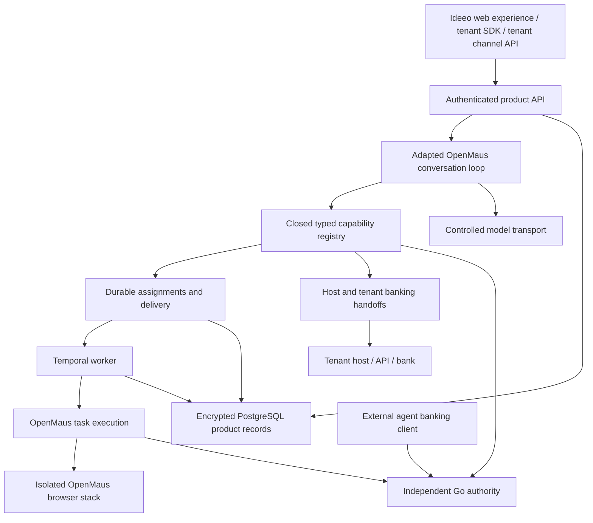

# IdeeoOrchestrator: product adaptation plan for OpenMausBot

Assessment date: 18 November 2026.

Local context: [documentation guide](../docs/ideeo/README.md), [rewritten architecture](../docs/ideeo/product/architecture/arquitectura-motor-agentes-rev4.html), and [candidate implementation status](../docs/ideeo/IMPLEMENTATION_STATUS.md). The documentation import preserves source provenance; it does not qualify runtime behavior.

Repository-specific reassessment: copied from `OpenMausBot/output/ideeo-openmaus-product-adaptation-plan-2026-11-18.md` and revised against IdeeoOrchestrator's current source. The original sibling file is unchanged. Its SHA-256 at copy time was `299191545ab3f8668319108d5477841f324a6e25d03a62c27eb39479dec5a890`.

**Recommendation:** retain the original direct-adoption direction. This checkout can supply the conversation loop, browser machinery and customer UI, but its newer upstream features do not supply Ideeo's customer trust, independent financial authority or durable product journal. The important corrections to the original plan are the actual baseline, tool-admission and inference-budget seams, startup and distribution isolation, and newer evidence from the other candidate. Sections 4.1, 5.4 and 6.3 make those changes concrete.

Status: user-requested architecture findings and implementation proposal for the OpenMausBot product candidate. Direct adoption of OpenMausBot as this candidate's foundation is the user's direction. The specific module layout, implementation sequence and minimum release slice below are proposals. Source inspection is not runtime verification, independent acceptance or production approval.

## 1. Direction and scope

Build this candidate as an Ideeo product fork of OpenMausBot: preserve its conversation loop, browser stack and React experience; replace its trust, persistence and task-lifecycle assumptions wherever they conflict with Ideeo's required behavior.

This candidate should have one conversational brain: the adapted OpenMaus runtime. It should not call Ideeo's existing assistant/planner as a second brain. Independent authority, durable scheduling and tenant integrations are separate responsibilities, not additional conversational decision makers.

The user is developing two candidates in parallel toward a minimally ready product within two weeks:

1. The sibling Ideeo repository is developing an Ideeo-native conversation and execution path.
2. This IdeeoOrchestrator repository adopts OpenMaus directly as the alternative product foundation. The sibling OpenMausBot checkout supplies the original plan and historical baseline; it is not a runtime or build dependency.

The sibling native-runtime recommendation supplies decision history, evidence, product boundaries and report links. Its instructions to remove OpenMaus, avoid source adoption and build an Ideeo-owned browser integration do **not** apply to this candidate. Conversely, this plan does not modify or replace the other candidate's direction.

Preserve requirements and security boundaries, not every existing Ideeo class, schema or service implementation. Reuse cohesive components where they help. Redesign unnecessary coupling. The earlier recommendation to preserve every Ideeo service is not binding.

Full scope remains the shared multi-tenant engine: conversation, authority, delegation, agent accounts, banking interfaces, durable work and customer experience. PayMe is one tenant, not the universal bank backend. A selected two-week increment does not redefine the product as a PayMe-only fallback.

## 2. Inspected baselines and evidence boundaries

### 2.1 Local repository state

| Repository | Observed state | Interpretation |
| --- | --- | --- |
| IdeeoOrchestrator | Branch `main`, HEAD `c444029f3dc97a65caab20b4c9a9f398f435c2f2`; package version `0.1.170` | Source baseline for this reassessment; working tree initially clean |
| IdeeoOrchestrator versus the original baseline | 770 commits reachable from current HEAD and not `263d9b79b`; 1,561 files differ, with 70,497 insertions and 14,999 deletions | The earlier source inspection cannot automatically qualify this checkout; selected architecture seams were reread |
| Sibling OpenMausBot | HEAD `263d9b79b1164510718994d65dd678f266a61b3e` | Original plan's source baseline; left unchanged |
| Ideeo-IA-general checkout | Branch `feat/engine-owned-openmaus-browser`, HEAD `68749d1` | Contains substantial pending browser integration/source/documentation work |
| Ideeo local integration branch | `dev` at `644f0a1b7a44901dbaaaa18b376dac0180219860`, three commits ahead of that checkout | Integration evidence is newer than both the checkout and the original copied plan |
| New Ideeo commits | `491ba70` history/cancellation repairs; `8285964` native conversation as default; `644f0a1` native retained evidence and durable task controls | These increments do not establish complete native browser acquisition, banking or consumer acceptance |
| Remote freshness | No fetch performed | These are local repository observations |
| Runtime execution for this assessment | None | No new functional, security, performance or production qualification |

The newer Ideeo integration branch was inspected through Git without switching, merging or editing the sibling checkout. Its pending OpenMaus integration/source/documentation work was preserved. Only this copied Markdown plan was changed by the reassessment; application code and configuration were not modified.

The sibling checkout and local `dev` must not be treated as interchangeable. In particular, ADR-017 and the latest verification entries existed on `dev`, while the older checkout retained the pending OpenMaus integration. Recheck branch tips and source fingerprints at implementation start because the other candidate is active.

### 2.2 What the historical experiments establish

The original retained-evidence runtime campaign accounted for 54 journeys and 132 physical model dispatches across the repaired incumbent, PydanticAI and Pi integrations. Both replacement integrations failed all three correction repeats in that campaign. The exact-current-text correction contract was missing from the replacement integrations' model-facing instructions/schema; these results do not prove an inherent framework limitation.

The aligned follow-up was incomplete: six of 36 journeys had their operations observed, five had finish markers, and 30 journeys were not run. Twelve public turns were observed, eleven completed and one failed. The failing P2 generation hit the 2,048-output-token limit before an admissible typed final result reached validation. Its unfinished body was not retained, so the contents and cause of its output consumption remain unknown. Relevant live correction and validation-repair behavior was not exercised.

Those semantic experiments used preloaded synthetic source evidence. They did not execute the complete browser-worker/Temporal/public-site acquisition journey. A synthetic task marked running is not evidence of actual worker progress. Their outcomes neither qualify nor disqualify a full OpenMaus-based product.

Two shared repairs have useful evidence: authorized partial answers must survive failed-turn history reload, and cancellation must join owned terminal persistence and lease release. Their behavior belongs in this candidate's acceptance tests; the Python patches themselves are not a prescribed implementation for Node.

Historical OpenMaus browser evidence is promising but qualified:

- Doctoralia standalone results changed from 0/3 strict successes with minimal instructions to 3/3 with explicit instructions. One successful run recorded about 404,000 input tokens. Billed cost was not established.
- The general browser campaign included a failed dynamic-search assertion and a tested Chrome-version incompatibility. Settled runs were not all successful cases.
- Synthetic typed form values were retained contrary to expectations. This is directly relevant to input/evidence/logging controls.
- Some cancellation observations established no further recorded steps over a short interval, which is weaker than proof of process termination.
- Later authenticated Ideeo/OpenMaus journeys recorded useful research, history reload without additional inference, and cancellation/cleanup observations, across successive revisions and environments.

Different prompts, policies, budgets, browser artifacts and environments prevent a valid speedup ratio between those runs and earlier Ideeo research campaigns.

The original plan described `8285964`'s source-free conversation increment. Current local `dev` also contains `644f0a1`: retained-public-evidence queries, task inspection, same-task correction and cancellation. Its verification index records 2,851 passing fast-profile tests and 154 targeted scenarios across the recorded review runs; these are reported results, not tests rerun here. It also reports 20 initial physical live model calls and nine review-refresh calls, using synthetic identities and seeded observations. Failed/interrupted runs are retained; the final corrected evaluator and restrictive prompt were not paid-rerun. The index separately records primary and adversarial model reviews, while different-human acceptance and production approval remain pending.

That newer evidence supersedes the statement that the sibling candidate has no task-control tools. It still does not qualify native page acquisition, new-task execution, physical browser disposal or actual bank/native-client adoption. Its cancellation result was `cancel_requested`, with cleanup owned by the compatible worker. Report names use UTC dates extending into 19 November; this assessment uses the local 18 November date. No candidate-wide winner follows from those scoped results.

### 2.3 Evidence vocabulary for implementation

| Classification | Meaning |
| --- | --- |
| Inspected implementation | Code exists and its relevant ownership/control paths were read |
| Developer verification | Identified revision/configuration passed named executed checks |
| Experimental evidence | Results apply to the experiment's actual identities, data, tools and boundaries |
| Independent acceptance | Required independent reviewers and a different human tester assessed the integrated behavior |
| Production readiness | Exact artifact/configuration has accepted tenant, security, operational, legal and recovery evidence |

None of these classifications automatically implies the next. HTTP 200, fluent prose, a finished browser step, or a successful unit test does not establish a completed customer journey.

## 3. Governing product boundaries

The principal specification sources are in the sibling Ideeo-IA-general repository:

- [Agent instructions](../docs/ideeo/reference/SOURCE_REFERENCES.md#source-a54ff182c7e8), [README](../docs/ideeo/reference/SOURCE_REFERENCES.md#source-b33563055168), [project context](../docs/ideeo/product/PROJECT_CONTEXT.md), [integration context](../docs/ideeo/product/INTEGRATION_CONTEXT.md) and [UX](../docs/ideeo/product/UX.md).
- [Shared interface](../docs/ideeo/contracts/SHARED_INTERFACE.md), [capabilities](../docs/ideeo/contracts/CAPABILITIES.md), [tenant backends](../docs/ideeo/contracts/TENANT_BACKENDS.md), [authentication](../docs/ideeo/contracts/AUTH_PROFILE.md), [authority](../docs/ideeo/contracts/AUTHORITY.md) and [bank adapter](../docs/ideeo/contracts/BANK_ADAPTER.md).
- [Host banking](../docs/ideeo/contracts/HOST_BANKING.md), [onboarding](../docs/ideeo/contracts/ONBOARDING.md), [background tasks](../docs/ideeo/contracts/BACKGROUND_TASKS.md), [coordination](../docs/ideeo/contracts/AGENT_COORDINATION.md), [service integrations](../docs/ideeo/contracts/SERVICE_INTEGRATIONS.md) and [proposed service consumer contract](../docs/ideeo/contracts/SERVICE_SDK.md).
- [Provider profiles](../docs/ideeo/contracts/PROVIDER_PROFILE.md), [administration](../docs/ideeo/contracts/ADMINISTRATION.md), [assistant profiles](../docs/ideeo/contracts/ASSISTANT_PROFILES.md) and [data ownership/lifecycle](../docs/ideeo/product/DATA_OWNERSHIP_AND_LIFECYCLE.md).

Preserve these substantive requirements:

1. Identity comes from validated proof and trusted records. Tenant/member/client/agent/grant fields in model text, arbitrary JSON, channel labels, phone numbers or SDK identifiers confer no authority.
2. Resolve bank/provider endpoints, credentials, capabilities and model routes from trusted tenant configuration. Missing, invalid, removed or changed configuration fails closed; no cross-tenant or fixture fallback.
3. The brain proposes; independent authority authorizes; the bank/provider/host executes. Current permission applies before execution and disclosure, including replay, history and streaming.
4. Financial operations retain exact money, stable identity, protected terms, atomic allowance controls and source reconciliation after uncertain dispatch. A retry is not permission for another effect.
5. Interactive app/SDK banking follows ADR-010: host-owned authentication, core calls and protected single display. Balance/history never become chat/model results. A missing host cannot trigger a direct-read fallback.
6. Tenant APIs own enrollment, session exchange and WhatsApp ingress/delivery under ADR-011. The engine receives verified turns and supplies typed handoffs.
7. Customer-visible original messages and model context are separate. Captured banking values must not leak into subsequent prompts, summaries, helper requests, native logs or memory. Secrets never belong in ordinary chat/inference.
8. Conversation, durable assignment, memory, files, connection and compute have separate ownership/lifecycles. Replacing compute does not erase tasks or imply revocation; a saved session does not grant spending permission.
9. Durable acceptance, correction, cancellation and delivery require committed state. Disconnection is not cancellation. Expired proof cannot be renewed by a workflow timer.
10. A customer can continue conversation while background work waits. Controls target exact tasks/revisions, useful partial evidence survives failure, and every displayed success corresponds to observed state.

### 3.1 ADR interpretation

The [ADR index](../docs/ideeo/decisions/README.md) records distinct acceptance statuses. ADR-001/002/003 remain proposed overall, with scoped implementation records. ADR-008 accepts consistency-first behavior for authority, money and accepted transitions. ADR-010/011 establish confirmed product boundaries. ADR-012 specifies generation-bound browser ownership and disposal, with production qualification pending. ADR-014 separates continuing-assistant state lifecycles while leaving detailed new contracts proposed. ADR-015/016 are scoped trial/internalization history; the newer ADR-017 applies to the sibling native candidate.

Do not import the other candidate's runtime-removal instructions as requirements here. Preserve the browser isolation, data, authority and lifecycle boundaries that those decisions protect. An implementation stack or class name in a proposed ADR is not automatically a requirement of this alternative candidate.

## 4. OpenMaus architecture findings

| Inspected source | Finding | Adaptation consequence |
| --- | --- | --- |
| [openai-chat.ts](../server/drivers/openai-chat.ts), [chat-mcp-tools.ts](../server/drivers/chat-mcp-tools.ts) | Native model/tool iteration, streaming, tool validation/mounting, interruption, retries and protocol recovery already exist | Keep the loop; provide controlled model/tool/persistence ports instead of adding another assistant |
| [openai-chat.ts](../server/drivers/openai-chat.ts) | Runtime event listeners are invoked synchronously; helper generation and additional inference paths exist | An asynchronous subscriber is insufficient for durable ordering; mediate every physical inference path |
| [request-auth.ts](../server/request-auth.ts) | Trust is based on local-owner/service rules and paired sessions; service-loopback allowlist includes some customer-facing operations and documents an open bot-shell risk | Replace customer ingress with verified principal/delegation admission; do not equate loopback or admin scope with bank authority |
| [fleet.ts](../server/fleet.ts) | Fleet plans separate OS users/services and workspace directories | Useful operational isolation, but not a substitute for within-tenant membership/client/grant authorization |
| [store.ts](../server/store.ts), [message-db.ts](../server/message-db.ts), [runtime/store.ts](../server/runtime/store.ts) | Application state persists through JSON/files and SQLite; assignment storage exists | Do not claim OpenMaus has no persistence. Replace ownership/semantics for the Ideeo product journal rather than treating existing threads as complete durable banking assignments |
| [task-record.ts](../server/task-record.ts), [runtime-coordinator.ts](../server/runtime-coordinator.ts) | Threads and coordinated assignments carry application approval levels, origin and task state | Preserve interaction patterns; independently bind product task, caller, mandate, budgets and goal revision |
| [turn-resources.ts](../server/turn-resources.ts), [turn-dispatch-guard.ts](../server/turn-dispatch-guard.ts) | In-process resource ownership and stale-turn guards are present | Retain useful safeguards; add durable fencing and confirmed physical disposal for restart/distributed boundaries |
| [browser-runtime.ts](../server/browser-runtime.ts), [browser-engine.ts](../server/browser-engine.ts), [browser/engines.ts](../server/browser/engines.ts) | Existing automation, observations, session management and takeover; default agent-browser and optional OpenMaus Chrome/CDP backend | Keep the browser stack; qualify one backend first and bind it to task-specific ownership |
| [browser/config.ts](../server/browser/config.ts) | `agent-browser` is the default; `chrome` is described as an early-test alternative | Do not introduce a backend change as a prerequisite for this candidate |
| [browser/egress/gate.ts](../server/browser/egress/gate.ts) | SOCKS proxy resolves/checks network destinations and carries encrypted HTTP traffic unchanged | Useful SSRF/network foundation; it cannot alone enforce provider HTTP method/path/mutation restrictions |
| [browser-evidence.ts](../server/browser-evidence.ts), [drivers/native.ts](../server/drivers/native.ts) | Browser steps/images and native protocol records have separate file retention/logging paths | Integrate encryption, minimization and erasure; heuristic secret scrubbing is not sufficient privacy qualification |
| [enterprise.ts](../server/enterprise.ts), [enterprise license](../enterprise/LICENSE) | Optional enterprise module supplies capabilities including a workspace-access factory, under separate terms | Exclude enterprise from the distributed candidate; implement Ideeo customer/tenant authentication independently |
| [DESIGN.md](../DESIGN.md) | Strong shared visual/accessibility conventions; also defaults to Full access and discourages approval interruptions | Preserve visual quality; explicitly revise product rules for independent financial approval and Ideeo branding |
| [host module rules](../server/host/README.md), [route module rules](../server/routes/README.md) | Explicit dependency factories, central composition and route modules are established conventions | Keep new work modular; do not add another large request-handler region or import the composition root from modules |

The committed OpenMaus loop is not a standalone library without application dependencies. Its tool mounting reaches configuration, process/MCP integrations and application observation. This is acceptable for direct product adoption, but the product wiring must deliberately close ambient paths rather than assume a small factory already supplies isolation.

### 4.1 Findings specific to the current IdeeoOrchestrator baseline

These are source findings at `c444029f3`, not executed exploit demonstrations or runtime qualification.

| Current source evidence | Consequence and required adaptation |
| --- | --- |
| `server/drivers/openai-chat.ts` calls `withHostFileTools(turn.integrations)`; `chat-mcp-tools.ts` adds host-file support when `localComputer` is configured | An empty custom MCP list is not sufficient isolation. Product composition must inject its own closed tool session and reject local-computer integration; do not expose host files through inherited configuration |
| The loop mounts MCP servers in the background and calls `joinLateChatTools` between rounds | Validate the complete admitted registry, including late joins, directory lookup/dispatch and refitting. Product sessions should not discover ambient servers at all; test that a delayed server cannot enlarge the tool set |
| The previous `MAX_CHAT_ROUNDS = 64` is removed; the loop uses `for (let round = 0; ; round++)`. `MAX_TURN_TOOL_CALLS = 200`, abort checks and other local guards remain | Do not characterize the runtime as having no limits, but do not mistake tool-count or per-request idle limits for a durable total inference budget. Enforce physical-attempt, output, elapsed-time and task limits outside the loop, including no-tool recovery rounds |
| `complete` selects global `fetch` or `fetchPastLimit`; `generateText` also calls `complete`. Text-only requests do not explicitly set `redirect: "error"` in this call site | Introduce a controlled request port at the actual send boundary. Pin destinations, reject redirects for product model calls, bound response/error bodies and account for retries and helpers. A `prepareTurn` hook is too early and too coarse |
| `emit` still calls each listener synchronously, while `sendTurn` starts an internal async run | Add an awaited canonical persistence/publication boundary and an owned terminal-settlement promise. Merely returning an async subscriber does not make dispatch wait for a commit |
| `server/usage-caps.ts` has server/bot daily/monthly usage caps and ledger aggregation | Preserve useful usage presentation, but replace its product enforcement with atomic tenant/grant/task accounting. Existing bot-level caps are not proof of reservation before every physical inference attempt or distributed enforcement |
| `server/index.ts` constructs sessions, stores, vault integrations and provider registries before listening and registers many legacy routes | A new route module or UI feature flag does not create a product-only server. Establish an early composition choice and inspect imports and constructors for side effects before the customer mode can boot |
| `scripts/bundle-server.mjs` bundles `enterprise/server/index.ts` and its license whenever present | Runtime feature disablement is insufficient for redistribution. Add an explicit OSS/product packaging selection, build from clean staging, and verify no restricted source or stale enterprise bundles enter output or image layers |
| `server/browser-engine-release.ts` pins upstream `agent-browser` 0.37.0 and Windows `0.36.0-omb.1`; `browser/config.ts` still defaults to agent-browser | Preserve the existing backend initially. Pin the actual target-platform executable, Chromium and notices in the candidate manifest; do not assume Windows development qualifies Linux deployment or vice versa |

The reuse benefit is the existing interaction and execution machinery. The main internal schedule risks are separating startup side effects, making asynchronous publication durable, and adapting context/tool/model paths without retaining ambient authority. The external integration risks in section 10 remain independent of those code changes.

## 5. Proposed target architecture

The diagram expresses responsibility boundaries, not a requirement for a network service per box. Keep ordinary Node modules in-process where no independent trust or ownership boundary is needed.

| State or responsibility | Sole authoritative owner |
| --- | --- |
| Accepted conversation, answer, task controls, evidence references and delivery | Encrypted product PostgreSQL records |
| Scheduling, timers, signals and workflow recovery | Temporal |
| Current engine authorization, mandate controls, approval evidence and allowance reservations | Separate Go authority and its own database, under agreed bank enforcement contracts |
| Actual balances, available funds, bank allowance facts and financial outcomes | Tenant bank/core |
| Actual booking/order/trip state | Provider source |
| Browser generation, physical processes and confirmed disposal | Trusted browser owner |
| UI rendering and caches | Derived projections; never authority or a second task journal |

Use one API-backed OpenMaus driver and the existing default agent-browser integration initially. Qualify additional engines/providers separately. Do not expose unqualified CLI engines, coding shells or arbitrary tools to customers merely because upstream supports them.

Do not equate an OpenMaus bot with a tenant or authority agent account. Maintain explicit mappings among tenant assistant configuration, full verified caller scope, authority agent account, conversation and execution. Browser profiles and working files belong to the accepted task scope; never mount a customer's entire vault as a general bot workspace.

Product startup should register only the intended routes and services. Existing local application functionality can remain in source, but the product mode must not initialize unrelated services, discover personal credentials, or fall back into legacy endpoints. The isolation and import-side-effect checks are part of the first milestone.

### 5.1 Model and tool boundary

Adapt the existing OpenMaus loop through explicit ports for controlled model transport, tool sessions, context and awaited persistence. Every actual inference attempt—including retries, protocol repair, context reduction, helper generation and fallback—must perform current disclosure checks and atomic accounting. Unknown usage/cost stays unknown; retries do not refund attempts.

Begin with one qualified route. Ideeo's existing stateless fallback policy does not automatically qualify an agent tool loop. Provider refusal, malformed output, truncation, network uncertainty and uncertain domain effects remain distinct outcomes.

Expose only registered, typed capabilities derived from current caller access. The model may propose an action, not supply tenant identity, credential destinations, approval, current balance or a new grant. Domain code validates exact resources, revision and current authority after awaited checks and immediately before execution.

Financial and protected tool results remain outside ordinary inference unless their specific disclosure contract allows a minimized projection. Host-banking result cards contain opaque request references, never protected financial results. Customer-visible original messages are encrypted separately from reusable model context.

### 5.2 Persistence and delivery

There must be no competing state owners. The product store owns transcript, answer, task state and delivery. OpenMaus local stores must not independently resume, publish or authorize the same assignment.

Use transaction-local verified scope, forced RLS, non-owner/non-BYPASSRLS runtime roles, complete caller binding and authenticated encryption tied to resource/purpose/version. Separate expiring content from replay/reconciliation markers. Store no raw principal credential in general model or public event envelopes.

Persist accepted transitions and delivery entries before claiming acceptance. An awaited commit path, rather than an async event subscriber, controls publication and terminal settlement. Keep operational status, useful partial evidence and customer answer separate so a failed operation can retain an honest useful partial.

Temporal histories carry opaque task references and bounded control data. Activities reload protected state and reauthorize; they do not embed prompts, credentials or banking records in workflow history. Version workflow types and worker queues; do not replay another candidate's accepted tasks under new code without a tested migration.

### 5.3 Browser execution and evidence

Keep OpenMaus's browser automation and observation behavior, including focused reads and useful observations after actions. Add task/revision/generation binding, current authority, retained action budgets, controlled destinations and independent completion checks.

A read-only label does not make arbitrary clicks safe. Enforce approved routes at the trusted browser/network boundary, including redirects, subresources, methods and provider mutation restrictions as applicable. The SOCKS gate alone cannot inspect encrypted HTTP operations. Do not expose arbitrary evaluation, uploads, shell execution or personal-browser attachment as shortcuts around those controls.

Retain source URL/document identity, actual observation time, digest, entity/claim association, task/goal revision, exact supporting excerpts and known gaps. A model summary is not the sole evidence record. Valid citations alone do not prove every paraphrased claim. Additional page captures need a freshness, changed-state, missing-content or verification reason and must be counted.

Cancellation blocks further actions after its committed fence. Physical cleanup may still be pending. Replacement requires confirmed disposal, a fresh generation and fresh observations; it cannot create another writer while the previous one is uncertain. Human takeover blocks agent actions and protected-input observation. Handback requires fresh state.

A browser completion signal is not goal fulfillment. An HTTP success or submitted provider request is not confirmed booking, service completion or payment settlement. After uncertain dispatch, reconcile the original operation identity instead of repeating an effect.

### 5.4 Concrete admission, persistence and execution sequence

1. Verify caller proof and current access; resolve the tenant/client profile from trusted configuration. Reserve the caller-bound idempotency key and conversation lease in the product store. A duplicate resolves its committed receipt under current disclosure permission.
2. Build sanitized context independently of the visible transcript. Pin the admitted model/profile and tool-contract revisions. Bind all child work to the same restricted caller lineage and retained aggregate limits.
3. Before each physical inference request, revalidate the disclosure route and atomically charge/reserve the appropriate retained budget. Apply the task's absolute deadline as well as the provider timeout. Record returned usage or uncertainty without refunding an unknown attempt.
4. Validate proposed tools against the closed registry. The trusted handler loads current task/control revisions and independent authority immediately before dispatch. Model IDs, tool call IDs and prompt claims cannot create authorization or financial idempotency.
5. Commit accepted controls, evidence references, answer segments and delivery/outbox entries through an awaited boundary. Stream only authorized projections of committed content; use bounded chunk aggregation if needed. Never stream private reasoning or raw provider commentary merely because upstream emits it. Recheck permission for later disclosure and replay.
6. Release the conversation lease after owned terminal persistence settles. Durable tasks continue through Temporal without holding that lease. Cancellation commits the action fence first; browser cleanup and uncertain-effect reconciliation retain their own states and owners.

An activity retry reloads the accepted operation and original attempt identity. A process crash between possible effect and receipt routes to source reconciliation, not a fresh model-directed dispatch. Tenant configuration changes, revocation and goal corrections fence in-flight output; they must not be hidden by a cached authorization success.

Use exact decimal strings or validated integer minor units internally for money, with explicit currency scale and overflow checks. Do not port Python decimal behavior through JavaScript binary floating-point arithmetic. Canonical signed terms and digests must match the Go authority byte-for-byte; test cross-language vectors for amounts, Unicode, field presence, ordering and revision binding before integrating protected effects.

## 6. File-level adaptation map

Paths in this table are relative to IdeeoOrchestrator unless prefixed `Ideeo:` (the sibling Ideeo-IA-general repository). New paths are proposed, not already implemented. A bare filename following a fully qualified path in the same cell uses that path's directory.

| Area | Preserve or modify | Add or replace |
| --- | --- | --- |
| Product composition | `server/index.ts`, `server/config.ts`, `server/routes/table.ts` | New `server/host/ideeo.ts`, `server/ideeo/config.ts`. Keep composition in `index.ts`, dependency factories elsewhere and a closed product startup path |
| Verified identity/routing | Replace customer reliance on `server/request-auth.ts` and device-session semantics | New `server/ideeo/identity.ts`, `tenant-registry.ts`, `admission.ts`. Verify proof and resolve exact tenant/backend/client route from trusted configuration |
| Public contracts | Preserve applicable Ideeo JSON/SSE behavior and explicitly version incompatibilities | New `shared/ideeo/contracts.ts`, `server/routes/ideeo-turns.ts`, `ideeo-history.ts`, `ideeo-tasks.ts`; pinned canonical schema fixtures and independent conformance cases |
| Conversation runtime | Adapt `server/drivers/openai-chat.ts`, `openai-compat.ts`, `chat-mcp-tools.ts`, `openai-chat-fetch.ts`, `openai-responses.ts`, and the public driver contract in `server/contracts.ts` | New `server/ideeo/conversation.ts`, `tools.ts`; explicit model-send and tool-session ports, awaited commit/publication and terminal settlement, retaining the OpenMaus loop |
| Model policy/context | Adapt `server/turn-context.ts`, `server/system-prompt.ts`, `server/drivers/native.ts`; inspect `server/usage-caps.ts` without adopting its bot caps as mandate limits | New `server/ideeo/model-policy.ts`, `model-transport.ts`, `context.ts`, `money.ts`; separate visible history and inference projection, exact monetary validation and every-attempt accounting |
| Product persistence | Retain upstream stores only for unmodified local/upstream functionality | New `server/ideeo/storage/database.ts`, `resources.ts`, `crypto.ts`, `outbox.ts`, `retention.ts`, `migrations/ideeo/001_product_state.sql` |
| Independent authority | Reuse `Ideeo:authority/` as a cohesive versioned Go module, including migrations and tests | New local `authority/`, `server/ideeo/authority-client.ts`, `server/routes/ideeo-agent-accounts.ts`; separate workload roles and immutable migration history |
| Banking/onboarding | Behavioral references: `Ideeo:src/ai_engine/capabilities/host_banking.py`, `operations.py`, and tenant adapters | New `server/ideeo/banking/host.ts`, `tenant-handoff.ts`, `contacts.ts`, `operations.ts`, `server/routes/ideeo-banking.ts` |
| Durable tasks/delegation | Reuse OpenMaus coordination concepts and displays; replace their product authority/lifecycle ownership | New `server/ideeo/tasks/service.ts`, `commands.ts`, `delegation.ts`, `workflows.ts`, `activities.ts`, `worker.ts` |
| Browser/evidence | Adapt `server/browser-runtime.ts`, `browser-steps.ts`, `browser-evidence.ts`, `browser-processes.ts`, `browser-lifecycle-cleanup.ts`, `host/browser.ts`, `browser/egress/gate.ts` | New `server/ideeo/browser/policy.ts`, `owner.ts`, `evidence.ts`; encrypted canonical evidence, qualified request restrictions and task-generation fencing |
| Customer UI | Reuse `src/components/ChatView.tsx`, `Composer.tsx`, `src/state/live-reply.ts`, shared styles/accessibility | New `src/ideeo/api.ts`, `store.ts`, `TaskCard.tsx`, `HostBankingCard.tsx`, `AgentAccounts.tsx`; adapt `src/App.tsx` and affected state consumers |
| Administration | Reuse the Next.js console and operator-auth/configuration behavior | Proposed package destinations `apps/admin/` and `services/admin/`; replace brain construction with this candidate's HTTP API. Source seams: `Ideeo:apps/admin/src/lib/api.ts`, `src/ai_engine/admin/runtime.py` and its actual dependency closure |
| Packaging/verification | Extend `package.json`, `scripts/bundle-server.mjs`, `scripts/control-omb.ts`; review `Dockerfile`, `.dockerignore`, `server/browser-engine-release.ts`, `scripts/prepare-browser.mjs` | New `deploy/ideeo/Dockerfile`, `deploy/ideeo/compose.yaml`, `scripts/testing/ideeo-fixture.ts`, `scripts/testing/ideeo-journeys.ts`, `docs/verification/ideeo.md`; explicit enterprise exclusion and clean-artifact inspection |

The administration package requires a bounded dependency audit before import: its current API/runtime reaches engine modules. Reuse is worthwhile only after removing direct old-brain construction. Do not copy the entire Python application merely to keep its console working, and do not replace proven operator MFA/session controls with an improvised login.

Porting behavior into TypeScript does not require retaining Python class layouts or the universal plan schema. Preserve public contracts where consumers depend on them; select internal types for coherent ownership. Exact financial parsing, contact selection, protected handoff and reconciliation tests are useful independent migration oracles.

### 6.1 Remove or exclude from the Ideeo release path

- Exclude `enterprise/` from source/binary distribution unless a separate agreement authorizes its use. Do not bypass its checks or copy restricted implementations.
- Remove Full-access/auto-approval semantics as financial authority. An OpenMaus application approval setting cannot grant banking permission.
- Remove sessionless loopback access to customer operations and prevent legacy route fallback.
- Do not register arbitrary MCP servers, shell/computer tools, personal Chrome attachment or model-selected endpoints in the customer product.
- Disable automatic personal-memory capture and raw native protocol logs until their scoped lifecycle and disclosure behavior are implemented.
- Exclude upstream cloud purchasing, fleet administration, desktop lending and unrelated connector surfaces from the customer release.
- Do not import Ideeo's old `AssistantService`, universal planner or OpenMaus bridge as another execution layer.

Do not delete every unused upstream module first. Remove registration and packaging access, verify the product dependency graph, then prune source where it actually reduces maintenance. Preserve notices for retained code and historical reports.

### 6.2 Design and branding

Revise [DESIGN.md](../DESIGN.md) explicitly for this product: retain its visual tokens, shared components, accessibility, responsive states and localization discipline, while changing Full-access/no-new-asks rules where protected Ideeo approvals are required. Do not quietly violate the existing design policy.

A protected financial approval comes from the tenant/authority flow, not an ordinary chat card or spoken yes. Customer controls display only actions currently offered for the exact task/revision. Approval is not required for every valid A2/A3 action; policy determines that boundary.

Use Ideeo's own branding. [LICENSING.md](../LICENSING.md) reserves the OpenMausBot/MausBot names and mascot; [LICENSE](../LICENSE) permits commercial Apache-2.0 use with its conditions. Retain applicable [NOTICE](../NOTICE), modification and third-party license obligations. Reused Ideeo components also need their provenance/distribution rights recorded before publication; this plan is not a dependency-wide license audit.

### 6.3 Contract pinning and acceptance files

Pin reused components to a recorded committed revision (current Ideeo `dev` is `644f0a1`), with a manifest of deliberately included pending contract changes if any. Do not import the dirty sibling directory wholesale or read it at runtime. Public protocol conformance comes from pinned schemas and independent expected responses, not generated TypeScript types alone. Include `/v2/assistant`, turn/history/task routes, SSE cursor/replay/error semantics, host consume and task controls in the compatibility inventory; OpenMaus `/api/*` is not a substitute contract.

Proposed verification additions, beside the relevant product modules:

| Proposed path | Required evidence |
| --- | --- |
| `server/ideeo/admission.test.ts` | Full caller binding, two backends, expiry/revocation, unknown issuer/client, no loopback or legacy-route bypass |
| `server/ideeo/conversation.test.ts` | Existing loop through injected ports; late tools, helpers, retries and protocol changes cannot escape admission/accounting; persistence failure blocks dependent publication/actions |
| `server/ideeo/storage/resources.integration.test.ts` | Real PostgreSQL under runtime roles: RLS, ciphertext substitution, CAS/leases, idempotency, expiry and transactional outbox |
| `server/ideeo/banking/host.integration.test.ts` | Concurrent consume, lost reply, replacement proof, cleared captured fields and no replay/model disclosure |
| `server/ideeo/authority-client.integration.test.ts` | Real Go authority; cross-language digest vectors; workload-role separation; pause/revoke and uncertain reservation behavior |
| `server/ideeo/tasks/recovery.integration.test.ts` | Real Temporal and separate worker loss, stale-generation fencing, retained limits/deadlines, deduplicated publication and pending cleanup |
| `server/ideeo/browser/owner.integration.test.ts` | Actual selected browser artifact, acquisition provenance, hostile content, takeover, denied destinations and descendant disposal before replacement |
| `scripts/testing/ideeo-package.test.ts` | Clean release artifact contains only admitted services/assets, excludes enterprise, starts independently of sibling repositories and rejects legacy customer routes |
| `scripts/testing/ideeo-journeys.ts` | API-to-renderer/reload journeys in section 9, with separate host/channel consumer qualification and retained negative cases |

These filenames describe necessary acceptance work, not implemented or passing suites. Preserve upstream tests for the adapted loop/browser and add product tests at its real boundaries; do not turn source-text matches into security acceptance.

Administrative reuse needs more than changing the Next.js base URL: audit the backend behind `EngineBindings`, operator identity/session/MFA, configuration persistence/publication, preview isolation and model routing. A remote preview must select a trusted draft/revision through an authenticated server contract; it must not accept arbitrary instructions to impersonate a tenant or run the old assistant. Import only the cohesive dependency closure into `services/admin/`, or replace the coupled backend while preserving its public behavior. Decide this after the Day 1 dependency audit, before promising console reuse as a completed integration.

## 7. Required integration paths and agent-account behavior

| Path | Required behavior |
| --- | --- |
| App/SDK customer | Engine prepares banking intent; the host consumes once and owns authentication, protected screens and core calls. Balance/history never return to chat or inference |
| Tenant channel backend | Tenant owns WhatsApp ingress, customer binding and delivery; engine supplies typed protected-link handoffs |
| Another bank's assistant | Delegates reasoning under a separate verified and narrowed delegation profile; receives scoped progress/questions/results |
| External agent | Uses authority/banking interfaces under its mandate without needing the OpenMaus conversational brain |

The current development customer JWT profile does not already implement the last two profiles. They require distinct proof, client registration, scope, audience and disclosure tests; renaming a `kind` field is insufficient.

Agent accounts retain A0–A3 behavior, pause/revoke/resume, immutable mandate history and bank-sourced allowance. A2 threshold equality remains explicit in signed policy; zero allocation is not unlimited. A3 activation/caps follow their protected contract. External agents see permitted mandate allowance, not parent balances. Preferences cannot enlarge resources or change bank funding rules.

Host requests bind the exact verified session, caller, expiry and resource. Concurrent consume has one winner. Lost consume response, replaced credential or replay does not rearm a display. There is no invented host completion callback: the current contract accepts no bank results back into chat. Transfers/payments remain subject to the bank's own operation reconciliation.

Tenant protected-link handoffs preserve their stable request/source identity and explicit lifecycle. Onboarding is intent-only. The engine does not collect KYC/PIN, create accounts or take over Meta webhook ownership.

## 8. Dependency order and two-week delivery

The critical chain is:

**Identity/contracts → encrypted records/current authority → controlled OpenMaus loop → durable tasks/browser evidence → consumer journeys → release qualification.**

| Window | Deliverable | Exit evidence |
| --- | --- | --- |
| Days 1–2 | Pin baseline; product-only bootstrap; enterprise exclusion; verified scope; two synthetic tenants; database roles and authority connection | Cross-tenant/caller denial; distinct trusted backends; no ambient tools or legacy API bypass |
| Days 3–4 | OpenMaus conversation with controlled transport, encrypted answers/history and typed tools | Greeting → draft → revise → recall → reload; every inference attempt accounted; useful failed partials retained |
| Days 4–6 | Host banking, tenant links, onboarding and owner agent-account controls | One-time consume; chat-approval rejection; pause/revoke; no protected values in model context/replay |
| Days 5–8 | Durable tasks, controls, outbox and narrowed child delegation | Actual worker restart; retained budgets/deadlines; correction fencing and delivery recovery |
| Days 7–10 | Actual OpenMaus browser acquisition, evidence, takeover and service preparation | Complete research/follow-up/reload; confirmed cleanup; one synthetic protected-effect/reconciliation journey |
| Days 9–11 | Customer UI and administration integration; intended SDK/channel testing; tenant/provider gap closure | Actual consumer handles authentication, recovery, protected handoffs and unavailable states |
| Days 11–14 | Combined-artifact stabilization; independent reviews/testing; restore/rollback rehearsal | Accepted named journeys, operating evidence and explicit release decision |

These are proposed windows, not demonstrated estimates. Overlap follows dependencies and available capacity; it does not assume an unlimited team. No subagents were launched during this assessment, and this table does not assign people or authorize delegated work.

For this checkout, Day 1 must also prove the product bootstrap can start without ambient tools, credentials, local state or enterprise artifacts; the newer upstream snapshot increases that isolation work. Freeze this candidate baseline for the first slice and review upstream changes selectively instead of continuously moving it during qualification. Keep Node (manifest requires `>=24`, pnpm `10.33.0`), Go, database, Temporal and browser artifact versions explicit in deployment; a broad supported range is not an immutable release pin.

Use the table as a dependency forecast, not a promise that every listed area fits fourteen days. The first protected synthetic vertical slice decides whether the integration approach is viable. Actual host/tenant/provider contracts and the admin dependency audit decide what can be qualified for release. If a required journey misses its gate, report a development candidate and its blocker; do not relabel synthetic acceptance as a minimally ready customer product.

The first implementation milestone should already be a complete vertical slice:

**Authenticated customer → OpenMaus conversation → independently authorized typed tool → committed answer → UI → reload**, with a second tenant attempting access.

Proposed minimum release: conversation, public research, durable task controls/delivery, protected banking handoffs, agent-account controls and tenant administration. Real provider commitments and real external-agent access enter the release only when their integrations qualify. If those are mandatory launch journeys, their open integrations are release blockers, not silently deferred work. The full product scope remains intact.

Start external contract and consumer checks on Day 1. Do not wait until the final acceptance window to discover missing tenant credentials, incompatible host lifecycle or unapproved provider access. Judge both candidates by integrated outcomes, remaining dependencies and defect closure; do not apply an automatic Day 4 cancellation or treat one isolated model failure as a verdict.

## 9. Complete acceptance journeys

Every journey traverses the actual product API, persistence, authority and intended consumer. Driver-only demos and fixture-seeded source facts are supporting checks, not complete acquisition or consumer acceptance.

| Journey | Required end-to-end observation |
| --- | --- |
| 1. Tenant/caller isolation | Two tenants with overlapping resource IDs use distinct backends. Cross-member/client/agent/grant reads, writes, streams, attachments and replay fail. Configuration removal never falls back to fixtures |
| 2. Conversation continuity | Draft, revise, change topic, recall the revision and reload. Tenant language/personality applies; no invented memory or unnecessary tool work |
| 3. Research/factual follow-up | Actual browser acquisition retains source-bound facts. Exact/starting prices, entities and unknowns remain distinct. Follow-ups/reload reuse authorized evidence without unnecessary acquisition |
| 4. Correction plus question | A request such as “Under 100 pesos; also explain delivery” updates the intended task once, keeps budget/deadline, answers the question, and fences old evidence from satisfying the revised goal |
| 5. Stop/recovery | Cancel during inference, queued work and browser action. Committed cancellation blocks new actions; cleanup stays pending until confirmed. Restart creates no duplicate writer or renewed budget |
| 6. Partial failure/history | Acquisition succeeds and later inference fails. Honest failure and useful permitted evidence both survive reload. Revocation blocks subsequent disclosure |
| 7. Native host banking | Balance/history and transfer intent route to host. Concurrent consume has one winner. Lost response, replacement token, restart and replay cannot rearm. No bank result enters chat/model context |
| 8. Tenant channel/onboarding | Verified channel turn yields the correct protected link; retries retain request identity. Enrollment stays tenant-owned. Missing identity or unavailable tenant service cannot trigger direct-core fallback |
| 9. Agent-account controls | Owner inspects accounts/history/allowance, pauses and revokes. Resume requires current protected evidence. Allowance comes from bank records; external agents cannot obtain parent balances |
| 10. Delegated reasoning | Bank-assistant delegation creates caller-bound work. Children receive narrowed capabilities and aggregate budgets. Parent correction/cancellation fences affected children; joined delivery is deduplicated |
| 11. Financial uncertainty | Synthetic quote → protected approval → one dispatch; crash before receipt. Restart reconciles the original operation. Changed terms invalidate approval; timeout cannot prove no effect or release uncertain holds |
| 12. Delivery/reauthentication | Customer disconnects while work proceeds. Worker commits result/outbox; consumer loses acknowledgement and reconnects. One visible result survives. Expired proof needs valid same-binding reauthentication |
| 13. Takeover/hostile content | Takeover blocks agent action and secret observation; handback refreshes state. Page content cannot expand tools, destinations, identity or spending permission |
| 14. Administration/lifecycle | Tenant editor publishes allowed versioned configuration with audit evidence but gains no financial authority. Operator revocation applies. Expiry, deletion, restore and rollback preserve restrictions |

Additional negative variants are mandatory where relevant: stale task/question/goal revisions, ambiguity across concurrent tasks, changed quote/recipient/payment terms, grant revocation between authorization and dispatch, source credential echoes, oversized inputs/results, budget exhaustion, provider refusal/truncation, database/authority outages, old callbacks and duplicate deliveries.

For the current upstream delta, also inject a delayed MCP registration, configured local-computer/file integration, a model HTTP redirect, repeated no-tool/protocol-repair rounds, a helper inference call, a rejected persistence commit and a stale enterprise build directory. They must respectively leave the closed registry unchanged, deny host access, deny unapproved egress, obey retained budgets, pass controlled transport, prevent uncommitted publication and fail the distribution check. Exercise model/profile revocation between streamed chunks and deny private reasoning disclosure. These checks distinguish the proposed ports from configuration that only appears restrictive.

Follow-up explanation alone must not create a new task. A mixed control/question turn applies valid controls before explanation. A completed task cannot silently restart because a late correction arrives. Source observations predating a correction may remain inspectable with that attribution, but do not establish fulfillment of the revised goal.

### 9.1 Verification method

Follow [OpenMaus verification instructions](../docs/verification/README.md). Launch isolated fixtures with `scripts/control-omb.ts`; never verify mutations against the user's live app/data. Extend that fixture with disposable PostgreSQL, Go authority, Temporal, trusted fake tenant/provider services and owned browser processes. Use explicit fixture URLs and separate resource claims rather than historical experiment ports/databases.

During implementation, run affected developer checks, including applicable `pnpm typecheck`, lint, focused Vitest suites, build and required packaging/browser checks. UI changes additionally follow `DESIGN.md`, localization/contrast checks and real renderer verification. This document does not claim those commands were executed or passed.

Durability checks require a real Temporal service and separate worker process. Kill/restart at meaningful boundaries, including after durable publication before acknowledgement and after possible effect before receipt. Demonstrate process-descendant disposal, not only absence of new log lines.

Deliberately break critical scope, replay and effect fences in disposable test copies to verify that the acceptance checks detect them. Do not weaken assertions to obtain a green run. Skips, empty selections, stopped campaigns and missing consumer environments remain explicit gaps.

Record revision/build/configuration, tenant/data source, browser artifact, model/prompt/tool versions, every actual inference attempt, action/capture counts, useful completion versus useful partial, first meaningful content latency, total latency, cancellation/cleanup time and billing uncertainty. Do not call an acknowledgement the first useful answer or treat an estimated reservation as invoiced cost.

Set performance/usefulness release thresholds against the intended journeys before acceptance; no universal SLO is invented here. Unauthorized disclosure, cross-tenant access and duplicate financial effects are hard failures, not metrics to average away.

Paid/live checks require their applicable scope and finite budget. Historical experiment authorizations are not a reusable budget for this candidate. No new paid call, live browser visit, message, financial effect or deployment was performed for this assessment.

### 9.2 Independent acceptance and release

Apply Ideeo's [methodology](../docs/ideeo/policies/METHODOLOGY.md), [testing ownership](../docs/ideeo/policies/TESTING_OWNERSHIP.md), [production readiness](../docs/ideeo/policies/PRODUCTION_READINESS.md) and [compliance](../docs/ideeo/policies/COMPLIANCE.md) requirements. Keep implementation checks, independent review, different-human acceptance and production promotion separate.

No tester or reviewer is assigned by this plan. Research completion does not automatically require a fictitious software-verification issue; subsequent functional implementation does require its actual acceptance work. Production promotion remains a human decision on the exact artifact/configuration and operating evidence.

## 10. External gaps affecting the deadline

| Dependency | Gap and consequence | Evidence needed to close it |
| --- | --- | --- |
| Tenant authentication | Real issuer/session exchange, membership mapping, audience, revocation and assurance remain tenant-specific. Development JWTs do not qualify real customers | Agreed trust profile and actual tenant authentication/revocation journey |
| Native host adoption | SDK/app consume, protected display clearing, authentication and lifecycle are externally owned | Actual native build/device checks for consume, expiry, background/logout/restart and uncertain bank operation behavior |
| Bank authority integration | Membership, available-to-spend meaning, allowance, approval, final execution acceptance and reconciliation require bank mappings | Actual adapter/source evidence and failure/uncertainty tests; preproduction reads qualify only their narrower scope |
| Delegated/external-agent profiles | Current customer profile does not supply registered-client/delegation protocols or their disclosure rules | Separate client proof, scope, audience and allowance/denial conformance |
| Provider access/funding | Uber access/OAuth, permitted consumer routes, funding and reconciliation are unqualified by synthetic service tests | Approved provider route/test account, funding boundary and source outcome qualification; otherwise an explicitly labelled handoff |
| Browser isolation | Existing process management does not establish production isolation for authenticated sessions | Qualified isolated runtime, vault lifecycle, protected takeover, egress controls and confirmed disposal |
| Administration compatibility | Existing console constructs/calls Ideeo engine bindings | Actual preview/publication/conversation flow against this candidate, without old-brain fallback |
| Operations/data processing | Managed keys, TLS, retention/backup erasure, approved processing, capacity and recovery are deployment-specific | Exact artifact/configuration operating checks and accepted tenant/provider/data prerequisites |
| Independent acceptance | Integrated candidate still needs required independent reviews and a different human tester | Attributed reviews and complete customer-journey acceptance; no assumed assignment |

Provider keys do not themselves establish consumer booking access. Browser automation does not establish permission to use a site or process payment data. A synthetic quote/commit/status fixture is not a real provider integration. Missing partner access cannot be repaired merely by implementing more adapters.

Optional media and voice require a parity/adoption inventory. Do not silently drop already-used interfaces when adapting the entry point, and do not claim an entire channel is supported because one text API request succeeds. Voice notes, live voice and protected visual approval have separate lifecycle and disclosure requirements.

The largest schedule risk is completing external customer journeys, not generating source files. Start those checks immediately and maintain explicit unavailable states when dependencies are absent.

## 11. Compliance, licensing and migration

The adaptation principally affects legal-register LR-01–05, LR-12/13/17, with LR-15 for cardholder scope and LR-16/18 when voice/messaging enters scope. See the [legal register](../docs/ideeo/compliance/LEGAL_REGISTER.md). Relevant ISO/IEC 27001 controls include identity/access, supplier/cloud relationships, privacy, deletion, logging, application security, verification and change management; ISO/IEC 42001 impact/data/lifecycle evaluation includes the existing A.6.2.4, A.6.2.8 and A.7.2 mappings.

These are engineering obligations, not legal interpretation, risk acceptance or certification. Real-tenant disclosure, new suppliers/destinations, cardholder processing and production activation remain subject to their recorded prerequisites. Preserve the source documents' actual pending legal/tenant decisions rather than inventing universal bank policies.

Use forward migrations and separate candidate databases, keys, task queues and configuration. No existing customer data is to be imported by this assessment. A later migration must inventory accepted tasks, approval/operation identities, retention obligations and compatible worker versions. Drain or explicitly cancel/clean up old work under its owning runtime; never relabel old evidence as produced by this candidate.

Rollback must preserve consumed budgets, uncertain effects, revoked access and single-use approvals. It must not restart completed work or reset a possible financial commitment. Backup restoration needs the same restriction and replay tests as forward migration.

Pin reused Go/admin components to recorded source revisions and package them independently of a sibling checkout. Do not create a build that works only because another candidate's working directory is present. Preserve OpenMaus and third-party notices, browser binary provenance and applicable source/license obligations. Audit the actual distributed artifact, not only the root package license.

## 12. Evidence and source reading map

Cross-repository links below use the current sibling layout for convenience. They are research references, not build/runtime dependencies. If directories move, use the named repository and path.

| Source | Use | Qualification limit |
| --- | --- | --- |
| [Repository comparison, 17 November](../docs/ideeo/reference/research/ideeo-agent-architecture-repository-comparison-2026-11-17.md) | Coupling findings, runtime/browser source observations, failure cases, evidence ledger | Historical recommendation against whole-application adoption is not this track's instruction |
| [Native-runtime recommendation, 18 November](../docs/ideeo/reference/research/ideeo-native-runtime-recommendation-2026-11-18.md) | Decision history, requirements, repairs, reports and consumer gaps | Its native runtime/removal instructions govern the other candidate |
| [Earlier OpenMaus comparison handoff](../docs/ideeo/reference/research/ideeo-openmaus-runtime-comparison-implementation.md) | Historical lifecycle and integration context, as referenced by the two reports | Historical proposal, not a binding preservation mandate |
| [Fresh experiment preparation](../docs/ideeo/reference/SOURCE_REFERENCES.md#source-38c6db42523d) | Early experiment identities and reproduction context | Database-blocked status was superseded |
| [Database qualification](../docs/ideeo/reference/SOURCE_REFERENCES.md#source-defdf81777ae) | Actual authenticated API/PostgreSQL mechanics and shared repairs | Scripted inference, preloaded evidence; no complete acquisition journey |
| [Original live runtime results](../docs/ideeo/reference/SOURCE_REFERENCES.md#source-1f1c47d97b65) | R1/P/J semantic outcomes and failures | Narrow retained-evidence campaign; not this product |
| [Live repair record](../docs/ideeo/reference/SOURCE_REFERENCES.md#source-90cad3553cb5), [continuation record](../docs/ideeo/reference/SOURCE_REFERENCES.md#source-503db264c47a) | Supporting provenance linked by the native recommendation | Not additional independent wins |
| [Contract-alignment preparation](../docs/ideeo/reference/SOURCE_REFERENCES.md#source-c66be0ff6b0d) | Typed correction/output changes and offline checks | Pre-live status is historical |
| [Contract-alignment live results](../docs/ideeo/reference/SOURCE_REFERENCES.md#source-ed9e7fbfd3ce) | Incomplete follow-up, output-limit failure and missing live coverage | No relevant live correction/repair qualification; no browser worker |
| [Ideeo verification index](../docs/ideeo/reference/development/VERIFICATION.md) | Product evidence and acceptance gaps | Check the actual revision; local `dev:docs/development/VERIFICATION.md` had newer entries than the inspected checkout |
| [OpenMaus verification guide](../docs/verification/README.md) | Required isolated runtime verification workflow | A recipe or existing test file does not mean it was executed for this adaptation |

During this reassessment, local architecture source, the two supplied comparison/recommendation documents, governing product documents and relevant contract/ADR/report passages were inspected. Historical experiment counts retained from the original plan remain attributed to those reports; their raw campaigns were not rerun or independently audited here. Current sibling progress was checked in `dev:docs/development/VERIFICATION.md`, rather than inferred from the older checkout's linked file. No benchmark winner, complete security certification, native-device adoption or production approval is claimed.

## 13. First implementation handoff

Start with the product-only bootstrap, verified scope, two synthetic tenants, encrypted records and current authority. Wire one existing OpenMaus model loop through controlled transport and a small typed tool registry, then complete the first authenticated UI/reload journey. This gives an early integrated result while testing the highest-risk assumptions.

Before editing, recheck current branch/worktree/HEAD, sibling integration changes and exclusive file/resource claims. Preserve existing user material. Follow this repository's comment, route-factory, composition and isolated-verification rules. Record consequential accepted architecture changes in the appropriate repository documentation when implementation proceeds; this proposal does not itself mark ADRs accepted.

Evaluate progress by completed customer journeys, prohibited behavior checks, recovery and remaining integration dependencies. Neither the earlier recommendation nor an isolated runtime result is the verdict on this candidate.
